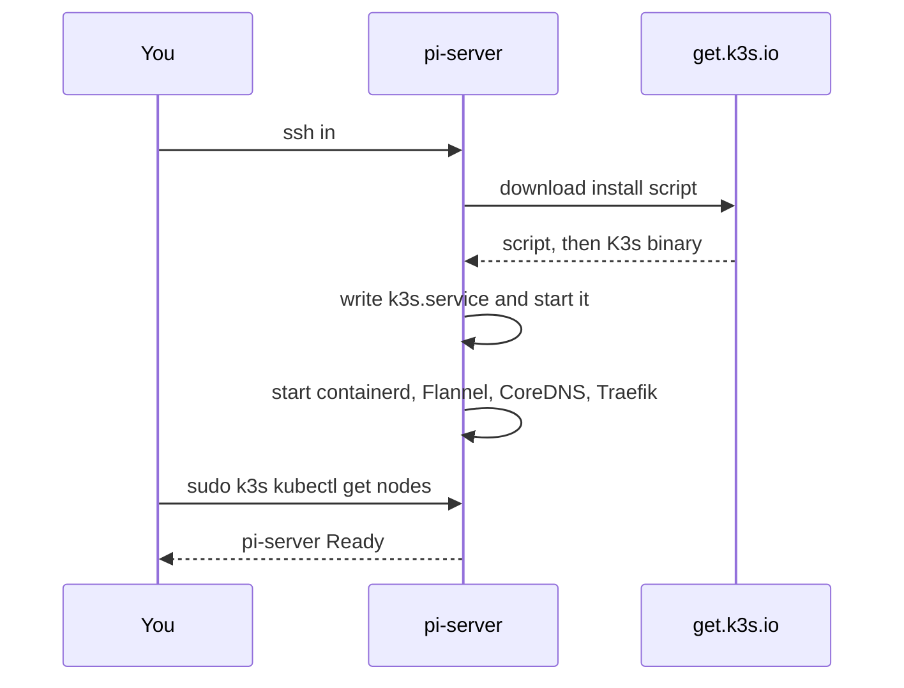

{:class="cover"}

---

By the end of this lesson you will be able to install a K3s server on a Raspberry Pi, check that it is ready, and find the join token for your workers.

---

## One command, one server

K3s installs with a single script. It sets up a systemd service called `k3s`, so it starts at boot and restarts if it crashes. The same script also gives you `kubectl`, `crictl`, `ctr` and the `k3s-killall.sh` and `k3s-uninstall.sh` helpers.



---

## Step 1: SSH into the server

From your computer:

```bash
ssh pi@pi-server.local
```

Use your own username and hostname or address. Make sure you have done the `cmdline.txt` step from lesson 3 on this Pi first.

---

## Step 2: Install K3s

Piping a script from the internet into `sh` is convenient, and the official quick start does exactly this. It is good practice to read a script before you run it as root, so download it first if you like:

```bash
curl -sfL https://get.k3s.io -o install-k3s.sh
less install-k3s.sh
sudo sh install-k3s.sh
```

Or run the quick-start one-liner, which does the same thing:

```bash
curl -sfL https://get.k3s.io | sh -
```

It takes a minute or two on a Pi. K3s installs, starts, and brings up its bundled components as pods.

---

## Step 3: Check the node

```bash
sudo k3s kubectl get nodes
```

You should see one row for `pi-server` with `Ready` under STATUS. The ROLES column shows `control-plane` (and possibly other labels). If it says `NotReady`, wait 30 seconds and try again while the components start.

Look at what K3s started for you:

```bash
sudo k3s kubectl get pods -n kube-system
```

Expect pods for CoreDNS, the local-path provisioner, metrics-server and Traefik, plus a small `svclb-` pod from ServiceLB. A couple of `helm-install-` entries showing `Completed` are normal: K3s installs Traefik using a Helm job. This is the "batteries included" part.

---

## Step 4: Where things live

| What | Path |
|---|---|
| Admin kubeconfig | `/etc/rancher/k3s/k3s.yaml` |
| Join token | `/var/lib/rancher/k3s/server/node-token` |
| Service | `k3s.service` (use `systemctl` and `journalctl -u k3s`) |
| Uninstall script | `/usr/local/bin/k3s-uninstall.sh` |
{:class="table table-single"}

The kubeconfig is readable only by root by default, because it grants full administrator access to the cluster. That is why we typed `sudo` above. Fetch the token now, because the workers need it next:

```bash
sudo cat /var/lib/rancher/k3s/server/node-token
```

Treat the token like a password: anyone who has it can join a machine to your cluster. Copy it somewhere safe for the next lesson.

---

## What K3s is doing underneath

- It runs the control plane (API server, scheduler, controllers) as one process.
- By default it stores cluster state in an embedded **SQLite** database, which is ideal for a single server. For high availability you would use embedded etcd or an external database instead.
- The default pod network is **Flannel** with the VXLAN backend.

> **Teachers**: The install pulls several container images and takes a few minutes. If a whole class installs at once over one school connection it can be slow, so stagger the installs or pre-download. Remind learners that the join token is a credential: it should not be pasted into shared documents or screenshots.

---

## Try it Yourself

1. Run `sudo systemctl status k3s` and find the line that says whether the service is active.
2. Run `sudo k3s kubectl get pods -A` and count how many pods are running. Which namespaces do they belong to?
3. Challenge: run `sudo k3s kubectl get nodes -o wide` and find the node's internal IP address. Does it match your plan?

---

## Common Issues

- **Problem**: `k3s.service` fails to start.
- **Solution**: Run `sudo journalctl -u k3s -e` and read the last lines. If it mentions the memory cgroup, repeat the `cmdline.txt` step from lesson 3.
- **Why**: K3s needs the memory cgroup on Raspberry Pi OS, and it stops with a clear message when it is missing.

- **Problem**: `kubectl get nodes` says permission denied or cannot read the kubeconfig.
- **Solution**: Put `sudo` in front, as in `sudo k3s kubectl get nodes`.
- **Why**: `/etc/rancher/k3s/k3s.yaml` is root-only by default.

- **Problem**: The node stays `NotReady` for several minutes.
- **Solution**: Check `sudo journalctl -u k3s -e` and confirm the Pi has internet access.
- **Why**: The first start needs to pull images, and without a connection the node cannot finish setting up.

---

## Check your understanding


? What is the default datastore for a single K3s server?
- [ ] etcd with three members
- [x] Embedded SQLite
- [ ] PostgreSQL
> K3s uses SQLite by default. Embedded etcd or an external database is for high availability.

? Where is the node join token stored?
- [ ] /etc/rancher/k3s/k3s.yaml
- [x] /var/lib/rancher/k3s/server/node-token
- [ ] ~/.kube/token
> The kubeconfig is a different file. The token is under /var/lib/rancher/k3s/server.

? Why does `k3s kubectl get nodes` need `sudo` at first?
- [x] The admin kubeconfig is root-only by default
- [ ] K3s has no kubectl without it
- [ ] The Pi needs a reboot
> The kubeconfig has full cluster-admin access, so it is not world-readable.

