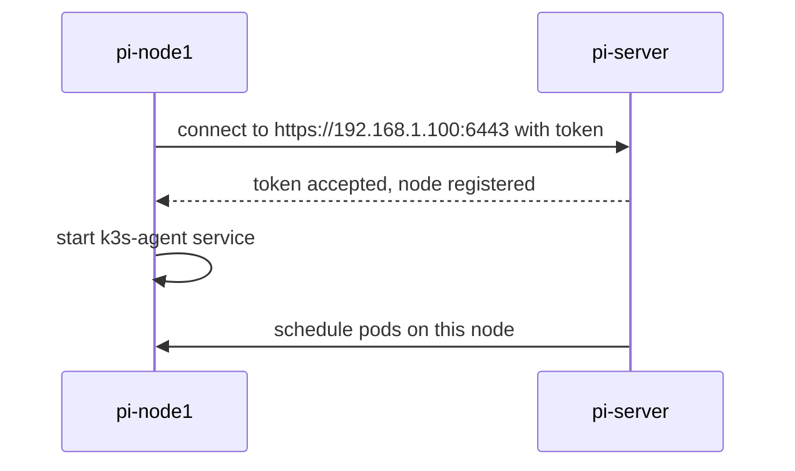

{:class="cover"}

---

By the end of this lesson you will be able to join worker Pis to your K3s server with the install script, and confirm they have registered as nodes.

---

## How a worker joins

A worker runs the `k3s agent` instead of the server. It needs two things: the **address of the server** and the **token** you copied in the last lesson. Setting the `K3S_URL` environment variable is what tells the install script to install an agent rather than a server.



---

## Step 1: Get the token again if you need it

On the **server**:

```bash
sudo cat /var/lib/rancher/k3s/server/node-token
```

It is a long string. Copy all of it with no spaces or line breaks.

---

## Step 2: Install the agent on each worker

SSH into the worker, for example `ssh pi@pi-node1.local`. Make sure you did the `cmdline.txt` step from lesson 3 on this Pi too. Then run, replacing the address and token with your own:

```bash
curl -sfL https://get.k3s.io | K3S_URL=https://192.168.1.100:6443 K3S_TOKEN=<YOUR_TOKEN> sh -
```

Use the server's **IP address** and port `6443`. The script installs the `k3s-agent` systemd service and starts it.

Each machine in the cluster needs a unique hostname. If two nodes share one, set a unique name for the worker with `K3S_NODE_NAME=pi-node1` in front of `sh -`, or better, fix the hostname.

---

## Step 3: Check from the server

Back on the **server**:

```bash
sudo k3s kubectl get nodes
```

You should see one row per Pi. The server shows a ROLES value including `control-plane`, and the workers show `<none>`. All should be `Ready` within a minute or so. The shape looks like this (your ages and version will differ):

```text
NAME         STATUS   ROLES           AGE   VERSION
pi-server    Ready    control-plane   ...   ...
pi-node1     Ready    <none>          ...   ...
pi-node2     Ready    <none>          ...   ...
```

That `<none>` is not a problem, it just means no role label is set. You can add one for readability:

```bash
sudo k3s kubectl label node pi-node1 node-role.kubernetes.io/worker=worker
```

---

## Watching work spread out

Now that you have more than one node, ask for a few pods and see where they land:

```bash
sudo k3s kubectl create deployment spread-test --image=nginx --replicas=3
sudo k3s kubectl get pods -o wide
sudo k3s kubectl delete deployment spread-test
```

The NODE column shows which Pi each pod runs on. The scheduler usually spreads them out.

---

## Removing a node

To take a worker out, run this on that worker, and then delete the node record from the server:

```bash
sudo /usr/local/bin/k3s-agent-uninstall.sh
```

```bash
sudo k3s kubectl delete node pi-node1
```

> **Teachers**: This is where shared kit goes wrong. Two groups using the same network can join each other's workers if they share a token or address, so give each group its own network or its own server address. Make sure each Pi has a unique hostname. Remind learners the token is a password.

---

## Try it Yourself

1. Join one worker and confirm it appears as `Ready`.
2. Create three nginx replicas with `-o wide` and note which nodes they land on.
3. Challenge: add the `worker` role label to your workers and check the ROLES column changes.

---

## Common Issues

- **Problem**: The worker never appears in `get nodes`.
- **Solution**: On the worker run `sudo journalctl -u k3s-agent -e`. Check that `K3S_URL` uses the right IP with `https://` and `:6443`, and that the worker can reach the server (`ping`).
- **Why**: The agent logs say exactly why it could not register, usually an unreachable address or a firewall on port 6443.

- **Problem**: The log says the node password was rejected, or mentions a duplicate hostname.
- **Solution**: Give the worker a unique hostname, or set `K3S_NODE_NAME`, then uninstall and rejoin.
- **Why**: The server remembers each node name, and a different machine trying to reuse it is refused.

- **Problem**: The token is rejected.
- **Solution**: Copy the token again from the server and check for stray spaces or line breaks.
- **Why**: The token is long, and a missing character makes it invalid.

---

## Check your understanding


? Which variable makes the install script set up an agent instead of a server?
- [ ] K3S_TOKEN
- [x] K3S_URL
- [ ] K3S_NODE_NAME
> Setting K3S_URL points the script at an existing server, so it installs an agent.

? Which port do workers use to reach the server?
- [ ] 22
- [ ] 8472
- [x] 6443
> TCP 6443 is the API and supervisor port.

? What does `<none>` under ROLES mean for a worker?
- [x] No role label is set, which is normal for workers
- [ ] The worker has failed
- [ ] The worker is a second server
> Workers carry no role label unless you add one.

