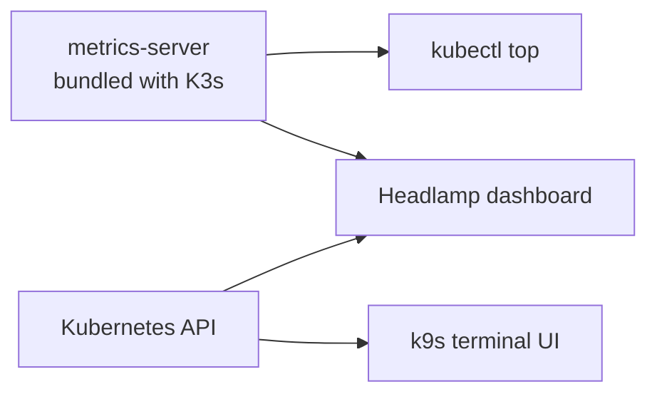

{:class="cover"}

---

By the end of this lesson you will be able to check the CPU and memory use of your nodes and pods, and look at your cluster in a graphical or terminal dashboard.

---

## Why look at your cluster?

A Pi has very little memory to spare, so you want to know early when a pod is hungry. Monitoring comes in layers, from a quick command to a full dashboard:



---

## Layer 1: metrics-server and kubectl top

K3s bundles **metrics-server**, so you do not need to install it. It collects CPU and memory use from every node, and `kubectl top` reads it:

```bash
kubectl top nodes
kubectl top pods -A
```

You should get a table of CPU (in millicores, where 1000m is one core) and memory per node, then per pod. If it says metrics are not available yet, wait a minute after the cluster starts and try again. Look for the node using the most memory: on a 2GB Pi that is the one to watch.

---

## Layer 2: a terminal dashboard

**k9s** is a popular terminal UI that lists pods, shows logs and lets you jump around with the keyboard. It runs on your computer and uses the same kubeconfig as `kubectl`. Install it by following the instructions on the k9s project page (k9scli.io) for your system, then run:

```bash
k9s
```

Type `:nodes` or `:pods` to switch view, `l` to see logs for a pod, and `q` or Ctrl+C to exit. It is a lot like a task manager for Kubernetes.

---

## Layer 3: a web dashboard with Headlamp

You may see older guides installing the Kubernetes Dashboard. The Kubernetes project has retired that dashboard and points people to **Headlamp** instead, so that is what we use.

There are two ways to run it. The first needs nothing on the cluster:

**Headlamp desktop app.** Download it from headlamp.dev, install it on your computer, and open it. It uses your existing kubeconfig (the file you set up in lesson 8) to show your cluster: nodes, pods, logs and more.

**Headlamp inside the cluster.** This needs Helm, which we cover in lesson 13, so come back to this part afterwards if you like. The Headlamp docs give these commands:

```bash
helm repo add headlamp https://kubernetes-sigs.github.io/headlamp/
helm install headlamp headlamp/headlamp --namespace kube-system
```

The in-cluster Headlamp logs in with a service account token. Create an account for it and give it permissions. Granting `cluster-admin` is the simplest, and also the most powerful, so only do this on a cluster that is yours:

```bash
kubectl -n kube-system create serviceaccount headlamp-admin
kubectl create clusterrolebinding headlamp-admin --serviceaccount=kube-system:headlamp-admin --clusterrole=cluster-admin
kubectl create token headlamp-admin -n kube-system
```

The last command prints a token to paste into the login page. Then reach the dashboard with a port-forward (check the service name with `kubectl get svc -n kube-system`):

```bash
kubectl port-forward -n kube-system service/headlamp 8080:80
```

Open `http://localhost:8080` and paste the token. If the pod does not start, check `kubectl describe pod` for an image or architecture error.

---

## What to look at

Once you have a view, try these:

- Which node has the most pods? Is that what you expected?
- How much memory does Traefik use?
- When you scale an app up, which node does the extra pod land on?

> **Teachers**: A token with `cluster-admin` can do anything, including delete the whole cluster. In a class, create read-only access for learners, or keep the admin token with the teacher and demonstrate on a projector. Do not leave a dashboard port exposed on the school network.

---

## Try it Yourself

1. Run `kubectl top nodes` and note the memory use of each Pi.
2. Scale a deployment to five replicas and run `kubectl top pods` again. What changed?
3. Install the Headlamp desktop app, connect to your cluster, and find the logs of a pod.
4. Challenge: find out which pod uses the most memory in `kube-system`, and work out whether you could disable it. Hint: K3s has `--disable` options for bundled components.

---

## Common Issues

- **Problem**: `kubectl top` says `Metrics API not available`.
- **Solution**: Wait a minute or two, and check `kubectl get pods -n kube-system` for a running `metrics-server` pod.
- **Why**: Metrics need a short time to be collected after the cluster starts.

- **Problem**: The Headlamp login rejects your token.
- **Solution**: Create a fresh one with `kubectl create token headlamp-admin -n kube-system` and paste all of it.
- **Why**: Tokens made this way expire after a time, and one with a missing character fails.

- **Problem**: `port-forward` says the service is not found.
- **Solution**: Run `kubectl get svc -n kube-system` and use the real service name.
- **Why**: The service is named after the Helm release you chose.

---

## Check your understanding


? Which component provides the data for `kubectl top`?
- [ ] Traefik
- [x] metrics-server
- [ ] CoreDNS
> K3s bundles metrics-server, which `kubectl top` queries.

? What do you need to run the Headlamp desktop app against your cluster?
- [ ] A Helm chart on every node
- [x] Your kubeconfig
- [ ] A public IP address
> The desktop app uses the same kubeconfig as kubectl.

? Why be careful with a `cluster-admin` token?
- [x] It can do anything in the cluster
- [ ] It slows the Pi down
- [ ] It only lasts a second
> cluster-admin is unrestricted, so protect the token.

