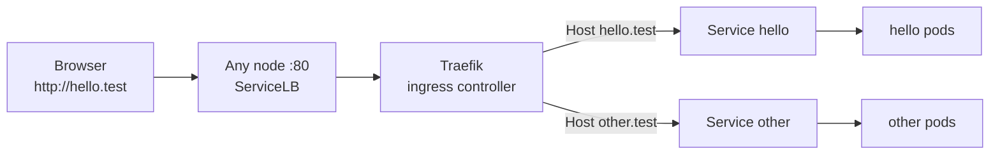

{:class="cover"}

---

By the end of this lesson you will be able to choose between ClusterIP, NodePort and LoadBalancer Services, and publish an app on a friendly web address using a Traefik Ingress.

---

## Pods come and go, so we need Services

Pods get a new IP every time they are recreated, so you never talk to a pod directly. A **Service** gives a group of pods one stable name and address, and spreads traffic across them.

| Type | What it does | Reachable from |
|---|---|---|
| ClusterIP | The default. A stable address inside the cluster | Other pods only |
| NodePort | Also opens a port (30000 to 32767) on every node | Your network, by node IP and port |
| LoadBalancer | Asks for an external address | Your network. K3s's ServiceLB provides it |
{:class="table table-single"}

On a cloud cluster, a LoadBalancer gets an address from the cloud provider. On a bare Pi cluster there is no cloud, so K3s bundles **ServiceLB**, which makes `LoadBalancer` services work by running small pods that use the nodes' own addresses.

---

## Ingress: one front door for many apps

With NodePort, every app needs its own odd port number. An **Ingress** lets many apps share ports 80 and 443 and routes by host name or path. K3s bundles **Traefik** as the ingress controller, and it publishes itself through ServiceLB on ports 80 and 443 of your nodes.



---

## Step 1: A complete app with an Ingress

Create `hello.yaml`. It holds a Deployment, a ClusterIP Service and an Ingress, separated by `---`:

```yaml
apiVersion: apps/v1
kind: Deployment
metadata:
  name: hello
spec:
  replicas: 2
  selector:
    matchLabels:
      app: hello
  template:
    metadata:
      labels:
        app: hello
    spec:
      containers:
        - name: nginx
          image: nginx:alpine
          ports:
            - containerPort: 80
---
apiVersion: v1
kind: Service
metadata:
  name: hello
spec:
  selector:
    app: hello
  ports:
    - port: 80
      targetPort: 80
---
apiVersion: networking.k8s.io/v1
kind: Ingress
metadata:
  name: hello
  annotations:
    traefik.ingress.kubernetes.io/router.entrypoints: web
spec:
  rules:
    - host: hello.test
      http:
        paths:
          - path: /
            pathType: Prefix
            backend:
              service:
                name: hello
                port:
                  number: 80
```

```bash
kubectl apply -f hello.yaml
kubectl get ingress
```

The `ADDRESS` column fills in with your node addresses once Traefik has picked the Ingress up.

---

## Step 2: Visit it

The Ingress only matches requests with the host name `hello.test`. The quickest test needs no setup, because you can send the host name yourself:

```bash
curl -H "Host: hello.test" http://192.168.1.100/
```

You should get the nginx welcome page HTML. To use a browser, add a line to your computer's hosts file (`/etc/hosts` on Linux and macOS), pointing the name at a node's address:

```text
192.168.1.100 hello.test
```

Then browse to `http://hello.test`. I use `.test` because it is reserved for testing and never clashes with a real domain, unlike `.local`, which is used by mDNS. Any node's address works, because ServiceLB listens on all of them.

If you ask for an address Traefik has no rule for, it replies `404 page not found`. That is Traefik working: it just has no route for that name.

---

## Step 3: Look under the hood

```bash
kubectl get svc -A
kubectl get pods -n kube-system -l app.kubernetes.io/name=traefik
```

In the first list, find the `traefik` Service of type `LoadBalancer` with ports 80 and 443. Because ServiceLB uses real ports on the nodes, two LoadBalancer services cannot both use port 80 on the same node.

HTTPS with a real Let's Encrypt certificate needs a public domain name and ports open to the internet, which is outside this course. We cover a safer local approach to TLS in lesson 16.

> **Teachers**: Ingress by host name needs each learner to edit their own hosts file, which school computers often forbid. The `curl -H "Host: ..."` form works without any changes and is a good fallback. On a shared cluster, give every learner a different host name such as `alice.test`, or two apps will fight over one name.

---

## Cleanup

```bash
kubectl delete -f hello.yaml
```

---

## Try it Yourself

1. Apply the manifest and fetch the page with `curl -H "Host: hello.test"`.
2. Change the host in the Ingress to `hello2.test`, apply it, and confirm the old name now returns 404.
3. Deploy a second app (use `httpd:alpine`) with its own Service and a second Ingress host, and reach both from the same node address.
4. Challenge: change the Service to `type: NodePort`, apply it, and compare how you reach the app.

---

## Common Issues

- **Problem**: You get `404 page not found`.
- **Solution**: Check the host name in your request matches the Ingress `host:`, and that `kubectl get ingress` shows the rule.
- **Why**: Traefik routes by host name, and an unmatched request has nowhere to go.

- **Problem**: You get `503 Service Unavailable`.
- **Solution**: Run `kubectl get endpoints hello` and make sure it lists pod addresses. Check the Service `selector` matches the pod labels.
- **Why**: The Ingress found a Service, but the Service had no healthy pods behind it.

- **Problem**: A `LoadBalancer` service stays `Pending`.
- **Solution**: Check another service is not already using that port on every node.
- **Why**: ServiceLB needs a free port on a node, and Traefik already holds 80 and 443.

---

## Check your understanding


? Which K3s component routes web traffic by host name?
- [ ] ServiceLB
- [x] Traefik
- [ ] local-path
> Traefik is the bundled ingress controller.

? What does ServiceLB do?
- [x] Makes LoadBalancer services work on bare metal using node addresses
- [ ] Encrypts traffic between nodes
- [ ] Stores volumes
> Without a cloud provider, ServiceLB supplies the external address.

? What is the range for a NodePort?
- [ ] 1 to 1023
- [x] 30000 to 32767
- [ ] 8000 to 8999
> Kubernetes uses this high range by default.

