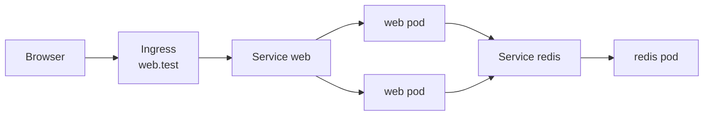

{:class="cover"}

---

By the end of this lesson you will be able to deploy a two-part app, a web service and a Redis database, connect them with Services, publish them with an Ingress, and scale and update the web part.

---

## The app: a visit counter

We will build a tiny web page that counts visits and says which pod answered. It has two parts that talk to each other:



To keep this lesson self-contained, and to avoid depending on an image somebody else hosts, the web app is a short Python program stored in a **ConfigMap** and run inside the official `python:3.12-alpine` image. Both `python` and `redis` publish images for `arm64`, so they run on a Pi. It talks to Redis using Redis's simple text protocol, so there is nothing extra to install.

---

## Step 1: Redis

Create `redis.yaml`:

```yaml
apiVersion: apps/v1
kind: Deployment
metadata:
  name: redis
spec:
  replicas: 1
  selector:
    matchLabels:
      app: redis
  template:
    metadata:
      labels:
        app: redis
    spec:
      containers:
        - name: redis
          image: redis:7-alpine
          ports:
            - containerPort: 6379
          resources:
            requests:
              memory: 32Mi
              cpu: 50m
            limits:
              memory: 128Mi
---
apiVersion: v1
kind: Service
metadata:
  name: redis
spec:
  selector:
    app: redis
  ports:
    - port: 6379
      targetPort: 6379
```

The Service called `redis` gives other pods a stable name. Inside the cluster, CoreDNS makes the name `redis` resolve to that Service. This lesson's Redis keeps its data in memory only, so the count resets if the pod restarts. We fix that with a volume in the final project.

---

## Step 2: the web app

Create `web.yaml`:

```yaml
apiVersion: v1
kind: ConfigMap
metadata:
  name: web-code
data:
  app.py: |
    import os
    import socket
    from http.server import BaseHTTPRequestHandler, HTTPServer

    REDIS_HOST = os.environ.get("REDIS_HOST", "redis")
    REDIS_PORT = int(os.environ.get("REDIS_PORT", "6379"))


    def count_visit():
        # Talk to Redis using its plain-text protocol: INCR replies with ":<number>"
        with socket.create_connection((REDIS_HOST, REDIS_PORT), timeout=2) as s:
            s.sendall(b"INCR visits\r\n")
            reply = s.recv(64).decode().strip()
        return int(reply.lstrip(":"))


    class Handler(BaseHTTPRequestHandler):
        def do_GET(self):
            if self.path != "/":
                self.send_error(404)
                return
            try:
                body = "Visit number %d, served by pod %s\n" % (
                    count_visit(), socket.gethostname())
                status = 200
            except OSError as err:
                body = "Cannot reach Redis: %s\n" % err
                status = 503
            data = body.encode()
            self.send_response(status)
            self.send_header("Content-Type", "text/plain")
            self.send_header("Content-Length", str(len(data)))
            self.end_headers()
            self.wfile.write(data)


    if __name__ == "__main__":
        HTTPServer(("0.0.0.0", 8080), Handler).serve_forever()
---
apiVersion: apps/v1
kind: Deployment
metadata:
  name: web
spec:
  replicas: 2
  selector:
    matchLabels:
      app: web
  template:
    metadata:
      labels:
        app: web
    spec:
      containers:
        - name: web
          image: python:3.12-alpine
          command: ["python", "-u", "/app/app.py"]
          env:
            - name: REDIS_HOST
              value: redis
          ports:
            - containerPort: 8080
          resources:
            requests:
              memory: 32Mi
              cpu: 50m
            limits:
              memory: 128Mi
          volumeMounts:
            - name: code
              mountPath: /app
      volumes:
        - name: code
          configMap:
            name: web-code
---
apiVersion: v1
kind: Service
metadata:
  name: web
spec:
  selector:
    app: web
  ports:
    - port: 80
      targetPort: 8080
```

Read it from the top. The ConfigMap holds the code. The Deployment runs two copies of the image, mounts the ConfigMap as the folder `/app`, and runs `app.py`. The Service sends port 80 on to port 8080 in the pods. The `resources` block tells the scheduler how much memory each pod needs, which matters on small Pis.

---

## Step 3: Apply and watch

```bash
kubectl apply -f redis.yaml
kubectl apply -f web.yaml
kubectl get pods -o wide -w
```

`-w` watches for changes. The first start pulls images, so allow a minute. Press Ctrl+C when all three pods show `Running`. Check the Service can see its pods:

```bash
kubectl get endpoints web redis
```

---

## Step 4: Add the Ingress

Create `web-ingress.yaml`:

```yaml
apiVersion: networking.k8s.io/v1
kind: Ingress
metadata:
  name: web
  annotations:
    traefik.ingress.kubernetes.io/router.entrypoints: web
spec:
  rules:
    - host: web.test
      http:
        paths:
          - path: /
            pathType: Prefix
            backend:
              service:
                name: web
                port:
                  number: 80
```

```bash
kubectl apply -f web-ingress.yaml
curl -H "Host: web.test" http://192.168.1.100/
```

Run the `curl` several times. The visit number goes up each time, and the pod name changes as Traefik and the Service spread requests across the two web pods. (Or add `web.test` to your hosts file, as in the last lesson, and use a browser.)

---

## Scale and update

```bash
kubectl scale deployment web --replicas=4
kubectl get pods -o wide
```

To change the app, edit the Python in the ConfigMap, apply it again, and restart the pods so they reload the code:

```bash
kubectl apply -f web.yaml
kubectl rollout restart deployment web
kubectl rollout status deployment web
```

A rollout replaces pods a few at a time, so the app stays up. If it goes wrong, `kubectl rollout undo deployment web` takes you back.

> **Teachers**: Pulling images over a shared connection is the bottleneck: the first deployment on a fresh cluster downloads each image once per node. Docker Hub also limits anonymous pulls per network address, so a whole class behind one school address can hit the limit. Pre-pull images on the nodes, or use a local registry, before a lesson.

---

## Cleanup

```bash
kubectl delete -f web-ingress.yaml -f web.yaml -f redis.yaml
```

---

## Try it Yourself

1. Deploy the app and call it ten times. Does the visit number always go up by one?
2. Scale `web` to 4 replicas and watch the pod names in the replies.
3. Delete the Redis pod and call the page. What do you see, and how does it recover?
4. Challenge: change the message in the Python code to include the node name, and roll it out. Hint: pass `spec.nodeName` into an environment variable with the downward API (`valueFrom: fieldRef: fieldPath: spec.nodeName`).

---

## Common Issues

- **Problem**: The web page says `Cannot reach Redis`.
- **Solution**: Check `kubectl get pods` shows Redis running and `kubectl get endpoints redis` lists an address. Check the Service is named `redis`.
- **Why**: The app finds Redis by the Service name, and a typo or a pod that is not ready breaks that link.

- **Problem**: Pods show `ImagePullBackOff`.
- **Solution**: Run `kubectl describe pod <name>` and read the Events. Check internet access, and the image name and tag.
- **Why**: The node could not download the image, or the image does not exist for `arm64`.

- **Problem**: The change to the code did not appear.
- **Solution**: Run `kubectl rollout restart deployment web`.
- **Why**: Pods read the ConfigMap code when they start, so running pods keep the old code.

---

## Check your understanding


? How does the web pod find Redis?
- [ ] By the Redis pod's IP address
- [x] By the Service name `redis`, resolved by cluster DNS
- [ ] By a node's hostname
> Pod IPs change, so Services give a stable DNS name.

? What does `kubectl rollout restart deployment web` do?
- [x] Replaces the pods gradually so they reload their config
- [ ] Reboots the node
- [ ] Deletes the Service
> A rollout restart recreates pods without downtime.

? Why does the visit count reset if the Redis pod restarts?
- [ ] The Service forgets it
- [x] Redis keeps its data only in the pod's memory here
- [ ] The Ingress clears it
> Without a volume, the data lives only inside that pod.

