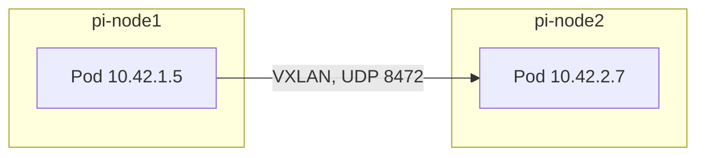

{:class="cover"}

---

By the end of this lesson you will be able to explain what a CNI plugin does, use a NetworkPolicy to allow or block traffic between pods in K3s, and describe what changes if you replace Flannel.

---

## What is a CNI?

Every pod gets its own IP address, and any pod should be able to reach any other pod, even on a different Pi. The **Container Network Interface (CNI)** is the standard plugin system that makes this happen. A CNI plugin assigns pod addresses and carries traffic between nodes.

K3s bundles **Flannel** as its CNI, with the default **VXLAN** backend. VXLAN wraps pod traffic in UDP packets on port 8472 and sends them between nodes, which is why that port must be open between your Pis.



Pods get addresses from `10.42.0.0/16` by default, and Services from `10.43.0.0/16`.

---

## NetworkPolicy: who may talk to whom

By default every pod can talk to every other pod. A **NetworkPolicy** is a firewall rule for pods. Plain Flannel does not enforce policies by itself, but K3s ships an embedded network policy controller, so NetworkPolicy objects work out of the box. K3s creates no policies by default, so nothing is blocked until you say so.

Let's try it. Create `netdemo.yaml`:

```yaml
apiVersion: v1
kind: Namespace
metadata:
  name: netdemo
---
apiVersion: apps/v1
kind: Deployment
metadata:
  name: web
  namespace: netdemo
spec:
  replicas: 1
  selector:
    matchLabels:
      app: web
  template:
    metadata:
      labels:
        app: web
    spec:
      containers:
        - name: nginx
          image: nginx:alpine
          ports:
            - containerPort: 80
---
apiVersion: v1
kind: Service
metadata:
  name: web
  namespace: netdemo
spec:
  selector:
    app: web
  ports:
    - port: 80
      targetPort: 80
```

```bash
kubectl apply -f netdemo.yaml
```

Now start a throwaway pod that fetches the page. `--rm` deletes it afterwards, and `-T 3` makes `wget` give up after three seconds:

```bash
kubectl run tester -n netdemo --rm -it --restart=Never --image=busybox:1.36 -- wget -qO- -T 3 http://web
```

You should see the nginx welcome page HTML. Open traffic, as expected.

---

## Step 2: Block everything

Create `deny-all.yaml`:

```yaml
apiVersion: networking.k8s.io/v1
kind: NetworkPolicy
metadata:
  name: deny-all-ingress
  namespace: netdemo
spec:
  podSelector: {}
  policyTypes:
    - Ingress
```

`podSelector: {}` selects every pod in the namespace, and with `Ingress` listed but no rules allowed, nothing may come in.

```bash
kubectl apply -f deny-all.yaml
kubectl run tester -n netdemo --rm -it --restart=Never --image=busybox:1.36 -- wget -qO- -T 3 http://web
```

This time the command should hang for three seconds and report that the download timed out. The policy is working.

---

## Step 3: Let one kind of pod in

Create `allow-client.yaml`:

```yaml
apiVersion: networking.k8s.io/v1
kind: NetworkPolicy
metadata:
  name: allow-labelled-clients
  namespace: netdemo
spec:
  podSelector:
    matchLabels:
      app: web
  policyTypes:
    - Ingress
  ingress:
    - from:
        - podSelector:
            matchLabels:
              access: allowed
      ports:
        - protocol: TCP
          port: 80
```

```bash
kubectl apply -f allow-client.yaml
kubectl run tester -n netdemo --rm -it --restart=Never --labels=access=allowed --image=busybox:1.36 -- wget -qO- -T 3 http://web
```

With the `access=allowed` label the request works again. Without the label it is still blocked. Remember that a deny-all policy also blocks Traefik from reaching your pods, so a real policy must allow the ingress controller too.

Clean up with `kubectl delete namespace netdemo`.

---

## Replacing Flannel

Flannel is simple and enough for most Pi clusters. People replace it for features such as Cilium's eBPF visibility, or Calico's routing options. If you want to try, the K3s docs describe the route:

- Start the server with `--flannel-backend=none`, and also `--disable-network-policy`, so the built-in controller does not clash with the new CNI's own.
- With no CNI, nodes stay `NotReady` until you install one.
- Then install your chosen CNI. Calico, Canal and Cilium each need K3s-specific settings (for example, Calico needs IP forwarding enabled in its container settings), so follow the K3s networking page and the CNI's own K3s instructions step by step, and use a version that supports `arm64`.

I have not given a full Calico or Cilium install here because the exact manifests change between releases and need those K3s-specific tweaks. A simpler change that still helps is Flannel's `wireguard-native` backend, which encrypts traffic between nodes, as long as the WireGuard kernel modules exist on every node.

> **Teachers**: Replacing the CNI can leave a whole cluster without networking, and there is no quick undo besides reinstalling. Keep that for a spare cluster, and make the NetworkPolicy exercise the classroom activity. It needs no extra installs and gives clear pass or fail results.

---

## Try it Yourself

1. Run the three-step demo and note what the tester prints each time.
2. Run `kubectl get networkpolicy -n netdemo` and `kubectl describe networkpolicy allow-labelled-clients -n netdemo`.
3. Make a second namespace and confirm a pod there cannot reach `web` after the deny-all policy.
4. Challenge: write a policy for a Redis pod that only lets pods labelled `app: web` connect on port 6379.

---

## Common Issues

- **Problem**: Your policy has no effect.
- **Solution**: Check `kubectl get networkpolicy -n <ns>`, the namespace and the `podSelector` labels, and that you did not start K3s with `--disable-network-policy`.
- **Why**: A policy only applies to pods it selects in its own namespace, and needs a controller to enforce it.

- **Problem**: After a deny-all policy, your Ingress returns errors.
- **Solution**: Add a policy that allows traffic from the Traefik pods, which run in `kube-system`.
- **Why**: Traefik is a pod too, so the deny rule blocks it from reaching your app.

- **Problem**: Nodes are `NotReady` after setting `--flannel-backend=none`.
- **Solution**: Install a CNI plugin, or reinstall K3s without that flag.
- **Why**: Without a CNI, pods cannot get network addresses.

---

## Check your understanding


? What does a CNI plugin do?
- [x] Gives pods addresses and carries their traffic between nodes
- [ ] Builds container images
- [ ] Stores volumes
> It provides the pod network.

? Which port does Flannel's default VXLAN backend use between nodes?
- [ ] TCP 6443
- [x] UDP 8472
- [ ] TCP 10250
> Flannel VXLAN uses UDP 8472.

? What does `podSelector: {}` in a NetworkPolicy mean?
- [ ] It selects no pods
- [x] It selects every pod in the namespace
- [ ] It selects only the nodes
> An empty selector matches all pods in that namespace.

