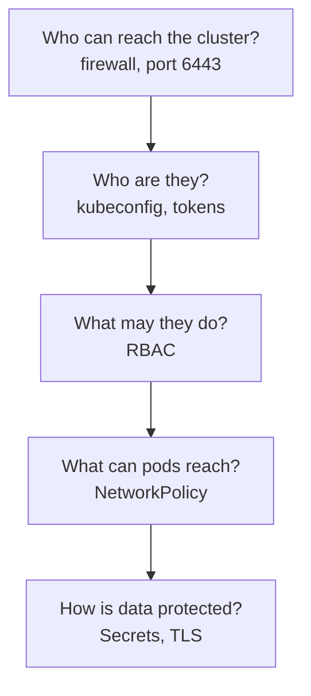

{:class="cover"}

---

By the end of this lesson you will be able to store credentials in a Secret, limit what an account can do with RBAC, serve an app over HTTPS, and apply a short list of hardening steps to a K3s cluster.

---

## Why bother on a home cluster?

A Kubernetes cluster is a powerful thing to leave unlocked. Whoever holds your kubeconfig can run anything on every node. Home labs get connected to the internet by accident more often than you would think, so let's build good habits from the start.



---

## 1. Secrets for credentials

Never write a password into a Deployment. Put it in a **Secret** and reference it:

```bash
kubectl create secret generic db-credentials \
  --from-literal=username=pi \
  --from-literal=password='change-me-please'
```

A pod then reads it into an environment variable. Create `secret-demo.yaml`:

```yaml
apiVersion: v1
kind: Pod
metadata:
  name: secret-demo
spec:
  containers:
    - name: busybox
      image: busybox:1.36
      command: ["sh", "-c", "echo user is $DB_USER; sleep 3600"]
      env:
        - name: DB_USER
          valueFrom:
            secretKeyRef:
              name: db-credentials
              key: username
```

```bash
kubectl apply -f secret-demo.yaml
kubectl logs secret-demo
```

You should see the username printed. Now look at how the Secret is stored:

```bash
kubectl get secret db-credentials -o jsonpath="{.data.password}" | base64 -d
```

Anyone who can read Secrets can decode them. They are **base64-encoded, not encrypted**, in the API. K3s can encrypt them at rest in its datastore. The K3s hardening guide enables this with `secrets-encryption: true` in `/etc/rancher/k3s/config.yaml` on the server, then a restart of K3s. Do this before you store anything precious.

---

## 2. RBAC: least privilege

**Role-based access control (RBAC)** says who may do what. A **Role** lists permissions in one namespace, and a **RoleBinding** gives it to a user or service account. Create `rbac-demo.yaml`:

```yaml
apiVersion: v1
kind: ServiceAccount
metadata:
  name: viewer
  namespace: default
---
apiVersion: rbac.authorization.k8s.io/v1
kind: Role
metadata:
  name: pod-reader
  namespace: default
rules:
  - apiGroups: [""]
    resources: ["pods", "services"]
    verbs: ["get", "list", "watch"]
---
apiVersion: rbac.authorization.k8s.io/v1
kind: RoleBinding
metadata:
  name: viewer-pod-reader
  namespace: default
subjects:
  - kind: ServiceAccount
    name: viewer
    namespace: default
roleRef:
  apiGroup: rbac.authorization.k8s.io
  kind: Role
  name: pod-reader
```

```bash
kubectl apply -f rbac-demo.yaml
kubectl auth can-i list pods --as=system:serviceaccount:default:viewer
kubectl auth can-i delete pods --as=system:serviceaccount:default:viewer
```

The first answers `yes` and the second `no`. This is what you want a CI pipeline or a dashboard to have: only the access it needs. Compare that with the `cluster-admin` tokens we made earlier.

---

## 3. HTTPS with Traefik

Traefik serves HTTPS on port 443. For a local cluster you can use a self-signed certificate, which encrypts traffic but makes browsers warn. Make a certificate and store it as a TLS Secret:

```bash
openssl req -x509 -nodes -newkey rsa:2048 -days 365 \
  -keyout tls.key -out tls.crt \
  -subj "/CN=hello.test" -addext "subjectAltName=DNS:hello.test"
kubectl create secret tls hello-tls --cert=tls.crt --key=tls.key
```

Add a `tls` section to the Ingress from lesson 11 (apply `hello.yaml` again first) and switch it to the `websecure` entry point:

```yaml
apiVersion: networking.k8s.io/v1
kind: Ingress
metadata:
  name: hello
  annotations:
    traefik.ingress.kubernetes.io/router.entrypoints: websecure
spec:
  tls:
    - hosts:
        - hello.test
      secretName: hello-tls
  rules:
    - host: hello.test
      http:
        paths:
          - path: /
            pathType: Prefix
            backend:
              service:
                name: hello
                port:
                  number: 80
```

Test it without editing your hosts file. `-k` accepts the self-signed certificate:

```bash
curl -k --resolve hello.test:443:192.168.1.100 https://hello.test/
```

For a public domain you would use cert-manager with Let's Encrypt, which needs a real domain name and is a good next course.

---

## 4. Lock the front door and the kubeconfig

- Do not expose port **6443** to the internet. Keep it on your home network, and use a VPN if you need remote access.
- If you run a firewall (UFW, for example), allow only what K3s needs: 6443/tcp, and the ports from lesson 4.
- Treat `~/.kube/config` as a password. Keep it `chmod 600`, and never commit it to Git.
- Keep the node token private, and keep Pi OS updated with `sudo apt update && sudo apt full-upgrade`.
- Do not disable Traefik, ServiceLB or metrics-server unless you replace them. They are not security risks by themselves.

The K3s hardening guide goes further, with Pod Security Admission and audit logs. It also notes that nothing is restricted by default: no network policies, no pod security rules, and auditing is off. That is a good reading list for when you want to go deeper.

---

## Safer pods

When you write your own manifests, ask pods to drop privileges:

```yaml
securityContext:
  runAsNonRoot: true
  allowPrivilegeEscalation: false
```

Put these under a container, and make sure the image can run as a non-root user. If a pod crashes with a permission error, that is why.

> **Teachers**: This lesson has the most classroom catches. Learners should never put real passwords in a Secret on a shared cluster, since anyone with access can decode them. A `cluster-admin` kubeconfig must not be shared between learners. If you give access to a shared cluster, create one ServiceAccount per learner with a Role limited to their own namespace. Also warn against opening router ports for 6443.

---

## Try it Yourself

1. Create the Secret and the pod, and confirm the username is printed in the logs.
2. Run the two `auth can-i` commands, then edit the Role to add `delete` and see the answer change.
3. Serve `hello.test` over HTTPS with a self-signed certificate.
4. Challenge: write a Role that lets an account read pods and logs (`pods/log`) in one namespace only.

---

## Common Issues

- **Problem**: The pod is stuck `CreateContainerConfigError`.
- **Solution**: Run `kubectl describe pod secret-demo`. Check the Secret name and key match, and that the Secret is in the same namespace.
- **Why**: A pod can only use a Secret that exists in its own namespace.

- **Problem**: `kubectl auth can-i` always says `no`.
- **Solution**: Check the service account name and namespace in `--as=system:serviceaccount:<namespace>:<name>` and in the RoleBinding.
- **Why**: A binding only grants access to the exact subject it names.

- **Problem**: The browser warns about the HTTPS certificate.
- **Solution**: Expected with a self-signed certificate. Use `curl -k` or accept the warning for testing.
- **Why**: Browsers only trust certificates from authorities they know.

---

## Check your understanding


? Are Kubernetes Secrets encrypted by default in the API?
- [ ] Yes, with AES
- [x] No, they are only base64-encoded
- [ ] Yes, with the node token
> Base64 is an encoding, not encryption. K3s offers secrets encryption at rest as an option.

? What gives a ServiceAccount the permissions listed in a Role?
- [ ] A ConfigMap
- [x] A RoleBinding
- [ ] A NetworkPolicy
> A RoleBinding connects subjects to a Role.

? Why should you not expose port 6443 to the internet?
- [x] It is the Kubernetes API, and a stolen credential would give control of the cluster
- [ ] It is used only for DNS
- [ ] It makes Traefik stop
> The API is the key to the whole cluster, so keep it private.

