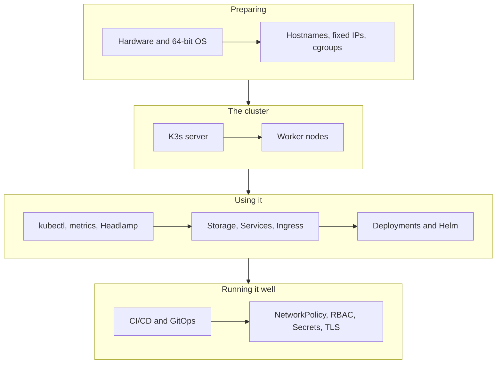

{:class="cover"}

---

By the end of this lesson you will be able to describe the pieces of your K3s cluster and how they fit together, and choose what to learn next.

---

## What you built

You started with a few bare Raspberry Pis and finished with a Kubernetes cluster running an app with a database that survives restarts.

| Lesson | The key idea you took away |
|---|---|
| Hardware and OS | An SSD, wired Ethernet and the memory cgroup matter on a Pi |
| Networking | Fixed addresses and unique hostnames keep nodes in the cluster |
| Installing K3s | One script gives a server, with Flannel, Traefik, ServiceLB and local-path built in |
| Adding nodes | `K3S_URL` and the token turn a Pi into a worker |
| kubectl | You describe what you want, and Kubernetes keeps it that way |
| Storage | A PVC keeps data beyond one pod, but local-path is tied to one node |
| Ingress | Traefik routes many apps through ports 80 and 443 |
| Helm | A chart and a values file make deployments repeatable |
| CI/CD | A runner inside your network, or GitOps, deploys from Git |
| Security | Secrets, RBAC, NetworkPolicy and TLS, and never exposing port 6443 |
{:class="table table-single"}

---

## Where to go next

- **Containers underneath.** Revisit [Docker](/learn/docker/) for images and containers, or see how [Podman](/learn/podman/) connects to Kubernetes.
- **Another way to cluster.** Build a [Raspberry Pi 5 Cluster with Docker Swarm](/learn/docker_swarm/) and compare how the two approaches feel.
- **Your Linux skills.** Brush up in [Introduction to the Linux Command Line on Raspberry Pi OS](/learn/linux_intro/), which makes a cluster much easier to run.
- **Version control.** The [Git](/learn/git/) course makes the GitOps ideas in lesson 14 click.
- **Apps to run.** Try [Redis](/learn/redis/) properly, or write an API with [FastAPI](/learn/fastapi/) and deploy it on your cluster.

Ideas for your cluster: a self-hosted Git server, a dashboard for your robots, or an MQTT broker for a fleet of sensors. A cluster of Pis is a wonderful place to try things safely, because you can wipe and rebuild it in under an hour.

> **Teachers**: A good wrap-up is a short demo from each group: show your app, kill a pod, kill a node (pull its power lead), and explain what Kubernetes did. Ask groups to write one thing that went wrong and how they fixed it. Do a final tidy: delete test namespaces and, if kit is shared, uninstall K3s with the uninstall scripts so the Pis are clean for the next class.

---

## Try it Yourself

1. Write a one-page README for your cluster: node names, addresses, K3s version and what is running on it.
2. Pull the network cable from a worker and run `kubectl get nodes` and `kubectl get pods -o wide` a few times over a few minutes. What happens to the pods that were on that worker?
3. Challenge: pick one idea from the list above and plan the manifests it would need.

---

## Check your understanding


? Which two files do you need from the server to work from your laptop and to join workers?
- [x] The kubeconfig and the node token
- [ ] The Traefik config and the PVC
- [ ] The cmdline.txt and the hosts file
> The kubeconfig lets kubectl and Helm talk to the cluster, and the token lets workers join.

? Which K3s feature stores volumes on a node's disk by default?
- [x] local-path
- [ ] ServiceLB
- [ ] CoreDNS
> The local-path provisioner creates folders on a node for each claim.

? What is the safest way to deploy from Git to a home cluster without opening ports?
- [ ] Expose port 6443 to GitHub
- [x] A self-hosted runner inside the network, or a GitOps controller in the cluster
- [ ] Copy files by hand
> Both keep the cluster private and reach it from inside.

