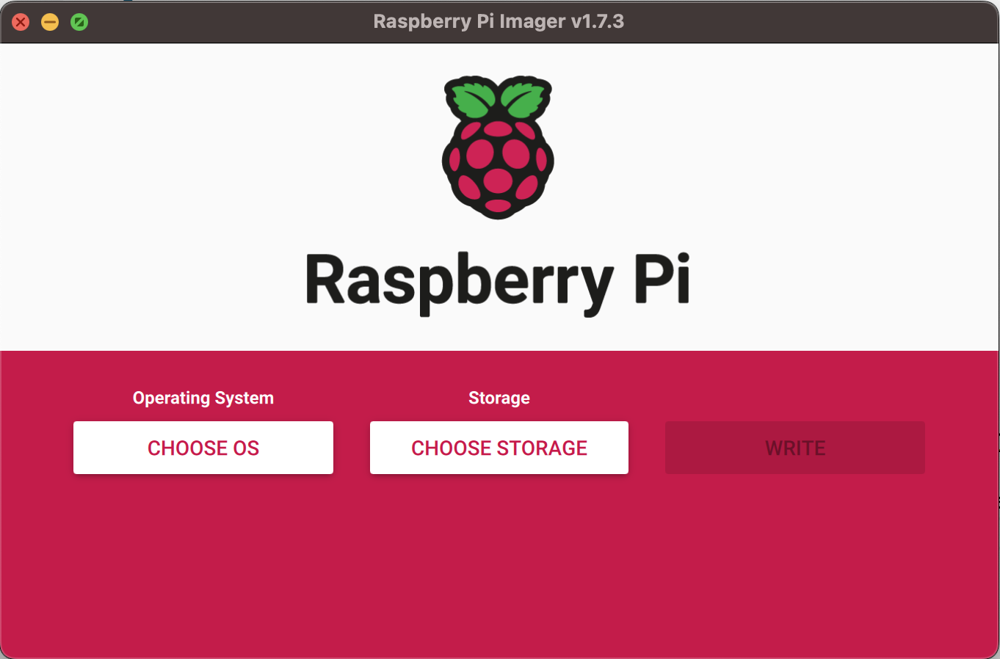
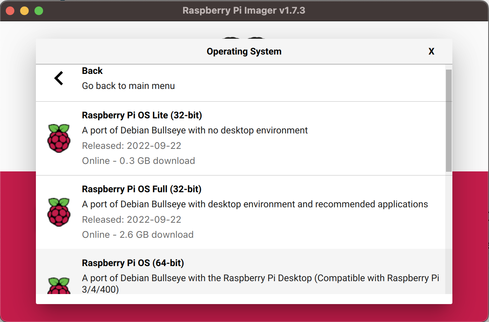
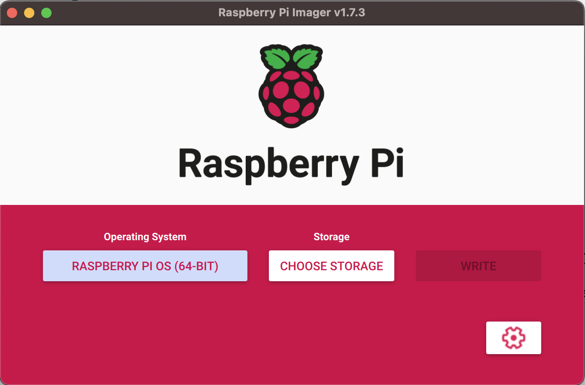
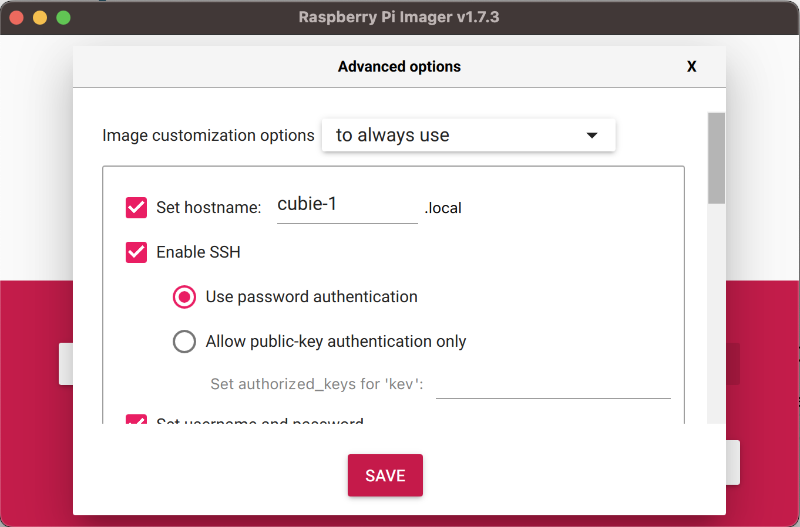

{:class="cover"}

---

By the end of this lesson you will be able to write a 64-bit Raspberry Pi OS card with Wi-Fi and SSH set up, and check that the Pi is really running 64-bit.

## Watch the video



---

## Why 64-bit?

The official ROS 2 Docker images for the Pi are built for 64-bit ARM. A 32-bit Raspberry Pi OS can't run them, so Docker would pull the wrong image or fail. That's why we flash the **64-bit** version of Raspberry Pi OS. Everything else about the Pi stays the same, and it works on a Raspberry Pi 4 or 5.

## Setup the SD card using Raspberry Pi Imager

{:class="img-fluid w-50 shadow-lg"}

* **Get the Raspberry Pi Imager** - from: <https://www.raspberrypi.com/software/>
* **Insert your SD card** - put the blank card into a card reader on another computer; 32GB or larger is recommended, because ROS images are big
* **Choose the OS** - click `Choose OS`, and select Raspberry Pi OS (64-bit) Desktop, under the `Raspberry Pi OS (other)` menu

{:class="img-fluid w-50 shadow-lg"}

* **Choose Storage** - click `Choose Storage` and select the SD card from the list. Check the size matches your card, because the Imager erases whatever you pick

{:class="img-fluid w-50 shadow-lg"}

* **Advanced Options** - click the cog icon (in newer versions of Imager, click `Edit Settings` when asked about OS customisation). Add your Wi-Fi name and password, set a username and password, and make sure `enable SSH` is ticked. SSH lets us connect to the Pi from VS Code later

{:class="img-fluid w-50 shadow-lg"}

* **Write the Image** - click `Write`. It may take a few minutes
* **Remove the SD Card** - then insert it into the Raspberry Pi and plug in the power

## Check it's 64-bit

Once the Pi has booted, open a terminal (or SSH in) and type:

```bash
uname -m
```

You should see `aarch64`, which is how a 64-bit ARM system reports itself. If you see `armv7l` you have the 32-bit OS and need to write the card again.

> **Teachers**: Each Pi needs its own SD card, and the Imager writes your Wi-Fi password and login onto it. Use a class Wi-Fi network rather than a personal one, and agree who sets the passwords. School networks that use a login page (captive portal) or block SSH will stop the Pi connecting; ask your network manager, or use a wired connection. Imaging cards one by one takes time, so do it before the lesson.

---

## Try it Yourself

1. Run `hostname` on the Pi and write down the name and the username you chose.
2. Run `ip a` and find your Pi's IP address; you'll need it for VS Code.
3. From another computer on the same network, try `ssh yourusername@theipaddress` and log in.
4. Challenge: find out how much free disk space the Pi has with `df -h /`. Roughly how many ROS images could you fit?

## Common Issues

- **Problem**: The Pi doesn't appear on the network.
- **Solution**: Check the Wi-Fi name and password you typed in the Imager (spelling and capitals), or plug in an Ethernet cable and try again.
- **Why**: The Wi-Fi details are copied onto the card at write time, so a typo means the Pi can't join.

- **Problem**: `ssh` says "connection refused".
- **Solution**: Write the card again with `enable SSH` ticked, or enable SSH from the Pi's settings with a screen attached.
- **Why**: SSH is switched off on a fresh Raspberry Pi OS install unless you ask for it.

## Check your understanding


? Why do we use the 64-bit Raspberry Pi OS?
- [ ] It's faster at writing to the SD card
- [x] The ROS 2 Docker images we use are built for 64-bit ARM
- [ ] 32-bit doesn't have a desktop
> The Docker images won't run on a 32-bit system.

? What should `uname -m` print on a 64-bit Raspberry Pi OS?
- [ ] `armv7l`
- [x] `aarch64`
- [ ] `x86`

? Why tick `enable SSH` in the Imager?
- [x] So we can connect to the Pi remotely from VS Code
- [ ] To make Wi-Fi faster
- [ ] To install Docker

