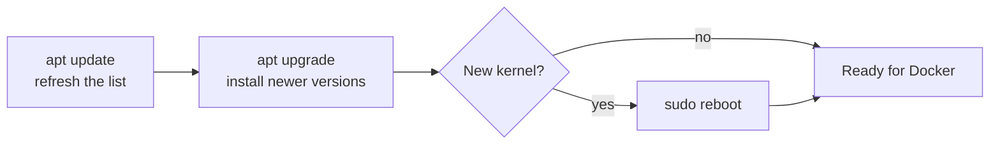

{:class="cover"}

---

By the end of this lesson you will be able to bring a Raspberry Pi fully up to date from the terminal or the desktop update icon.

## Why update first?

A fresh image can be weeks or months old. Updating before you install Docker means you get the latest security fixes and a kernel that matches the packages Docker will want. It also catches network problems early: if `apt update` can't reach the internet, Docker's installer won't either, and it's better to find that out now.

## Update from the terminal

* **Connect to the Pi** - once it has booted, either attach a keyboard, mouse and monitor, or connect remotely with `ssh`
* **Open a terminal** and type:

```bash
sudo apt update
sudo apt upgrade -y
```

`apt update` refreshes the list of available packages. `apt upgrade` installs the newer versions. The `-y` answers "yes" for you. On a new image this can take several minutes.

If the upgrade installed a new kernel, restart the Pi:

```bash
sudo reboot
```

## Or use the desktop

If you are using the desktop, click the **update icon** next to the clock. It may not appear immediately after startup. Click it, then choose to install the updates. Both ways do the same job.



---

## Try it Yourself

1. Run `sudo apt update` twice. What is different about the second run?
2. Run `apt list --upgradable` before upgrading to see what is waiting.
3. Challenge: use `cat /etc/os-release` to find the Debian version your Pi is running.

## Common Issues

- **Problem**: `apt update` shows "Temporary failure resolving".
- **Solution**: Check the Pi is on the network (`ip a`, or try `ping -c 3 raspberrypi.com`).
- **Why**: `apt` downloads from the internet, so no network means no packages.

- **Problem**: "Could not get lock /var/lib/dpkg/lock".
- **Solution**: Wait a minute, or close the desktop update window, then try again.
- **Why**: Only one program may use the package system at a time, and the updater may already be running.

## Check your understanding


? What does `sudo apt update` do?
- [ ] Installs the newest versions of everything
- [x] Refreshes the list of available packages
- [ ] Restarts the Pi
> The installing is done by `apt upgrade`.

? What does the `-y` in `sudo apt upgrade -y` do?
- [x] Answers "yes" to the confirmation question for you
- [ ] Upgrades only one package
- [ ] Skips the download

? When should you run `sudo reboot` after upgrading?
- [ ] Never
- [x] If the upgrade installed a new kernel
- [ ] Before `apt update`
> The diagram in the lesson shows the decision: new kernel means reboot, then carry on.

