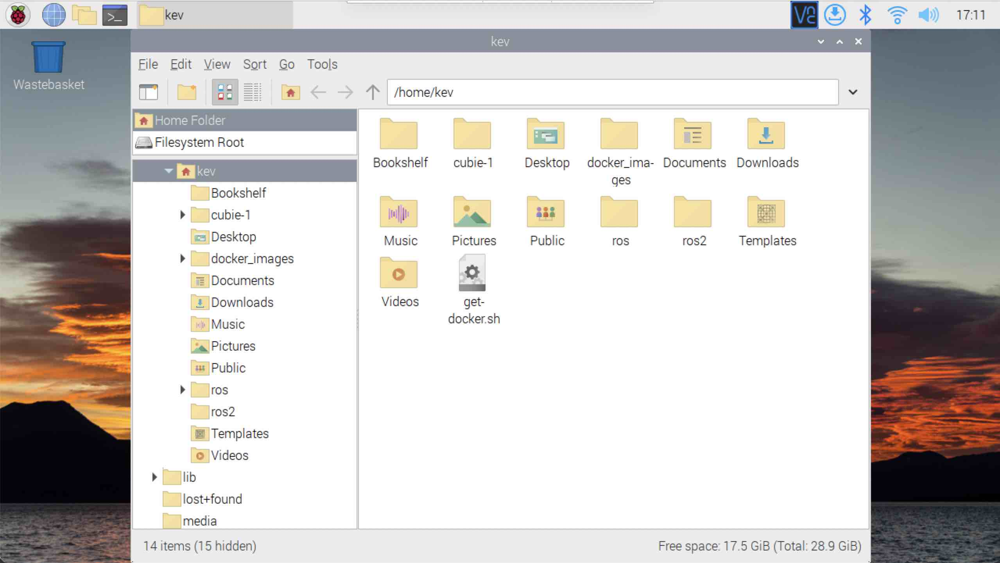

{:class="cover"}

## Get Docker

We will use Docker to manage our ROS environment. Docker enables us to run containers; each container is a separate environment and can contain its own files, and run its own processes. Containers are like lightweight Virtual Machines, without the need to emulate an entire computer.

To get the Docker installation script:

* **Get the install script** - From the terminal, type:

```bash
curl -fsSL https://get.docker.com -o get-docker.sh
chmod +x get-docker.sh 
```

---

## Remove any existing docker installation

If you want to remove any existing docker installations, do this step before installing docker.

* **Purge** - From the terminal, type:

```bash
sudo apt-get purge docker-ce docker-ce-cli containerd.io -y
```

---

## Install Docker

* **Run the script** - From the terminal, type:

```bash
./get-docker.sh
```

---

## Fix permissions

Docker can run commands from a regular user account, but first we need to add our user to the `docker` group

* **Let your user run docker commands** - From the terminal, type:

```bash
sudo usermod -aG docker $USER
```

*`$USER` is filled in automatically with the user account you created when [setting up the Pi](02_pi_setup.html#setup-the-sd-card-using-raspberry-pi-imager)*

---

* **Unmask docker**- From the terminal, type:

```bash
sudo systemctl unmask docker
```

---

> ## Docker Compose
>
> The Docker install script also installs **Docker Compose**, which we'll use to start our ROS container. It's run as `docker compose` (with a space). Older guides use `docker-compose` with a hyphen, which was a separate program you no longer need.
{:class="bg-blue"}

---

* **Start docker** - From the terminal, type:

```bash
sudo systemctl start docker
```

---

* **Reboot** - Restart the Pi to implement the changes. From the terminal, type:

```bash
sudo init 6
```

---

## Check your understanding


? Why add your user to the `docker` group?
- [ ] To make Docker run faster
- [x] So you can run `docker` commands without typing `sudo` every time
- [ ] To install Docker Compose
> The change takes effect after you log out and back in, which is why we reboot.

? How is a Docker container different from a virtual machine?
- [x] Containers share the host's operating system kernel, so they're much lighter
- [ ] Containers emulate a whole computer, including the hardware
- [ ] There is no difference

