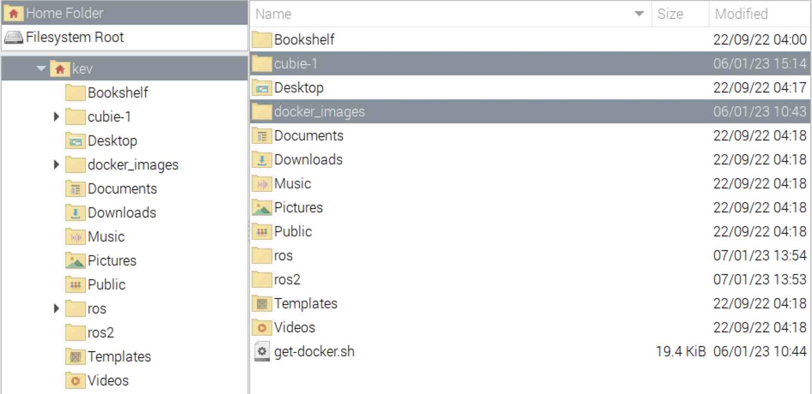
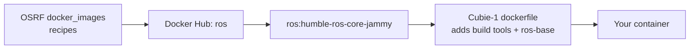

{:class="cover"}

---

By the end of this lesson you will be able to explain where the official ROS Docker images come from, and optionally download their definitions.

## Where do ROS images come from?

The Open Source Robotics Foundation (OSRF) maintains the official ROS Docker images. They're published on Docker Hub as `ros`, and the tag says which distro and how much is installed. For example `ros:humble-ros-base` is ROS 2 Humble with the core packages, and `ros:humble-ros-core` is even smaller. The Cubie-1 `dockerfile` starts `FROM ros:humble-ros-core-jammy`, where `jammy` is the Ubuntu 22.04 release name, and then adds the build tools we need.

The recipes that build those images live in a public repository. Cloning them is **optional**: Cubie-1 already has a tested `dockerfile` and `docker-compose.yml`. But it's worth looking if you ever want a different distro or a different set of packages.

## Clone the official OSRF Docker images

* **Get the official ROS docker images** - from the terminal, in your home folder, type:

```bash
cd ~
git clone https://github.com/osrf/docker_images
```

The repository includes a folder per image. Read a `Dockerfile` or two and you'll see how the pieces are put together.

## Summary

You should now have extra folders in your home folder on the Raspberry Pi:

{:class="img-fluid w-50"}

* `docker_images` - the official OSRF Docker definitions (the folder uses an underscore)
* `cubie-1` - the example files



---

## Try it Yourself

1. Run `ls ~/docker_images` to see what's inside.
2. Open the `dockerfile` in `~/cubie-1/docker` and find the `FROM` line. Which image does it start from?
3. Challenge: browse the `docker_images` folder and work out where the Humble images live.

## Common Issues

- **Problem**: `cd docker-images` says no such file or directory.
- **Solution**: The folder is `docker_images`, with an underscore.
- **Why**: Git names the folder after the repository.

- **Problem**: Which image tag should I use?
- **Solution**: For a robot, `humble-ros-base` is a good start; add `-desktop` tools only on machines with a screen.
- **Why**: The smaller the image, the less SD card space and RAM it uses.

## Check your understanding


? What does the `jammy` in `ros:humble-ros-core-jammy` stand for?
- [x] The Ubuntu 22.04 release the image is built on
- [ ] The name of the robot
- [ ] The ROS 1 version
> Ubuntu releases have code names, and Jammy is 22.04.

? Is cloning `docker_images` required to follow this course?
- [ ] Yes, the build fails without it
- [x] No, Cubie-1 already includes a tested dockerfile
> It's optional, useful if you want a different distro.

? What are the official ROS images published as on Docker Hub?
- [x] `ros`
- [ ] `ros-official`
- [ ] `cubie`

