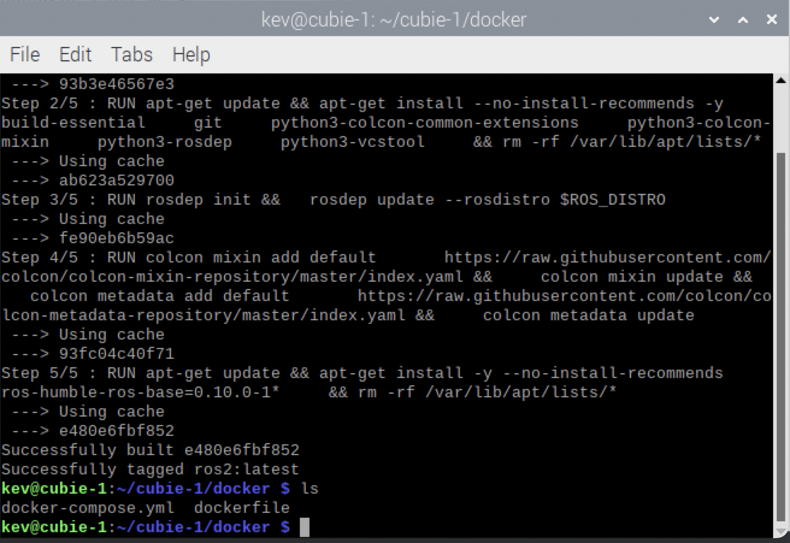

## Dockerfile & Docker-Compose.yml

To make the process of building our ROS2 container simpler I have created a `dockerfile` and accompanying `docker-compose.yml` file. These two files help us build and then run the ROS2 docker container.

> ### Docker-Compose.yml
>
> The `docker-compose.yml` file contains instructions on which docker image to use and also any parameters we want to include, such as host device (we'll want to use the lidar sensor which is found at `/dev/ttyUSB0` on the host file system), and also any volume or folder mappings.
>
> **Contents of the `docker-compose.yml`** (change `/home/kev` to your own home folder, for example `/home/pi`)
>
> ```docker
> version: "3.9"
> services:
>  ros2:
>    build: .
>    # restart: no
>    ports: 
>      - "3332:3332"
>    volumes:
>      - /home/kev/ros:/home/ros
>      - /home/kev/cubie-1:/ros2
>    devices:
>      - /dev/ttyUSB0:/dev/ttyUSB0
>    tty: true
> ```
>
> ---
>
> ### Folder mappings
>
> We can map local folders from our Raspberry Pi into our container so that any files we create inside or out of the container will show up.  Normally any changes made within the container are lost when we shut it down, however by mapping (called `binding` in Docker) the local host folder to the container we can ensure changes are retained.
>
> We will map two host folders:
>
> `/home/kev/ros` to `/home/ros` within the container
>
> `/home/kev/cubie-1` to `/ros2` within the container
>
{:class="bg-blue"}

---

## Build the container

* **Change directory** - From the terminal, type:

```bash
cd cubie-1/docker
```

* **Docker build** - From the terminal, type:

```bash
docker build -t ros2 .
```

*Where `ros2` is the name of the docker image we have created*

{:class="img-fluid w-100"}

---

## Run the container

* **Run the container** - From the terminal, type:

```bash
docker compose up -d
```

*The container will now be running. You can check using the `docker ps` command.*

> ## No LiDAR plugged in yet?
>
> The `devices` section passes the LiDAR on `/dev/ttyUSB0` into the container, and Docker won't start the container if that device doesn't exist. Comment out the two `devices` lines with a `#` until your LiDAR is connected.

---

## Check your understanding


? Why do we map (bind) folders from the Pi into the container?
- [ ] To make the container start faster
- [x] So files we create are kept when the container is stopped
- [ ] To give the container internet access
> Anything written inside a container is lost when it's removed, unless it's in a mapped folder.

? Which command starts the container in the background?
- [ ] `docker build -t ros2 .`
- [x] `docker compose up -d`
- [ ] `docker ps`
> `-d` means detached: the container keeps running after the command returns.

