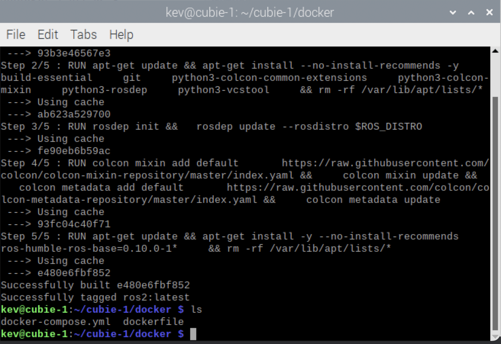

{:class="cover"}

---

By the end of this lesson you will be able to build the ROS 2 Humble image, start the container with Docker Compose, and explain what the folder mappings do.

## Dockerfile and docker-compose.yml

Two files in `~/cubie-1/docker` do the work. The **dockerfile** is the recipe for building an image: it starts from the official `ros:humble-ros-core-jammy` image, installs build tools such as `colcon` and `rosdep`, and then installs the `ros-humble-ros-base` packages. The **docker-compose.yml** says how to run that image: which folders and devices to share.

> ### docker-compose.yml
>
> **Contents of the file** (change `/home/kev` to your own home folder, for example `/home/pi`):
>
> ```yaml
> services:
>   ros2:
>     build: .
>     network_mode: "host"
>     volumes:
>       - /home/kev/ros:/home/ros
>       - /home/kev/cubie-1:/ros2
>     devices:
>       - /dev/ttyUSB0:/dev/ttyUSB0
>     tty: true
> ```
>
> The copy in the repository may also start with a `version: "3.9"` line. Current Docker Compose ignores that line and prints a warning about it; you can delete it.
{:class="bg-blue"}

Here is what each part means:

| Line | Why it's there |
|:-----|:---------------|
| `build: .` | Build the image from the `dockerfile` in this folder |
| `network_mode: "host"` | The container shares the Pi's network, so ROS 2 nodes can find each other |
| `volumes:` | Share folders between the Pi and the container |
| `devices:` | Pass the LiDAR (`/dev/ttyUSB0`) into the container |
| `tty: true` | Keep a terminal open so the container doesn't exit straight away |
{:class="table table-single"}

### Folder mappings

Anything written inside a container is lost when the container is removed. By mapping (Docker calls it *binding*) a Pi folder into the container, files you create there are kept on the Pi. We map two folders:

* `/home/kev/ros` on the Pi to `/home/ros` in the container
* `/home/kev/cubie-1` on the Pi to `/ros2` in the container

```mermaid
flowchart LR
    subgraph Pi
        A[~/cubie-1]
        B[~/ros]
    end
    subgraph Container
        C[/ros2]
        D[/home/ros]
    end
    A <--> C
    B <--> D
```

---

## Build the container

* **Change directory** - from the terminal, type:

```bash
cd ~/cubie-1/docker
```

* **Docker build** - from the terminal, type:

```bash
docker build -t ros2 .
```

*Here `ros2` is the name of the docker image we create. The first build downloads a few hundred megabytes and can take 10 minutes or more on a Pi. Subsequent builds are quick because Docker keeps what it already built.*

{:class="img-fluid w-100"}

---

## Run the container

* **Run the container** - from the terminal, type:

```bash
docker compose up -d
```

*The container is now running. Check with `docker ps`: you should see one container with `ros2` in its name.*

> ## No LiDAR plugged in yet?
>
> The `devices` section passes the LiDAR on `/dev/ttyUSB0` into the container, and Docker won't start the container if that device doesn't exist. Comment out the two `devices` lines with a `#` until your LiDAR is connected.

> **Teachers**: The first build downloads several hundred megabytes and needs a good connection, so 15 or more learners building at once on school Wi-Fi will be slow. Build once on one Pi, or pre-pull the base image before the lesson. Check each Pi has free disk space with `df -h /` first.

---

## Try it Yourself

1. Run `docker images` and find the `ros2` image. How big is it?
2. Run `docker ps` and read the columns. What is the container's name?
3. Change the host folder in `docker-compose.yml` to your own home folder, then run `docker compose up -d` again.
4. Challenge: stop it with `docker compose down`, start it with `docker compose up -d`, and check a file you made in `~/cubie-1` is still there.

## Common Issues

- **Problem**: `error gathering device information while adding custom device "/dev/ttyUSB0": no such file or directory`.
- **Solution**: Plug in the LiDAR, or comment out the two `devices` lines.
- **Why**: Docker can't pass through a device that isn't there.

- **Problem**: The build stops with "no space left on device".
- **Solution**: Free up space with `docker image prune`, or use a larger SD card.
- **Why**: ROS images are large, and old images stay on disk.

- **Problem**: A warning says the `version` attribute is obsolete.
- **Solution**: Delete the `version:` line, or ignore the warning.
- **Why**: Current Compose works out the file format itself.

## Check your understanding


? Why do we map (bind) folders from the Pi into the container?
- [ ] To make the container start faster
- [x] So files we create are kept when the container is stopped
- [ ] To give the container internet access
> Anything written inside a container is lost when it's removed, unless it's in a mapped folder.

? Which command starts the container in the background?
- [ ] `docker build -t ros2 .`
- [x] `docker compose up -d`
- [ ] `docker ps`
> `-d` means detached: the container keeps running after the command returns.

? What does `network_mode: "host"` do?
- [x] The container shares the Pi's network
- [ ] It turns off networking
- [ ] It gives the container a separate IP address
> ROS 2 nodes discover each other over the network, so sharing the Pi's network helps.

