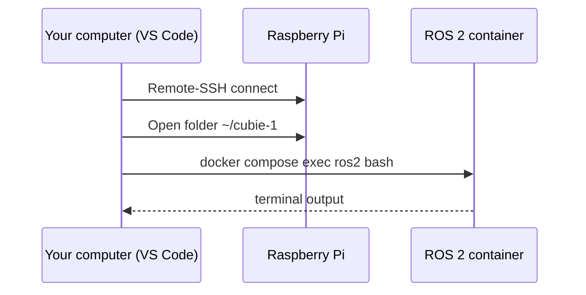
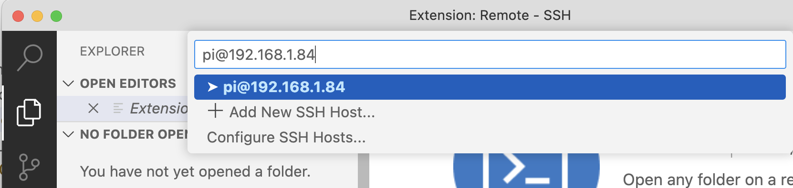
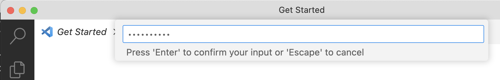
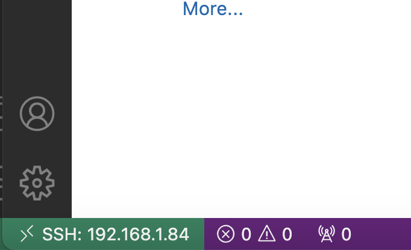
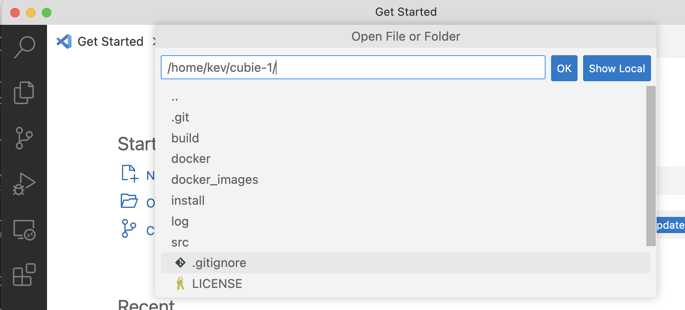
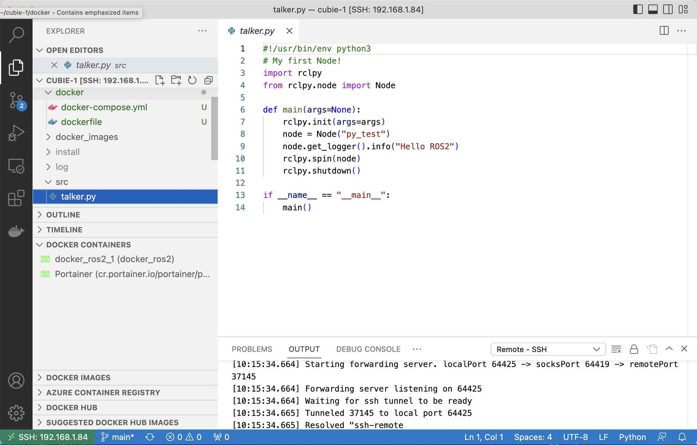
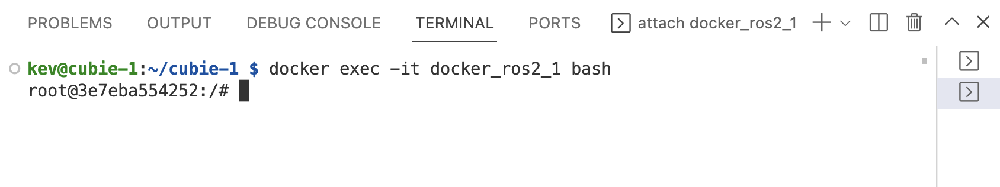

{:class="cover"}

---

By the end of this lesson you will be able to connect VS Code on your computer to the Pi over SSH, and open a terminal inside the running ROS 2 container.

## VSCode Remote connection

A Raspberry Pi is a fine computer, but it's nicer to write code on your main machine with its big screen and keyboard. VS Code can connect to the Pi over SSH. You edit files on the Pi as if they were local, and the VS Code terminal runs commands on the Pi.



## Install Extensions

Install these on your main computer (not the Pi):

* **Click on the Extensions icon** - this lists installed and installable extensions
* **Search for `docker`** and click Install on the `Docker` extension, published by Microsoft
* **Search for `remote`** and click Install on the `Remote - SSH` extension, also by Microsoft
* **Install `Remote Explorer`** too, which lists your remote machines

---

## Remote connect

* **Open the Command Palette** - press `CTRL + SHIFT + P` (`CMD + SHIFT + P` on a Mac)
* **Connect to Host** - type `connect`, and choose `Remote-SSH: Connect to Host...`
* **Enter the address** - type `pi@192.168.1.4`, where `pi` is the username you chose [earlier](02_pi_setup.html) and the IP address is your Pi's

{:class="img-fluid w-100 shadow-lg"}

> *To find your Pi's IP address, type `ip a` in a terminal on the Pi; it lists all the addresses the Pi is using.*

* **Type your Pi's password** - the one you created in the Imager

{:class="img-fluid w-100 shadow-lg"}

* **You are now connected** - notice the connection status at the bottom left of VS Code

{:class="img-fluid w-100 shadow-lg"}

* **Click `Open Folder`** - select `cubie-1`

{:class="img-fluid w-100 shadow-lg"}

*You can now browse the files we [downloaded earlier](05_get_cubie.html).*

{:class="img-fluid w-100 shadow-lg"}

---

## Connect to the container

Now connect to the container we started in [lesson 7](07_build_container.html).

* **Open a terminal** - with `CTRL + SHIFT +` backtick
* **Connect to the running container** - type:

```bash
cd ~/cubie-1/docker
docker compose exec ros2 bash
```

*`ros2` is the name of the service in our `docker-compose.yml`, so this works whatever Docker has named the container. You can also use `docker exec -it <container name> bash`, using the name shown by `docker ps`.*

{:class="img-fluid w-100 shadow-lg"}

Your prompt changes to something like `root@raspberrypi:/#`. You're now inside the container, where ROS 2 is installed. Type `exit` to leave it.

> Congratulations, you've set up ROS 2 in a container on the Raspberry Pi and connected to it from another computer running VS Code.
{:class="bg-blue"}

---

## Try it Yourself

1. Open a second terminal in VS Code (the `+` button) and connect it to the container too. You'll need two for later.
2. In the container, run `ls /ros2`. Compare it with `ls ~/cubie-1` on the Pi. What do you notice?
3. Challenge: create a file in `/ros2` in the container, then find it in the VS Code Explorer.

## Common Issues

- **Problem**: VS Code can't connect: "Could not establish connection".
- **Solution**: Check the IP address with `ip a` on the Pi, that the Pi and your computer are on the same network, and that SSH is enabled.
- **Why**: The address changes if your router gives the Pi a new one.

- **Problem**: `service "ros2" is not running`.
- **Solution**: Run `docker compose up -d` in `~/cubie-1/docker` first.
- **Why**: `exec` only works on a container that is running.

## Check your understanding


? Which VS Code extension lets us edit files on the Pi from another computer?
- [ ] Docker
- [x] Remote - SSH
- [ ] Remote Explorer
> Remote - SSH makes the connection; Remote Explorer lists the machines.

? How do we open a shell in the running ROS 2 container?
- [x] `docker compose exec ros2 bash`
- [ ] `docker build -t ros2 .`
- [ ] `ssh ros2`
> `exec` runs a command inside a running container; `bash` gives us a shell.

? Where do we find the Pi's IP address?
- [ ] In the Docker logs
- [x] By typing `ip a` in a terminal on the Pi
- [ ] In `docker-compose.yml`

