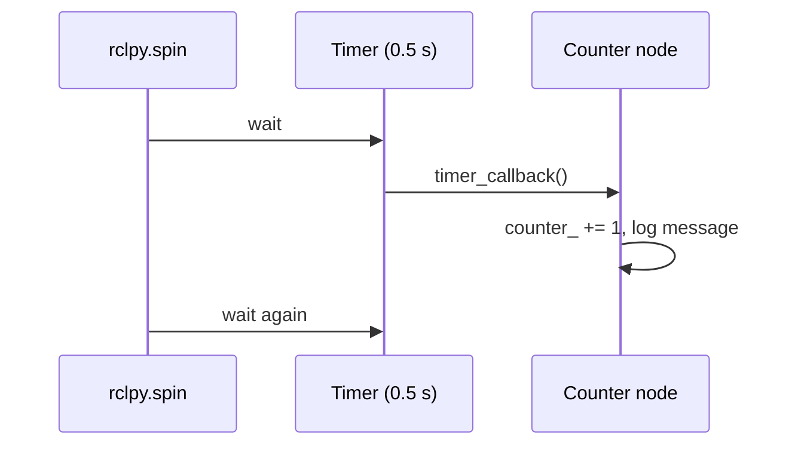

{:class="cover"}

---

By the end of this lesson you will be able to write a ROS 2 node as a Python class and use a timer to run code at a steady rate.

## Why a class?

Our first node was a short script. Real nodes need to remember things (a counter, the last sensor reading) and react to events (a timer firing, a message arriving). A class is a natural fit: the node's memory lives in `self`, and each event is a method. Almost every ROS 2 Python node you'll meet is written this way.

## A counting node

Save this as `counter.py` in the `src` folder of your `first_app` workspace, next to `talker.py`.

```python
import rclpy
from rclpy.node import Node


class Counter(Node):

    def __init__(self):
        super().__init__("counter_node")
        self.counter_ = 0
        self.get_logger().info("Hello World")
        self.create_timer(0.5, self.timer_callback)

    def timer_callback(self):
        self.counter_ += 1
        self.get_logger().info("Hello " + str(self.counter_))


def main(args=None):
    rclpy.init(args=args)
    node = Counter()
    rclpy.spin(node)
    rclpy.shutdown()


if __name__ == "__main__":
    main()
```

Run it from the container with `python3 src/counter.py`. You'll see `Hello World` once, then `Hello 1`, `Hello 2`, `Hello 3`... twice a second until you press `CTRL + C`.



---

## What the code means

* `class Counter(Node)` makes our own node by building on (inheriting from) ROS's `Node` class.
* `super().__init__("counter_node")` runs the parent's setup and gives the node its name.
* `self.counter_ = 0` is the node's memory: a number that survives between calls.
* `self.create_timer(0.5, self.timer_callback)` asks ROS to call `timer_callback` every 0.5 seconds. We hand over the method without brackets; ROS calls it for us.
* `rclpy.spin(node)` is what lets the timer fire. Without it the program would start, set things up and exit.

**Why this matters:** a robot's control loop is just a timer calling a method at a steady rate: read sensors, decide, drive the motors. This is the pattern you'll reuse for every node.

---

## Try it Yourself

1. Change the timer from `0.5` to `2.0`. How does the output change?
2. Make the node log "Beep" for odd numbers and "Boop" for even ones (hint: `self.counter_ % 2`).
3. Create a second timer that logs a message every 3 seconds, alongside the first.
4. Challenge: make the node stop itself after 10 counts by calling `rclpy.shutdown()` in the callback. What happens?

## Common Issues

- **Problem**: Nothing is printed after the program starts.
- **Solution**: Check you pass `self.timer_callback` (no brackets) and call `rclpy.spin(node)`.
- **Why**: Timers only run while the node is spinning, and adding brackets calls the method once instead of scheduling it.

- **Problem**: `AttributeError` mentioning `counter_`.
- **Solution**: Make sure `self.counter_ = 0` is set in `__init__`, and that you wrote `self.` each time you use it.
- **Why**: Without `self.`, Python treats it as a different, temporary variable.

## Check your understanding


? What is a ROS **node**?
- [x] A single program in a ROS system, usually doing one job
- [ ] A cable connecting two robots
- [ ] A type of sensor
> A robot is made of many nodes working together, for example one per sensor or motor.

? What does `self.create_timer(0.5, self.timer_callback)` do?
- [x] Calls `timer_callback` every 0.5 seconds while the node is spinning
- [ ] Calls it once, after 0.5 seconds
- [ ] Waits 0.5 seconds before the node starts
> The callback repeats until the node is stopped.

? Where does the node keep a value such as the counter between callbacks?
- [ ] In a global variable only
- [x] In an attribute on `self`
- [ ] In the `log` folder

