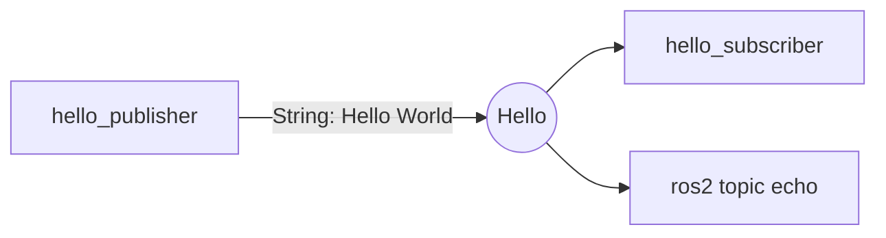

{:class="cover"}

---

By the end of this lesson you will be able to write a subscriber node, and run a publisher and subscriber together in two terminals.

## Create a new Python file called sub.py

* **Create the file** - from the container terminal, inside the `/ros2/my_py_pkg` folder, type:

```bash
touch my_py_pkg/sub.py
chmod -R 777 my_py_pkg
```

## Edit sub.py

Cut and paste the following code into the new file:

```python
import rclpy
from rclpy.node import Node
from std_msgs.msg import String


class Listener(Node):

    def __init__(self):
        super().__init__("hello_subscriber")
        # create_subscription needs 4 parameters: message type, topic name, the callback, and queue size
        self.subscriber = self.create_subscription(String, "Hello", self.callback_hello, 10)
        self.get_logger().info("Subscribed to Hello topic")

    def callback_hello(self, message):
        self.get_logger().info(message.data)


def main(args=None):
    rclpy.init(args=args)
    node = Listener()
    rclpy.spin(node)
    rclpy.shutdown()


if __name__ == "__main__":
    main()
```

A subscription has four parts: the **message type** (`String`), the **topic** (`"Hello"`, which must match the publisher exactly), a **callback** (`self.callback_hello`, called each time a message arrives, with the message as its argument) and the **queue size** (`10`). Unlike a timer, nothing in our code decides when the callback runs: it fires whenever the publisher sends something.

---

## Add the entry_point to setup.py

Add the listener to the list in `setup.py`:

```python
    entry_points={
        'console_scripts': [
            "pub = my_py_pkg.pub:main",
            "counter = my_py_pkg.counter:main",
            "listener = my_py_pkg.sub:main",
        ],
    },
```

Notice the name you type after `ros2 run` (`listener`) doesn't have to match the file name (`sub.py`).

---

## Build the package

```bash
cd /ros2/my_py_pkg
colcon build
source install/setup.bash
```

*Any time you change Python code or `setup.py`, build again. (`colcon build --symlink-install` makes edits to existing Python files take effect without a rebuild, but new entry points still need a build.)*

---

## Run the publisher and subscriber together

You need two terminals connected to the container. In VS Code, open a second terminal and run `docker compose exec ros2 bash`, then `source /opt/ros/humble/setup.bash` and `cd /ros2/my_py_pkg && source install/setup.bash`.

* **Terminal 1** - start the publisher:

```bash
ros2 run my_py_pkg pub
```

* **Terminal 2** - start the subscriber:

```bash
ros2 run my_py_pkg listener
```

The listener prints `Hello World` twice a second. Two separate programs are now talking to each other through the `Hello` topic!



> ## Topics, publishers and subscribers
>
> A **topic** is a named channel for messages. A **publisher** sends messages to a topic and a **subscriber** receives them. Neither needs to know the other exists, so you can add, remove or swap nodes without changing the rest of the robot. You can even have several subscribers on one topic, like `ros2 topic echo` above.
{:class="bg-blue"}

---

## Try it Yourself

1. Stop the publisher with `CTRL + C`. What does the listener do?
2. Start `ros2 topic echo Hello` in a third terminal. Do both receivers get every message?
3. Change the subscriber so it logs `I heard: ` before the message.
4. Challenge: make the listener count messages and log `Heard 10 messages` every ten.

## Common Issues

- **Problem**: The listener starts but prints nothing.
- **Solution**: Check the publisher is running, the topic names match exactly, and both terminals have sourced the setup files.
- **Why**: Nodes only find each other if they use the same topic name and message type.

- **Problem**: `Package 'my_py_pkg' not found` in the second terminal.
- **Solution**: Run `source install/setup.bash` from `/ros2/my_py_pkg` in that terminal.
- **Why**: Each terminal needs its own `source`.

- **Problem**: Your change doesn't appear when you run again.
- **Solution**: Run `colcon build` again and re-source.
- **Why**: `ros2 run` runs the installed copy, not the file you edited.

## Check your understanding


? What is a ROS **topic**?
- [ ] A Python file
- [x] A named channel that nodes publish messages to and subscribe to
- [ ] A type of package
> In our example the topic is called `Hello` and carries `String` messages.

? Which command shows the messages on a topic from the command line?
- [x] `ros2 topic echo Hello`
- [ ] `ros2 pkg create Hello`
- [ ] `colcon build Hello`

? You added a new entry point to `setup.py`. What must you do before `ros2 run` can find it?
- [ ] Restart the Raspberry Pi
- [x] Run `colcon build` and `source install/setup.bash` again
- [ ] Nothing

? When does `callback_hello` run?
- [ ] Every 0.5 seconds
- [x] Each time a message arrives on the topic
- [ ] Once, when the node starts
> A subscription callback is driven by incoming messages, not by a timer.

