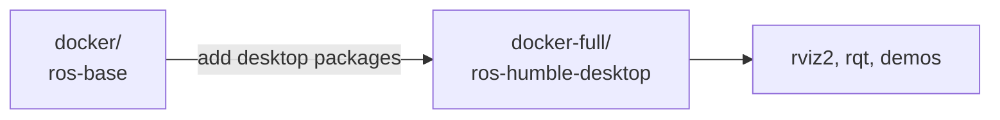

{:class="cover"}

---

By the end of this lesson you will be able to build the full ROS 2 container and open RViz2 on the Raspberry Pi desktop.

## Watch the video



---

## What is RViz2?

[`RViz2`](/resources/glossary#rviz2) is a 3D visualisation tool for ROS 2. It can draw robots, cameras, geometry, point clouds and more, in a single window. It's free, open source and part of the ROS desktop install.

Debugging a robot from text alone is hard. Is that distance 0.4 metres or 4? Is the obstacle to the left or right? RViz2 turns the numbers on your topics into something you can see, so you can spot problems in seconds.

We'll use it to display data from our LiDAR, and later you can add mapping and navigation nodes from the [SLAM](/resources/glossary#SLAM) toolkit.

---

## The full container

RViz2 is included in the full desktop version of ROS 2; so far we've only used the `core` version. The example files include a second Docker setup, `docker-full`, whose `dockerfile` also installs the `ros-humble-desktop` packages, and whose `docker-compose.yml` includes the `DISPLAY` and `network_mode: host` settings from the last lesson.



## Build the full container

First stop the earlier container, so the two don't compete for memory:

```bash
cd ~/cubie-1/docker
docker compose down
```

Now build and start the full one:

* **Build and start the container** - from the Raspberry Pi terminal, type:

```bash
cd ~/cubie-1/docker-full
docker compose build
docker compose up -d
```

This is a bigger download, so expect a long wait.

> If the build stops with an error about `ros-humble-desktop=0.10.0-1*` not being found, edit the `dockerfile`, remove `=0.10.0-1*` from that line so the latest version is installed, and build again.

> **Teachers**: The desktop image is large (well over a gigabyte), RViz2 needs a working 3D desktop on the Pi, and 8GB of memory is much happier than 4GB. Build it once and move the image between Pis if the network is slow, or demonstrate RViz2 on one machine for the class.

---

## Console into the container

Let's test out `RViz2`.

* **Open a shell in the container** - from the Raspberry Pi terminal, type:

```bash
docker compose exec ros2 bash
```

## Launch Rviz2

* **Launch RViz2** - from the container terminal, type:

```bash
source /opt/ros/humble/setup.bash
rviz2
```

RViz2 should open on the Raspberry Pi desktop. It's the container drawing its window through the Pi's X server. You'll see a grey 3D grid in the middle, a Displays panel on the left, and a Views panel on the right. It starts empty because nothing is publishing data yet.

---

## Try it Yourself

1. Run `ros2 pkg list | grep rviz` in the container. How many RViz packages do you find?
2. Close RViz2, then reopen it. Does it remember anything?
3. Use the mouse wheel and the left and middle buttons to move the 3D camera.
4. Challenge: in a second container terminal, run `ros2 topic list`. Why are only `/parameter_events` and `/rosout` listed, and what will change when the LiDAR node runs?

## Common Issues

- **Problem**: `rviz2: command not found`.
- **Solution**: Check you're in the `docker-full` container (not the earlier one) and sourced `/opt/ros/humble/setup.bash`.
- **Why**: The core image doesn't include the desktop tools.

- **Problem**: The window doesn't appear, or "could not connect to display".
- **Solution**: Go back through the X11 lesson: `xhost +local:root`, `echo $DISPLAY`, and recreate the container.
- **Why**: The container needs permission and a screen to draw on.

- **Problem**: RViz2 opens but is slow or crashes.
- **Solution**: Close other programs, use a Pi with 8GB, or turn off extra displays.
- **Why**: Drawing 3D in software is demanding on a small computer.

## Check your understanding


? Why do we use `docker-full` for RViz2?
- [x] It also installs the `ros-humble-desktop` packages, which include RViz2
- [ ] It's a different version of ROS
- [ ] It connects the LiDAR
> The `core` container doesn't have the desktop tools.

? Why does RViz2 appear on the Pi's screen even though it runs in a container?
- [ ] Docker has a built-in screen
- [x] It sends its graphics to the Pi's X server via `DISPLAY`
- [ ] It runs on the Pi itself
> That's the X11 forwarding we set up in the previous lesson.

? What is RViz2 mainly used for?
- [ ] Building packages
- [x] Visualising ROS data such as laser scans in 3D
- [ ] Writing Python

