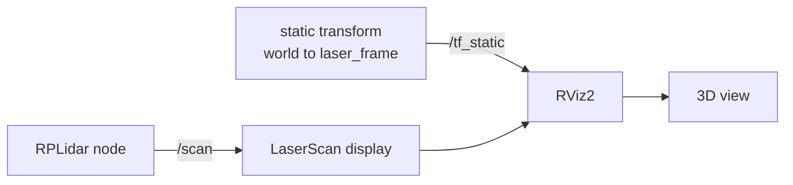

{:class="cover"}

---

By the end of this lesson you will be able to name the main RViz2 panels, build and start the RPLidar driver, and confirm the `/scan` topic exists.

## RViz2 Screen Layout

RViz2 has three main areas by default, and you can add more panels to suit your needs, so it's very flexible:

1. The **Displays** panel, on the left. This is the list of things RViz2 is drawing, plus the global options.
1. The **3D view** in the middle, where everything is drawn.
1. The **Views** panel, on the right, which controls the camera.

A **display** is one thing to draw, such as a laser scan, a map or a robot model. Each display subscribes to a topic and draws what arrives.



> ## RPLidar Laser scanner
>
> The Slamtec RPLidar A1 is an affordable 2D laser scanner, popular with hobby robots. It spins and measures the distance to the nearest object in every direction, a few times a second. We use it in this tutorial.
> {:class="img-fluid w-100 shadow-lg"}
{:class="bg-blue"}

> **Teachers**: The LiDAR is the one piece of kit that costs real money, so plan for a shared one per group. Its laser is a low-power infrared diode in a spinning head: keep fingers and hair clear of the moving part, and don't hold it near the face. Without a LiDAR you can still do lessons 14 and 15 and read the rest.

---

## Adding our LiDAR Laser Scan

To view our LiDAR data in RViz2 we need to:

* Download and compile the RPLidar ROS 2 driver
* Start the RPLidar node
* Start a transformation node (next lesson) that places the `laser_frame` in the `world`
* Add the LaserScan display in RViz2

## Download and compile the RPLidar code

* **Download the driver** - from the Raspberry Pi terminal, type:

```bash
cd ~/cubie-1
git clone https://github.com/babakhani/rplidar_ros2
```

> Slamtec now maintain their own ROS 2 driver, [sllidar_ros2](https://github.com/Slamtec/sllidar_ros2), which also supports their newer LiDARs. Its launch files are the better choice for a new project. This course uses the `rplidar_ros2` driver shown in the videos.

The `rplidar_ros2` folder needs to be inside the `cubie-1` folder, which appears as `/ros2` inside the container.

* **Compile the driver** - from the container, type:

```bash
source /opt/ros/humble/setup.bash
cd /ros2/rplidar_ros2
colcon build
source install/setup.bash
```

---

## Start the RPLidar node

* **Open a new container terminal** - from the Raspberry Pi terminal, type:

```bash
cd ~/cubie-1/docker-full
docker compose exec ros2 bash
```

* **Start the laser scanner** - from the container, type:

```bash
source /opt/ros/humble/setup.bash
cd /ros2/rplidar_ros2
source install/setup.bash
ros2 run rplidar_ros rplidar_composition
```

The RPLidar will briefly stop and restart, and the terminal shows that the LiDAR is up and running. The motor you can hear spinning is the scanner head.

---

## Check the scan data topic exists

Open another container terminal as above, source both setup files and run:

```bash
ros2 topic list
```

There should be three topics listed:

```text
/parameter_events
/rosout
/scan
```

If `/scan` is there, the LiDAR is sending data to ROS. You can peek at one message with `ros2 topic echo --once /scan`, and the `frame_id` near the top tells you which coordinate frame the scan is measured in. We need that in the next lesson.

---

## Start RViz2

In a container terminal, type:

```bash
source /opt/ros/humble/setup.bash
rviz2
```

We'll configure RViz2 in a moment.

---

## Try it Yourself

1. With the LiDAR node running, run `ros2 topic info /scan`. What message type does it say?
2. Run `ros2 topic hz /scan` to see how many scans per second the LiDAR sends.
3. Run `ros2 node list` and find the LiDAR node's name.
4. Challenge: stop the LiDAR node and run `ros2 topic list` again. What changed?

## Common Issues

- **Problem**: The LiDAR node can't open `/dev/ttyUSB0`.
- **Solution**: Check the LiDAR is plugged in, check `ls /dev/ttyUSB*` on the Pi, and make sure the `devices:` line was in `docker-compose.yml` when the container was created.
- **Why**: Docker only passes through devices listed in the compose file, and only when the container is created.

- **Problem**: `Package 'rplidar_ros' not found`.
- **Solution**: Source `/ros2/rplidar_ros2/install/setup.bash` in that terminal.
- **Why**: The driver is built in its own workspace, and each terminal must be told about it.

- **Problem**: `/scan` isn't in the topic list.
- **Solution**: Make sure the LiDAR node is still running and that you sourced ROS in this terminal.
- **Why**: Topics only exist while a node is publishing them.

## Check your understanding


? What is a **display** in RViz2?
- [x] One thing to draw, usually subscribed to a topic
- [ ] A monitor
- [ ] A Docker container
> For example, a LaserScan display draws the data from `/scan`.

? How do we know the LiDAR is sending data to ROS?
- [ ] The Pi restarts
- [x] `/scan` appears in `ros2 topic list`
- [ ] RViz2 closes
> The LiDAR node publishes to `/scan` while it's running.

? Where does `~/cubie-1/rplidar_ros2` appear inside the container?
- [x] `/ros2/rplidar_ros2`
- [ ] `/home/ros/rplidar_ros2`
- [ ] `/opt/ros/rplidar_ros2`
> The `cubie-1` folder is mapped to `/ros2` in the container.

