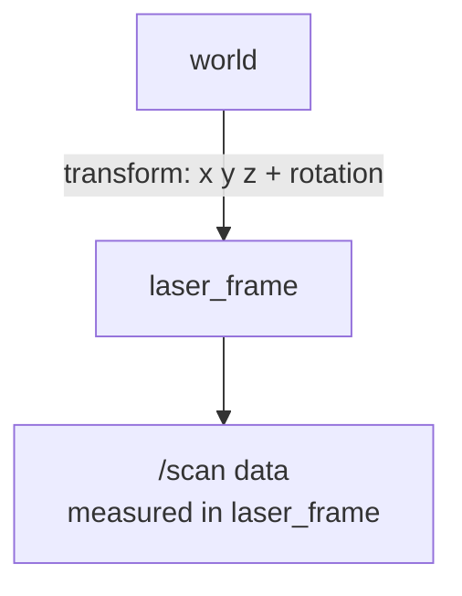

{:class="cover"}

---

By the end of this lesson you will be able to explain what a coordinate frame is and publish a static transform with `tf2_ros` so RViz2 can place the laser scan in the world.

## TF2

`tf2` is the ROS 2 transform library. It keeps track of many coordinate frames over time, arranged in a tree. You can ask it to convert a point or a vector from any frame to any other.

## Why we need transforms

Every sensor measures in its own **frame**. A LiDAR reports "something is 1.5 metres away at 30 degrees", measured from the LiDAR's own centre. But a robot is made of many parts, and it moves around a room. To draw the scan in the right place, ROS must know where the LiDAR sits on the robot, and where the robot sits in the world.

* **Local** coordinates start at the object's own origin.
* **World** coordinates have a different, fixed origin.
* A **transform** says how to convert between two frames: how far to move and how much to rotate.



Think of it like telling a friend where something is. "Two steps in front of me" is local. "By the kitchen door" is world. Transforms are how you convert between them.

---

## laser_frame to world

The scan messages say they were measured in a frame called `laser_frame` (check the `frame_id` in the last lesson). RViz2 draws everything relative to a *fixed frame*, which we'll set to `world`. If nothing connects `world` and `laser_frame`, RViz2 can't draw the scan.

For now our LiDAR sits exactly at the origin of our world, so we publish a **static transform** of zero offset and zero rotation. *Static* means it never changes, which suits a sensor bolted onto a chassis.

* **Publish the transform** - from the container, type:

```bash
source /opt/ros/humble/setup.bash
ros2 run tf2_ros static_transform_publisher --frame-id world --child-frame-id laser_frame
```

The `--frame-id` is the *parent* (world) and `--child-frame-id` is the frame that hangs off it (laser_frame). Offsets default to zero, which means the laser sits at the centre of the world, facing forwards. To place it elsewhere, add `--x`, `--y`, `--z` (metres) and `--roll`, `--pitch`, `--yaw` (radians), for example `--x 0.1 --z 0.05`.

> Older guides use the positional form `static_transform_publisher 0 0 0 0 0 0 world laser_frame`. ROS 2 Humble still accepts it but prints a warning that the "old-style arguments are deprecated", so we use the named form.
{:class="bg-blue"}

Leave this running, and in another container terminal check it:

```bash
ros2 run tf2_ros tf2_echo world laser_frame
```

You should see a translation of `[0.000, 0.000, 0.000]` and a rotation, confirming `tf2` can look up the link.

---

## Try it Yourself

1. Stop the transform and run it again with `--x 0.5`. The laser appears half a metre from the world origin.
2. Run `ros2 topic list` and find `/tf_static`. What publishes to it?
3. Add `--yaw 1.57` and think about how it rotates the scan (1.57 radians is about 90 degrees).
4. Challenge: draw your robot as a tree of frames, with `world`, a `base_link` and `laser_frame`.

## Common Issues

- **Problem**: RViz2 says `Frame [laser_frame] does not exist`, or the scan is missing.
- **Solution**: Make sure the transform publisher is running, and that the frame names match the scan's `frame_id` exactly.
- **Why**: A transform only links the frames you name, and names are case sensitive.

- **Problem**: A warning about "old-style arguments".
- **Solution**: Use the named arguments `--frame-id` and `--child-frame-id`.
- **Why**: The positional form is deprecated.

- **Problem**: `tf2_echo` says the frame does not exist.
- **Solution**: Start the static transform publisher first, then run `tf2_echo`.
- **Why**: The frames only exist while something publishes them.

## Check your understanding


? What does a static transform describe?
- [x] A fixed offset and rotation between two coordinate frames
- [ ] A moving robot's speed
- [ ] The LiDAR's baud rate
> Static means it never changes, such as a sensor bolted to a chassis.

? In `--frame-id world --child-frame-id laser_frame`, which is the parent?
- [x] `world`
- [ ] `laser_frame`
- [ ] Neither
> `--frame-id` names the parent, and `--child-frame-id` the child.

? Why does RViz2 need the transform?
- [ ] To speed up the LiDAR
- [x] To know where the laser frame sits in the fixed frame it is drawing
- [ ] To connect to Docker

