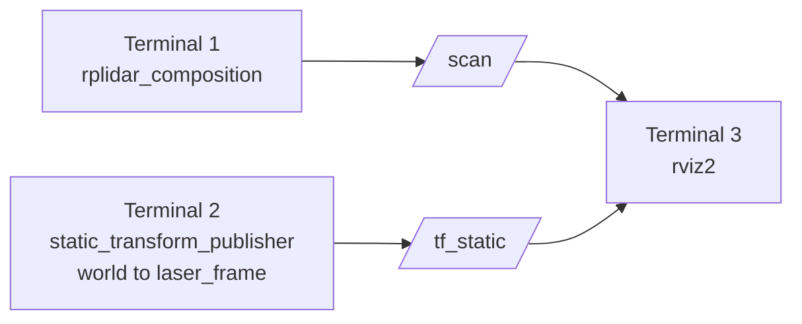

{:class="cover"}

---

By the end of this lesson you will be able to add a LaserScan display to RViz2, point it at `/scan`, and set the fixed frame so the live LiDAR data appears.

## What should be running

It's time to bring it all together. You need these running in separate container terminals:

Check them with `ros2 topic list`: you should see `/scan` and `/tf_static`.

## Visualise Laserscan

* **Add a display** - in RViz2, click the `Add` button at the bottom of the Displays panel
* **Choose LaserScan** - scroll the list of display types (it's under `By display type`), select `LaserScan` and click `OK`. A new `LaserScan` entry appears in the Displays panel, with a warning about the topic being empty

* **Open its settings** - click the disclosure triangle next to `LaserScan`
* **Set the topic** - set `Topic` to `/scan`. You can pick it from the drop-down list
* **Set the fixed frame** - at the top of the Displays panel, under `Global Options`, change `Fixed Frame` from `map` to `world`. It must be a frame that exists, which is why we published the transform

You should now see your LiDAR data in the middle panel: a ring of dots tracing the walls and objects around the scanner. Move something near the LiDAR, such as your hand, and watch the dots move.

If the dots are tiny, increase `Size (m)` in the LaserScan settings (a value like `0.05` is easier to see), or change `Style` to `Spheres`.

If the scan doesn't appear, this video covers a bug I hit at this point and how I fixed it:



Another common cause is that a LiDAR driver publishes its scans with a "best effort" quality of service, while an RViz2 display may ask for "reliable" delivery, so nothing is delivered. Open the `Topic` section of the LaserScan display and set `Reliability Policy` to `Best Effort`. I haven't been able to test that without a LiDAR attached, so treat it as something to try.

---

## Try it Yourself

1. Change the `Style` of the display to `Points`, then `Spheres`, then `Flat Squares`. Which is easiest to see?
2. Colour the points with `Color Transformer` set to `AxisColor` or `Intensity`. What changes?
3. Put a box in front of the LiDAR, then move it away. Watch the dots follow.
4. Challenge: change `world` to `laser_frame` as the Fixed Frame. Does the scan still appear? Why?

## Common Issues

- **Problem**: A status warning that the fixed frame `map` does not exist.
- **Solution**: Change `Fixed Frame` to `world`.
- **Why**: RViz2 starts with `map`, which nothing in our system publishes.

- **Problem**: LaserScan says "Transform [sender=...] For frame [laser_frame]: Frame [laser_frame] does not exist".
- **Solution**: Start the `static_transform_publisher` from the last lesson.
- **Why**: Without a transform, RViz2 can't place the scan in the fixed frame.

- **Problem**: The scan flickers, or doesn't show.
- **Solution**: Check `ros2 topic hz /scan` shows scans arriving, and try the `Best Effort` reliability setting.
- **Why**: Mismatched quality of service settings between publisher and subscriber can silently block messages.

## Check your understanding


? Why do we need a transform from `world` to `laser_frame`?
- [x] RViz2 needs to know where the laser's coordinates sit in the world it's drawing
- [ ] To make the LiDAR spin faster
- [ ] To convert the data to centimetres
> The scan is measured relative to the LiDAR (local coordinates). TF2 tells RViz2 how that relates to the fixed `world` frame.

? Which topic does the RPLidar node publish its scans to?
- [ ] `/rosout`
- [x] `/scan`
- [ ] `/Hello`

? Why does RViz2 need X11 forwarding when it runs in Docker?
- [ ] It doesn't; RViz2 has no window
- [x] So its window can be drawn on the Raspberry Pi's desktop, outside the container
- [ ] To connect to the LiDAR

