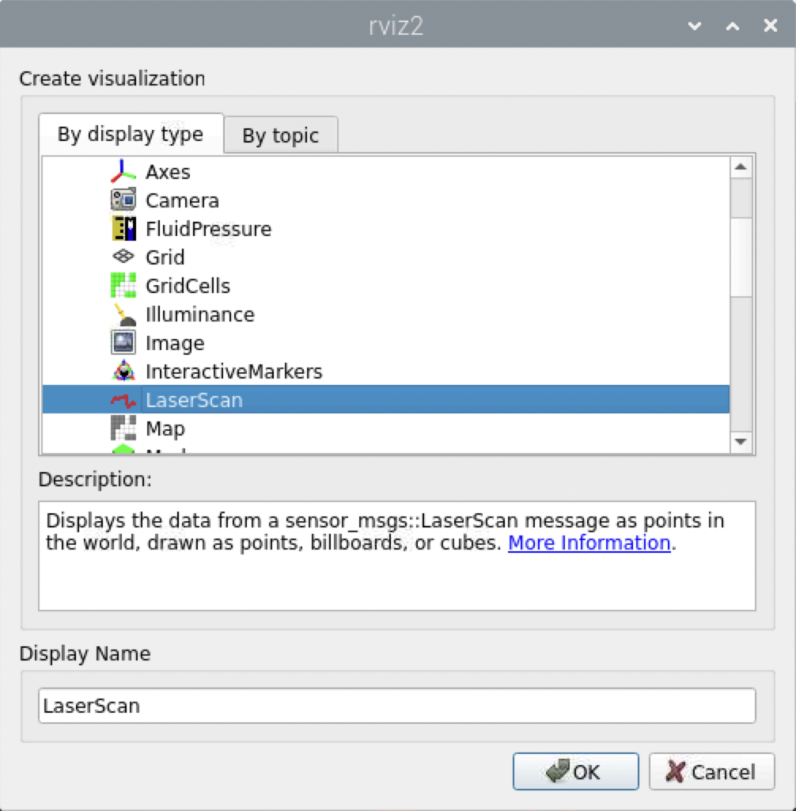
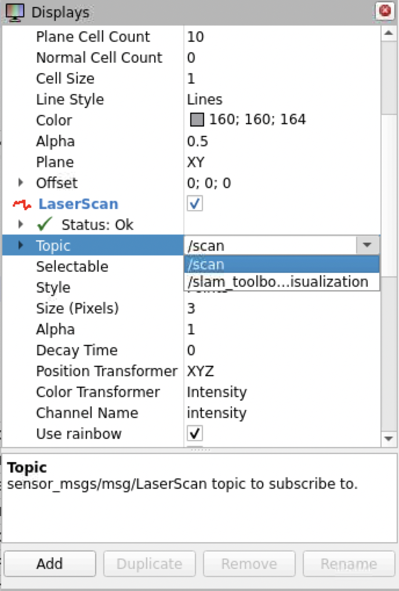
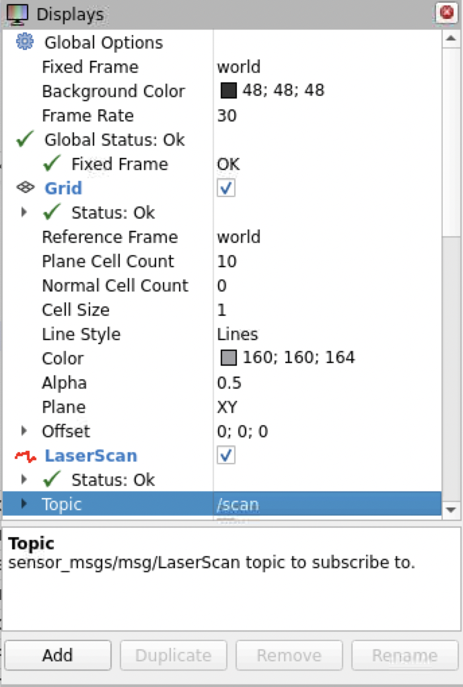
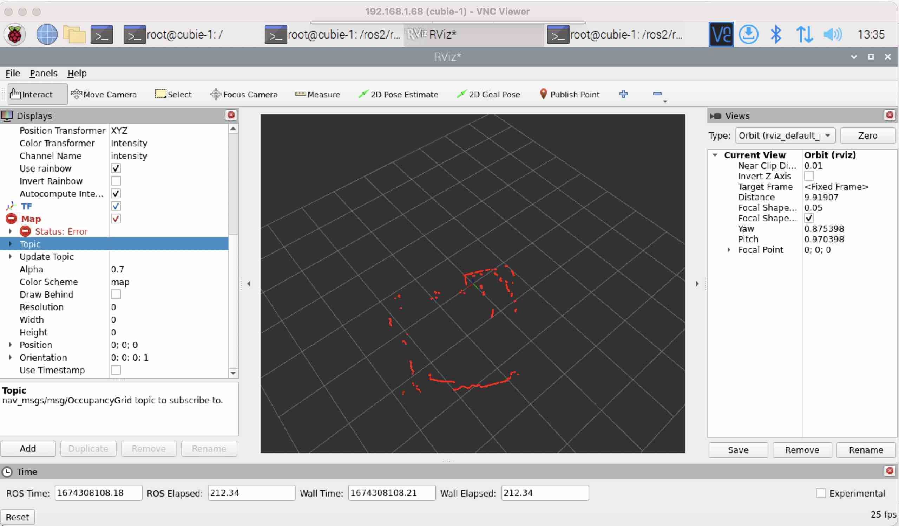

## Visualise Laserscan

It's finally time to visualise the laser scan data.

* **Add Laser_scan topic display** - In rviz2, click the `add` button

* **Select Laser_scan** - Scroll down the list of displays types and select the `laser scan` and click `ok`

{:class="img-fluid w-50 shadow-lg"}

---

* **Set the settings** - Click the disclosure triangle next to `LaserScan` to open it up

{:class="img-fluid w-50 shadow-lg"}

* **Change topic to scan** - Change the topic to `/scan`

---

* **Change the Fixed Frame to world** - Under `Global Options`, change the `Fixed Frame` to `world`

{:class="img-fluid w-50 shadow-lg"}

---

🥳 you should now be able to see the Lidar Data in the middle panel

{:class="img-fluid w-100 shadow-lg"}

---

If the scan doesn't appear, this video covers a bug I hit at this point and how I fixed it:



---

## Check your understanding


? Why do we need a transform from `laser_frame` to `world`?
- [x] RViz2 needs to know where the laser's coordinates sit in the world it's drawing
- [ ] To make the LiDAR spin faster
- [ ] To convert the data to centimetres
> The scan is measured relative to the LiDAR (local coordinates). TF2 tells RViz2 how that relates to the fixed `world` frame.

? Which topic does the RPLidar node publish its scans to?
- [ ] `/rosout`
- [x] `/scan`
- [ ] `/Hello`

? Why does RViz2 need X11 forwarding when it runs in Docker?
- [ ] It doesn't; RViz2 has no window
- [x] So its window can be drawn on the Raspberry Pi's desktop, outside the container
- [ ] To connect to the LiDAR

