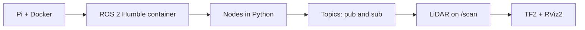

{:class="cover"}

---

By the end of this lesson you will be able to describe the ROS 2 system you've built, and pick what to learn next.

## What you've learned

Congratulations! You've gone from a blank SD card to live LiDAR data in RViz2. Along the way you:

* Set up a Raspberry Pi with 64-bit Raspberry Pi OS and Docker
* Built and ran ROS 2 Humble in a Docker container, and connected to it from VS Code
* Created a workspace with `colcon` and wrote ROS 2 nodes in Python
* Built a package with a publisher and a subscriber talking over a topic
* Forwarded X11 so RViz2 could run in the container
* Used TF2 to place your LiDAR scans in the world and displayed them in RViz2

## What's next

* **Launch files** start several nodes with one command. Try writing one that starts the RPLidar node and the static transform together.
* **SLAM** (Simultaneous Localisation and Mapping) uses LiDAR scans to build a map while the robot works out where it is in it. The [slam_toolbox](https://github.com/SteveMacenski/slam_toolbox) package is a great place to start.
* **Robot models**: ROS describes a robot's body in a URDF file. [Make It Move with BetterCad](/learn/bettercad_joints_urdf/) shows how joints are described.
* Watch [They All Gave Up on ROS and MicroPython, I Didn't](https://www.youtube.com/watch?v=vbLEdFrCbho) to see where I've taken ROS since.



## More courses

* [Docker](/learn/docker/): get more out of containers
* [Robotics 101](/learn/robotics_101/): the ideas behind robots
* [MicroPython Robotics Projects with the Raspberry Pi Pico](/learn/micropython_robotics/)

---

## Try it Yourself

1. Write down the three nodes and two topics you'd need for a robot that avoids obstacles using the LiDAR.
2. Re-run the whole chain from memory in a fresh container: publisher, subscriber, `ros2 topic echo`.
3. Challenge: write a subscriber for `/scan` (message type `sensor_msgs/msg/LaserScan`) that logs the first value in the `ranges` list.

## Common Issues

- **Problem**: A tutorial for a newer ROS 2 distro doesn't work as written.
- **Solution**: Check which distro it targets, and keep to Humble commands, or move your whole setup to the new distro together.
- **Why**: Package names, defaults and arguments change between releases.

## Check your understanding


? How do two nodes talk in ROS 2?
- [x] One publishes to a topic and the other subscribes to it
- [ ] They share a Python variable
- [ ] They call each other's `main`
> Topics decouple nodes, so neither needs to know about the other.

? Why is a transform needed to show a LiDAR scan in RViz2?
- [ ] To speed up the scan
- [x] To relate the laser's frame to the fixed frame RViz2 is drawing in
- [ ] To install RViz2

? What does a launch file do?
- [x] Starts several nodes with one command
- [ ] Builds the Docker image
- [ ] Creates a topic
> The lesson suggests it as a next step.

