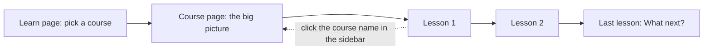

{:class="cover"}

---

By the end of this lesson you will be able to tell a course page from a lesson page, and use the sidebar, buttons and keyboard to move around a course.

## Two kinds of page

Every course on the [Learn](/learn/) page has two kinds of page, and it helps to know which one you are on.

### The course page

When you click a course card you land on the course page at `/learn/<course>/`. Think of it as the back of the box. It shows:

- the course cover, title and a short description
- the **level** (beginner, intermediate or advanced), the number of lessons, the total time and, where the course has quizzes, how many questions
- a **Start the course** button, and a **Watch the video** button if the course has a video on YouTube
- **What you'll learn**, **Before you start** and **What you need**, so you can check you have the kit before you begin
- the list of lessons, which ticks off as you open them
- any learning pathways the course belongs to (more on those in the next lesson)

Come back a second time and the **Start the course** button changes to **Resume**, which takes you to the lesson you were last on. Finish every lesson and it says **Review the course**.

### The lesson page

A lesson page has two parts: the **sidebar** on the left and the **lesson** on the right.

The sidebar shows the course name (click it to go back to the course page), a progress bar, and the lessons grouped into sections. The lesson you are on is highlighted. Lessons you have opened get a tick, and each section heading shows a count like `1/3`. On a wide screen the sidebar stays beside you as you scroll. On a phone the list folds away behind a **Show all lessons** button, and a slim bar follows you down the page so you can open the list again.

The lesson itself shows the title, who wrote it, roughly how many minutes it takes to read, and when it was last updated. At the bottom are **Previous** and **Next** buttons. You can also press the left and right arrow keys on your keyboard to go back and forward.

> **Teachers**: The minutes shown on each lesson are an estimate of reading time and do not allow for building, soldering or printing. Plan more time for hands-on lessons than the page suggests.

## Try it Yourself

1. Open the [Learn](/learn/) page, pick any course and find its **level** and the number of lessons on the course page.
2. Open a lesson in that course, then press the right arrow key twice and the left arrow key once. Which lesson are you on?
3. Challenge: shrink your browser window as narrow as it will go (or open the lesson on your phone) and find the **Show all lessons** button.

## Common Issues

- **Problem**: The arrow keys do nothing.
- **Solution**: Click on a blank part of the page first, and make sure you are not typing in a box.
- **Why**: The keys are ignored while a text box has focus, so that moving the cursor in a box does not change the page.

- **Problem**: The sidebar ticks have gone, or the course shows no progress.
- **Solution**: Check you are using the same browser as before, and not a private window.
- **Why**: Progress is stored in your browser. A new browser, a private window or cleared site data starts from zero (lesson 4 explains how an account fixes this).

## Check your understanding


? Which page tells you the level of a course and what you need before you start?
- [ ] A lesson page
- [x] The course page
- [ ] The Previous and Next buttons
> The course page shows the level, the lesson count, "Before you start" and "What you need".

? You have opened a course before and come back to its course page. What does the Start the course button say?
- [ ] Start again
- [x] Resume
- [ ] Skip
> It changes to Resume and takes you to the lesson you were last on.

? How can you move to the next lesson without the mouse?
- [ ] Press the Enter key
- [x] Press the right arrow key
- [ ] Press the Tab key twice
> The right arrow key goes to the next lesson, and the left arrow key goes to the previous one.

