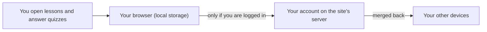

{:class="cover"}

---

By the end of this lesson you will be able to read your progress and quiz score, say what is saved in your browser and what needs an account, and reset a course.

## What counts as progress

Every lesson you open is ticked off in the sidebar, and the progress bar above it fills up. The text under the bar says something like `2 of 6 lessons visited (33%)`. So progress means lessons you have **opened**. The site cannot tell whether you read them, so be honest with yourself.

The sidebar also shows the quiz score, such as `Quiz score 3 / 9 (6 to go)`, once the course has quiz questions.

## Quizzes

Most lessons end with **Check your understanding**, a few multiple-choice questions. Click an answer and you get an instant verdict, with the right answer highlighted and a short explanation of why. A few rules:

- Only your **first** answer to each question counts towards your score.
- You can press **Try again** to have another go, but the score does not change.
- The score counts every question in the course, not just the lesson you are on.

Quizzes are there to help you learn, not to catch you out. If you get one wrong, read the explanation and move on.

## Where your progress lives

This is the part that surprises people, so let's be precise.

By default **everything is kept in your browser**, in its local storage, with one record per course. That record holds which lessons you opened, your quiz answers, and where you stopped. Nothing needs a login, and nothing leaves your device.

If you are **logged in**, the site also sends those records to your account and brings back what you did on other devices. When two devices disagree, it combines them: lessons you opened on either device count, the first answer to each question stands, and the most recent "last lesson" wins. The [My Learning](/learn/me/) page tells you which situation you are in: it says "Your progress is saved in this browser only" with log in and sign up links when you are not signed in.

Two more things use the site's servers, and both are separate from progress:

- **Was this lesson helpful?** at the bottom of each lesson. Only the counts of yes and no are kept, not who voted.
- **Likes and comments** at the bottom of the page. You need to be logged in to like or comment, and comments cannot contain links to other sites.

If you use a private window, clear your site data or switch browser without logging in, your progress starts from zero.

## Finishing a course

Open every lesson in a course and a **Course complete** window pops up the first time. On courses that have share cards it shows your card, with buttons to share it on X, Bluesky, LinkedIn or Facebook, copy the link, or download the card, and points you to the next course in your learning pathway. After that, a **Share your achievement** link appears in the sidebar so you can reopen it. The last lesson of every course also has a **What next?** box pointing you to the next course in your learning pathway (or to the pathways list, if the course is not in one) and, where it has some, projects to build.

Want to start a course over? Click **Reset my progress** in the sidebar. You will be asked to confirm, and it clears the ticks, the quiz answers and the completed mark for that course. If you are logged in it is cleared on your account too.

> **Teachers**: On a shared school computer, progress belongs to the browser profile, so the next learner who opens the same course on that machine sees the previous learner's ticks and quiz score. Have learners log in with their own accounts, use separate browser profiles, or click **Reset my progress** at the end of each session. There are no class lists or teacher dashboards, so you cannot see a learner's score from your own computer. Ask learners to show you their sidebar or their My Learning page instead.

## Try it Yourself

1. Answer the quiz at the end of this lesson, and watch the quiz score in the sidebar change.
2. Get one question wrong on purpose, press **Try again**, answer correctly, and check that your score did not go up.
3. Open the [My Learning](/learn/me/) page and find this course. Does it say you have finished it?
4. Challenge: with this course finished, find the **Share your achievement** link in the sidebar, or the **Review the course** button on the course page.

## Common Issues

- **Problem**: My progress disappeared.
- **Solution**: Open the course in the browser you used before. If you did the lessons while logged in, log in again.
- **Why**: Progress is stored in the browser, and only follows you between devices when you are logged in.

- **Problem**: I answered a quiz question wrongly, and my score is stuck.
- **Solution**: Read the explanation, then carry on. Use **Reset my progress** if you want a clean score.
- **Why**: Only the first answer to each question counts.

- **Problem**: The Course complete window did not appear.
- **Solution**: Make sure you have opened every lesson, including the intro. If the course has share cards, the Share your achievement link appears in the sidebar.
- **Why**: The window opens once, the first time all lessons are visited, and only on courses with share cards.

## Check your understanding


? What does the sidebar progress bar count?
- [ ] Lessons you have read to the end
- [x] Lessons you have opened
- [ ] Quiz questions you got right
> Progress counts the lessons you have opened, with a tick next to each one.

? You answer a quiz question wrongly, press Try again and then answer correctly. What happens to your score?
- [ ] It goes up by one
- [x] It does not change
- [ ] The whole course resets
> Only the first answer to each question counts towards the score.

? Where is your progress saved if you are not logged in?
- [ ] On the site's server
- [x] In your browser only
- [ ] In your email
> Without an account, progress lives in your browser's local storage, so a different browser starts from zero.

