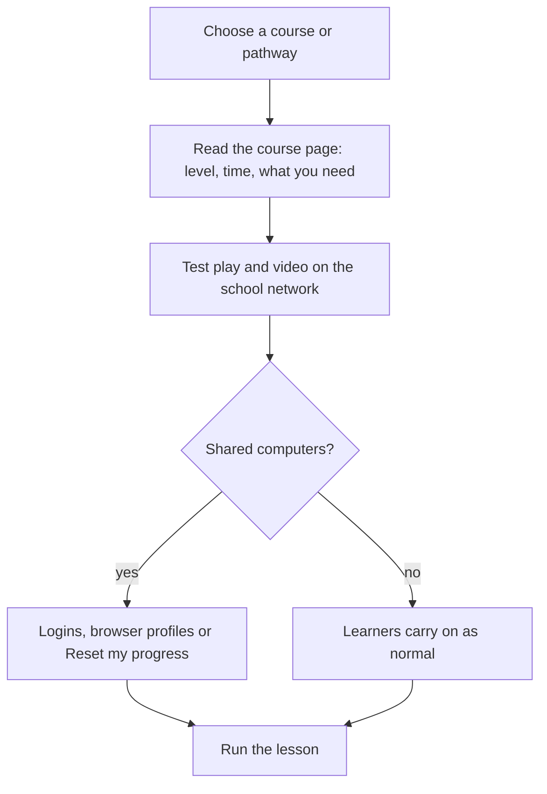

{:class="cover"}

---

By the end of this lesson you will be able to plan a session for a group of learners, avoid the usual classroom surprises, and pick a course to go on to.

## Why this lesson exists

Everything in the Learn section works the same for one learner at home as for thirty in a classroom. What changes is the small print: shared computers, school networks, and how you check progress. Let's go through the checklist.

## A planning checklist

1. **Pick a course, or a pathway.** The course page lists the level, the number of lessons, the time and, under **What you need**, the kit. Read it before the lesson, not during.
2. **Check the kit.** Many courses need a board, a motor or a 3D printer. The intro lesson of each course has a **Teachers** note on kit, timing and what can be done with no hardware.
3. **Decide about accounts.** Learners do not need one. A free account is only worth it if they will use more than one device.
4. **Test the network.** Open one lesson with a code block and press play, and open a video, on the actual classroom network.
5. **Decide how you will check progress.** Learners' sidebars and My Learning pages show their ticks and quiz scores.

## What each feature means for a class

| Feature | Classroom point |
| --- | --- |
| Progress and quiz scores | Stored in the learner's browser, or in their account if logged in. There are no class lists or teacher dashboards at the time of writing |
| Run button | Loads Snakie from `app.snakie.org` when pressed, so the network must allow it |
| Videos | Played from YouTube, which some schools block |
| Likes and comments | Need a login, and are separate from progress |
| Downloads | Plain links to STL and PDF files, handy to print ahead of time |
{:class="table table-single"}

> **Teachers**: Quizzes work nicely as a quick exit ticket. Ask learners to finish the lesson and show you the quiz score in their sidebar. Because only the first answer counts, a low score tells you which idea to revisit, not that the learner has failed. If learners share a computer, reset the course (the **Reset my progress** link in the sidebar) between classes so the next group starts clean.

## Where to go next

You now know the whole platform. A few good places to begin:

- [Learn MicroPython - The basics](/learn/micropython/) starts from what Python and MicroPython are and where to get them.
- [Robotics 101](/learn/robotics_101/) is a friendly first look at robots: what a robot is, a little history, and the skills and parts you need to build one.
- [Getting Started with Snakie](/learn/snakie_getting_started/) introduces Snakie, the MicroPython editor that powers the play button, and its built-in simulator.
- The [learning pathways](/learn/learning_pathways/) page lists every pathway if you would like a whole plan.

Thanks for taking the tour, and happy making!

## Try it Yourself

1. Pick a course from the [Learn](/learn/) page and write down its level, number of lessons and what you need, using only the course page.
2. Choose a lesson with a code block and press play on the classroom network, or on your home network if you are planning ahead. Does it run, or does a note appear?
3. Plan a 40-minute session around one lesson: when will learners read, when will they try the exercises, and when will they take the quiz?
4. Challenge: design a four-week plan from a learning pathway, choosing one lesson per session, and note the kit needed for each.

## Common Issues

- **Problem**: Videos or the play button work at home but not at school.
- **Solution**: Ask your IT team to allow YouTube and `app.snakie.org`, or run the code in an editor you already use.
- **Why**: School networks often filter video and unfamiliar websites, and both features load from outside the site.

- **Problem**: Learners see someone else's ticks and score.
- **Solution**: Use separate logins or browser profiles, or press **Reset my progress** between sessions.
- **Why**: Progress belongs to the browser, so people sharing a browser share the record.

- **Problem**: I cannot see how my class is doing.
- **Solution**: Ask learners to show their sidebar progress, or their My Learning page.
- **Why**: The platform does not have class lists or a teacher view.

## Check your understanding


? A class shares one set of school computers. How can learners avoid seeing each other's progress?
- [ ] Nothing can be done
- [x] Use their own logins or browser profiles, or press Reset my progress
- [ ] Delete the course
> Progress belongs to the browser, so separate profiles or logins, or a reset, keep records apart.

? Why should you test the play button and videos on the school network first?
- [ ] They only work on home networks
- [x] They load from outside sites that a school network may block
- [ ] They need a paid account
> The runner loads from app.snakie.org and videos from YouTube, which some schools block.

? Which page shows the level of a course and what kit to prepare?
- [ ] The My Learning page
- [x] The course page
- [ ] The Course complete window
> The course page lists the level, time and "What you need".

