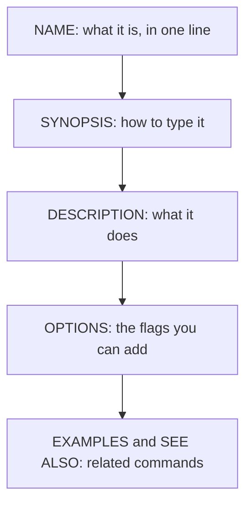

{:class="cover"}

---

By the end of this lesson you will be able to look up any command with `man` and `--help`, move around a manual page, and find a command when you only know what you want to do.

## Why start with help?

Nobody remembers every command. Experienced Linux users look things up all day, and the trick is knowing where to look. Your Pi already has the answers built in, even with no internet connection, which is handy for a robot out in the garden.

Let's get comfortable with that before we learn anything else, because from here on, whenever a command surprises you, you can ask the Pi.

## The `man` command

`man` (short for manual) shows the manual page for a command. Type `man` and then the command name:

```bash
$ man ls
LS(1)                            User Commands                           LS(1)

NAME
       ls - list directory contents

SYNOPSIS
       ls [OPTION]... [FILE]...

DESCRIPTION
       List information about the FILEs (the current directory by default).
       Sort entries alphabetically if none of -cftuvSUX nor --sort is
       specified.
```

{:class="w-100 img-fluid card-hover card-shadow rounded-3"}

The page opens in a viewer called `less`. It fills the whole terminal, so the way out is the key to learn first: **press `q` to quit**.

## Moving around a manual page

| Key | What it does |
|---|---|
| Up and Down arrows | Scroll one line at a time |
| Space | Down one screen |
| `b` | Back up one screen |
| `/word` then Enter | Search for `word`. Press `n` for the next match |
| `q` | Quit and get your prompt back |
{:class="table table-single"}

Try searching: inside `man ls`, type `/human` and press `Enter`. It jumps to the line about `-h, --human-readable`, which turns a size like `4096` into `4.0K`. We will use that option all the time.

## Reading the layout

Most manual pages share the same sections:



The **SYNOPSIS** is the part beginners skip and experts read first. Square brackets mean "optional", so `ls [OPTION]... [FILE]...` tells you that `ls` on its own is perfectly fine. Three dots mean "you can give more than one".

## When you do not know the command name

Searching the short descriptions of every manual page uses `man -k` (the same as the `apropos` command):

```bash
$ man -k "list directory"
dir (1)              - list directory contents
ls (1)               - list directory contents
vdir (1)             - list directory contents
```

The exact list depends on what is installed on your Pi. If you get `nothing appropriate`, the search index has not been built yet. Build it once with `sudo mandb` (it uses `sudo`, which we explain in the next lessons), then try again.

## A quicker answer with `--help`

Manual pages are thorough, which can be a lot when you only want to remember a flag. Most commands also print a short summary with `--help`:

```bash
$ mkdir --help
Usage: mkdir [OPTION]... DIRECTORY...
Create the DIRECTORY(ies), if they do not already exist.

  -p, --parents     no error if existing, make parent directories as needed
  -v, --verbose     print a message for each created directory
```

A good habit: try `--help` first for a quick reminder, and open `man` when you need the detail.

Pi progress: you can now answer your own questions about any command. That will save you hours.

## Try it Yourself

1. Open `man pwd`, find out what the `-P` option does, then quit with `q`.
2. Use `man -k directory` to find at least three commands that mention directories.
3. Run `cp --help` and work out which option asks before overwriting a file.
4. Challenge: open `man man`, find the section list, and work out what section 1 is for.

## Common Issues

- **Problem**: I am stuck in a manual page and typing does nothing useful.
- **Solution**: Press `q`.
- **Why**: `man` hands the page to `less`, which is a viewer, not a prompt. `q` is its quit key.

- **Problem**: `man: command not found`, or `No manual entry for ...`.
- **Solution**: Install the manual viewer with `sudo apt install man-db`. For a missing entry, check the spelling, or try `--help`.
- **Why**: Lean installs sometimes leave out the manual pages to save space, and some small tools only have `--help`.

## Check your understanding


? How do you leave a manual page?
- [ ] Press Ctrl + S
- [ ] Type exit
- [x] Press q
> The page is shown in a viewer, and `q` quits it.

? You want to find a command that lists a directory but do not know its name. What do you type?
- [ ] man list
- [x] man -k "list directory"
- [ ] man --find
> `man -k` searches the one-line descriptions of every manual page for your words.

? What does a part in square brackets, like `[OPTION]`, mean in a SYNOPSIS?
- [x] It is optional
- [ ] It is required
- [ ] It is a file name
> Square brackets mean you can leave that part out.

? Which gives a short usage reminder for most commands?
- [x] command --help
- [ ] command --list
- [ ] command --short
> Most commands print a short usage summary with `--help`.

