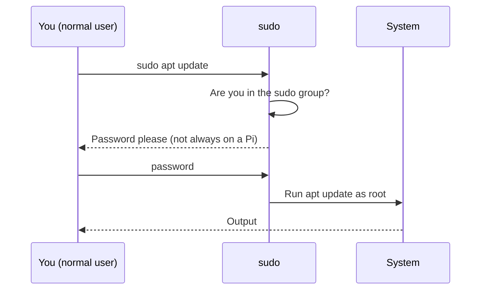

{:class="cover"}

---

By the end of this lesson you will be able to check which user and groups you belong to, use `sudo` safely, and add, change and remove a user account.

## Who are you, and what can you do?

Linux was built for many people sharing one computer, so everything on your Pi belongs to somebody. Normal users can change their own files. Only the **root** user, the all-powerful administrator, can change the system itself. Rather than logging in as root (which is easy to get wrong), Linux lets trusted users borrow root's powers for one command at a time with `sudo`, short for "superuser do".

This matters for our Docker-ready Pi. Installing software and managing services needs `sudo`, and later you will add your user to a group called `docker` so you can run containers without it. Today we learn how users and groups work.



## Check your identity

```bash
$ whoami
pi
$ id
uid=1000(pi) gid=1000(pi) groups=1000(pi),4(adm),27(sudo),29(audio),44(video),100(users),997(gpio),998(i2c),999(spi)
$ groups
pi adm sudo audio video users gpio i2c spi
```

`id` shows your user number and every group you belong to. Notice `sudo` in the list, which is why you can use it, and `gpio`, `i2c` and `spi`, which let your user control the Pi's pins without extra powers. The exact list on your Pi will differ.

## Using `sudo`

Put `sudo` in front of a command that needs administrator powers:

```bash
$ sudo apt update
```

On many Pis set up with Raspberry Pi Imager, the first user is allowed to use `sudo` without typing a password, which is convenient on your own board. Other users, and any Pi you set up differently, will ask for the user's own password.

> **Careful**: `sudo` takes away the safety net. Commands run with `sudo` can delete or overwrite system files, and the shell will not ask "are you sure". Read a `sudo` command twice before you press `Enter`, and never paste one from a website you do not trust. If you are only looking at something, you probably do not need `sudo`.

**Why not just log in as root?** `sudo` limits the damage of a typo to one command, and it writes a log entry of who ran what.

## Adding a user

Let's make a throwaway account called `student` to practise on. This is safe: we delete it again at the end.

```bash
$ sudo adduser student
Adding user `student' ...
Adding new group `student' (1001) ...
Adding new user `student' (1001) with group `student' ...
Creating home directory `/home/student' ...
New password:
Retype new password:
passwd: password updated successfully
Changing the user information for student
Enter the new value, or press ENTER for the default
	Full Name []:
	Room Number []:
	Work Phone []:
	Home Phone []:
	Other []:
Is the information correct? [Y/n] y
```

Press `Enter` to skip the personal details. Now check the account exists:

```bash
$ id student
uid=1001(student) gid=1001(student) groups=1001(student)
```

## Groups

A **group** gives several users the same permissions at once. Add `student` to a new group called `makers`:

```bash
$ sudo groupadd makers
$ sudo usermod -aG makers student
$ id student
uid=1001(student) gid=1001(student) groups=1001(student),1002(makers)
```

The `-aG` flag means **a**ppend to the **G**roup. Leave out the `-a` and the user is removed from all their other groups. This is a classic mistake, so remember it.

To give `student` administrator rights, add them to the `sudo` group, with `sudo usermod -aG sudo student`. Only do this for people you trust.

## Passwords

```bash
$ passwd
Changing password for pi.
Current password:
New password:
Retype new password:
passwd: password updated successfully
```

Change another user's password with `sudo passwd student`, and force a change at their next login with `sudo passwd -e student`. Use a strong password on any Pi that is on a network. A Pi with a default or simple password is the first thing attackers try.

## Cleaning up

Remove the practice account and its files:

> **Careful**: `--remove-home` permanently deletes the user's home folder and everything in it, with no bin to recover from. Check the name twice. Only use it on the throwaway `student` account.

```bash
$ sudo deluser --remove-home student
Looking for files to backup/remove ...
Removing user `student' ...
Warning: group `student' has no more members.
Done.
$ sudo groupdel makers
```

Without `--remove-home`, `deluser` removes the account but leaves `/home/student` behind, which you can review before deleting it yourself.

Pi progress: you understand users, groups and `sudo`, the three things Docker's installer will ask of you.

> **Teachers**: adding and deleting users changes the whole computer, so do this lesson on Pis the class owns, never on a shared server or a machine with real student accounts. Do not teach learners to hand out `sudo` to each other. Agree one admin password per group and store it somewhere safe. If you re-image the Pi after the course, the practice user disappears anyway.

## Try it Yourself

1. Run `id` and `groups`, then work out which group lets your user read the Pi's GPIO pins.
2. Create a user called `student`, a group called `makers`, and put the user in the group. Prove it with `id student`.
3. Run `sudo passwd -e student`, then check the account status with `sudo passwd -S student`. What changed in the output?
4. Challenge: remove `student` from `makers` with `sudo deluser student makers`, delete both, and show that `id student` now says `no such user`.

## Common Issues

- **Problem**: `student is not in the sudoers file. This incident will be reported.`
- **Solution**: Add the user to the sudo group with `sudo usermod -aG sudo student` from an account that already has `sudo`, then log out and back in.
- **Why**: `sudo` only works for members of the `sudo` group, and group changes apply to new login sessions.

- **Problem**: I added myself to a group but the new permission does not work.
- **Solution**: Log out and log in again, or run `newgrp groupname`. Check with `groups`.
- **Why**: The groups are read when you log in, so an open terminal still has the old list.

- **Problem**: `usermod -G makers student` removed the user from `sudo` and other groups.
- **Solution**: Put them back with `sudo usermod -aG sudo student`, and always use `-aG`.
- **Why**: Without `-a`, `-G` replaces the full group list instead of adding to it.

## Check your understanding


? What does `sudo` do?
- [ ] Switches you permanently to the root user
- [x] Runs one command with administrator powers
- [ ] Shows your password
> `sudo` borrows root's powers for a single command, and only for users who are allowed to.

? Which command adds `student` to the group `makers` while keeping their other groups?
- [ ] sudo usermod -G makers student
- [x] sudo usermod -aG makers student
- [ ] sudo adduser makers
> `-aG` appends. Without `-a` the user's group list is replaced.

? You want to delete the account `student` and their files. What do you use?
- [x] sudo deluser --remove-home student
- [ ] sudo rm student
- [ ] sudo passwd -d student
> `--remove-home` deletes the home folder as well, so use it with care.

? Why is `sudo` safer than working as root all the time?
- [ ] It makes commands run faster
- [x] A mistake only affects one command, and it is logged
- [ ] It hides the password
> Using root only when you need it limits accidents, and `sudo` keeps a record of what was run.

