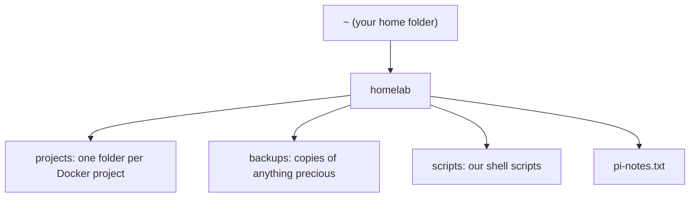

{:class="cover"}

---

By the end of this lesson you will be able to create a folder structure, copy, move and rename files, and delete things safely.

## A home for our Docker projects

Later in the Docker course you will have one folder per project: a web server here, a database there. If everything lands loose in your home folder, it turns into a junk drawer fast. So let's build a tidy structure now.



## Making folders with `mkdir`

`mkdir` makes a directory. The `-p` flag creates the parents too and does not complain if a folder is already there:

```bash
$ mkdir -p ~/homelab/projects ~/homelab/backups ~/homelab/scripts
$ ls ~/homelab
backups  projects  scripts
```

{:class="w-100 img-fluid card-hover card-shadow rounded-3"}

Notice we gave three paths in one command, and `~` expands to your home folder. To see everything inside, including sub-folders, use `ls -R`:

```bash
$ ls -R ~/homelab
/home/pi/homelab:
backups  projects  scripts

/home/pi/homelab/backups:

/home/pi/homelab/projects:

/home/pi/homelab/scripts:
```

(`vdir` is a close cousin of `ls`. It is the same as `ls -l`, a long listing, so you can ignore it unless you see it in an old tutorial.)

## Moving and renaming with `mv`

`mv` does two jobs: it moves a file, and, because renaming is just moving to a new name, it renames too. Let's put the notes file from the last lesson in its proper place:

```bash
$ mv ~/pi-notes.txt ~/homelab/
$ mv ~/homelab/pi-notes.txt ~/homelab/notes.txt
$ ls ~/homelab
backups  notes.txt  projects  scripts
```

## Copying with `cp`

`cp source destination` makes a copy. Folders need `-r` (recursive), which means "and everything inside":

```bash
$ cp ~/homelab/notes.txt ~/homelab/backups/notes-2026-11-24.txt
$ mkdir ~/homelab/projects/hello-docker
$ cp -r ~/homelab/projects ~/homelab/backups/projects-copy
$ ls ~/homelab/backups
notes-2026-11-24.txt  projects-copy
```

If the destination file already exists, `cp` and `mv` overwrite it silently. Add `-i` to be asked first: `cp -i`, `mv -i`.

## Deleting, carefully

There is no recycle bin on the command line. A deleted file is gone, so we learn the safe way first.

- `rmdir folder` removes an **empty** folder only. If the folder has anything inside, it refuses, which is a useful safety net.
- `rm file` deletes a file.
- `rm -r folder` deletes a folder and **everything inside it**.

> **Careful**: `rm -r` (and especially `rm -rf`, which also skips every warning) cannot be undone. A typo, a stray space or running it with `sudo` in the wrong place can wipe your whole project, or a whole system. Never run `rm -rf` on a path you have not just looked at with `ls`. Never use `sudo rm -rf` on a path you copied from the internet.

Here is the safe way to practise. Use `-i` so it asks, and `ls` first so you know what you are about to remove:

```bash
$ ls ~/homelab/backups/projects-copy
hello-docker
$ rm -ri ~/homelab/backups/projects-copy
rm: descend into directory '/home/pi/homelab/backups/projects-copy'? y
rm: remove directory '/home/pi/homelab/backups/projects-copy/hello-docker'? y
rm: remove directory '/home/pi/homelab/backups/projects-copy'? y
$ ls ~/homelab/backups
notes-2026-11-24.txt
```

Another good habit: `ls` the exact path, then press the Up arrow and change `ls` to `rm -ri`. What you listed is what you delete.

## Wildcards

A `*` matches anything, so `ls *.txt` lists every file ending in `.txt`. They are powerful and dangerous with `rm`, so always run the `ls` version first.

Pi progress: your Pi now has a tidy `~/homelab` with `projects`, `backups` and `scripts` folders, ready for Docker.

## Try it Yourself

1. Create `~/homelab/projects/robot-camera` and `~/homelab/projects/web-server`, then list the projects folder.
2. Copy `notes.txt` into `scripts/`, then rename the copy to `scripts-notes.txt`.
3. Make an empty folder called `scratch`, delete it with `rmdir`, then make it again, put a file in it and see that `rmdir` refuses.
4. Challenge: make a folder `old-stuff` with three `.txt` files inside. Use `ls old-stuff/*.txt`, then delete only the files with `rm -i`, and finally remove the folder.

## Common Issues

- **Problem**: `cp: -r not specified; omitting directory 'projects'`.
- **Solution**: Add `-r`: `cp -r projects backups/`.
- **Why**: `cp` will not copy a folder without being told to include its contents.

- **Problem**: `rmdir: failed to remove 'scratch': Directory not empty`.
- **Solution**: Look at what is inside with `ls`, decide if you really want it gone, then use `rm -ri scratch`.
- **Why**: `rmdir` only deletes empty folders, so it protects you from accidents.

- **Problem**: `mv` replaced a file I wanted to keep.
- **Solution**: Restore it from your backup, and use `mv -i` from now on.
- **Why**: `mv` overwrites without asking by default.

## Check your understanding


? Which command creates a folder and any missing parent folders?
- [ ] mkdir --all
- [x] mkdir -p
- [ ] touch -d
> `-p` makes the parents and does not complain if the folder already exists.

? How do you rename `old.txt` to `new.txt`?
- [ ] ren old.txt new.txt
- [ ] touch old.txt new.txt
- [x] mv old.txt new.txt
> Renaming is just moving a file to a new name.

? Which is the safest way to remove a folder with files in it?
- [ ] sudo rm -rf folder
- [x] ls folder, then rm -ri folder
- [ ] rmdir folder
> Looking first and using `-i` makes `rm` ask before each removal. `rmdir` would refuse because the folder is not empty.

? Why does `cp ~/homelab/projects ~/homelab/backups/` fail?
- [x] Folders need the -r option
- [ ] You need sudo
- [ ] backups is read only
> Copying a folder needs `-r` so it includes everything inside.

