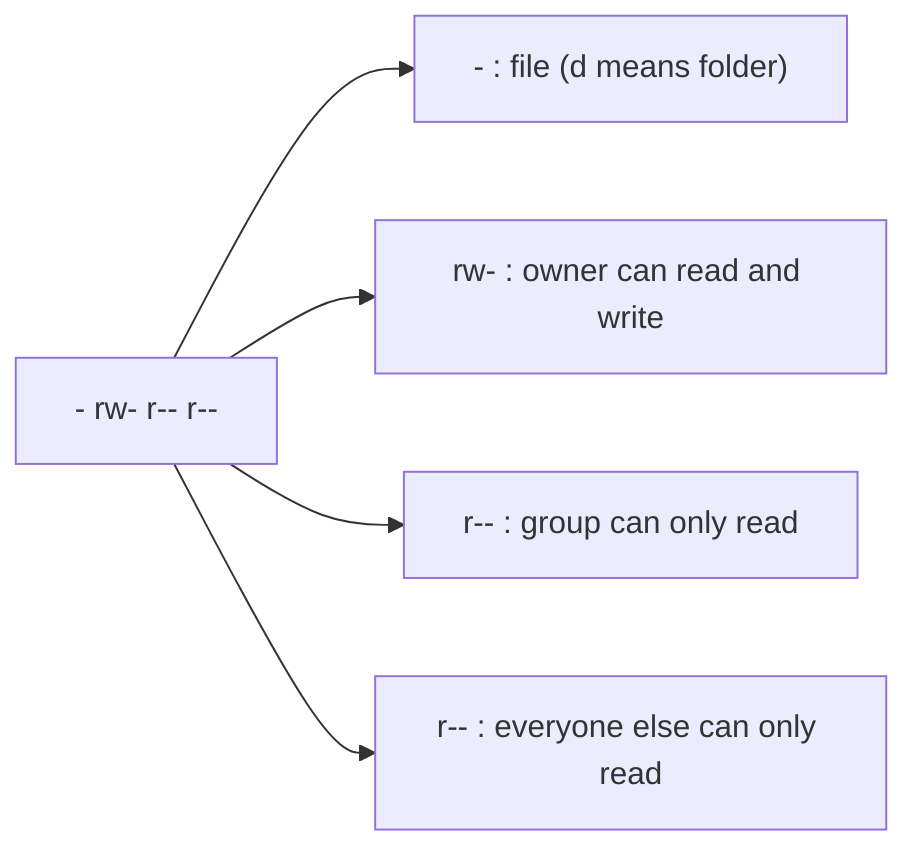
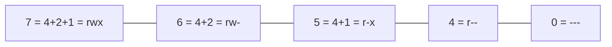

{:class="cover"}

---

By the end of this lesson you will be able to read a permission string such as `-rwxr-xr--`, change it with `chmod` in letters or numbers, and fix a file's owner with `chown`.

## Why permissions exist

Your Pi might one day hold a web server, a database password and a robot's control code. Permissions decide who may read, change or run each one. They stop a mistake in one program from wrecking another, and they keep secrets (like a password file) away from other users. Docker leans on them heavily: when a container cannot write to a folder, the answer is almost always permissions.

## Reading a permission string

Run a long listing on a file in our scripts folder:

```bash
$ touch ~/homelab/scripts/hello.sh
$ ls -l ~/homelab/scripts/hello.sh
-rw-r--r-- 1 pi pi 0 Nov 24 10:02 /home/pi/homelab/scripts/hello.sh
```

{:class="w-100 img-fluid card-hover card-shadow rounded-3"}

The first column is the permission string. Split it up:



After the permissions come the **owner** (`pi`) and the **group** (`pi`), then the size, the date and the name.

{:class="w-100 img-fluid card-hover card-shadow rounded-3"}

What do `r`, `w` and `x` mean?

| Letter | On a file | On a folder |
|---|---|---|
| `r` read | Look at the contents | List what is inside |
| `w` write | Change or empty the file | Create, rename or delete things inside |
| `x` execute | Run it as a program or script | Enter it with `cd` |
{:class="table table-single"}

So `-rwxr-xr--` means: a file, the owner can do anything, the group can read and run it, and everyone else can only read it.

## Changing permissions with `chmod`

`chmod` (change mode) has two styles. The **letter style** says who and what: `u` (user/owner), `g` (group), `o` (others), `a` (all), then `+` to add or `-` to remove:

```bash
$ cd ~/homelab/scripts
$ ./hello.sh
bash: ./hello.sh: Permission denied
$ chmod u+x hello.sh
$ ls -l hello.sh
-rwxr--r-- 1 pi pi 0 Nov 24 10:02 hello.sh
```

The file was not allowed to run until we added `x`. That "Permission denied" is the most common thing beginners hit when a script will not run.

The **number style** adds the numbers for each person: read is 4, write is 2, execute is 1.



Three digits: owner, group, others. Two you will use constantly:

```bash
$ chmod 755 hello.sh      # rwxr-xr-x: a script everyone can run, only you can change
$ echo "DB_PASSWORD=changeme" > secrets.env
$ chmod 600 secrets.env   # rw-------: only you can read or change it
$ ls -l secrets.env
-rw------- 1 pi pi 21 Nov 24 10:05 secrets.env
```

`600` is the right choice for anything secret, such as the `.env` files you will meet with Docker.

> **Careful**: `chmod -R` (recursive) changes every file in a folder tree. `chmod -R 777` makes everything writable by everyone and is a classic way to break security. Do not use 777 to "make it work". Practise `-R` only on a throwaway folder you made, and look at the result with `ls -lR`.

## Changing ownership with `chown`

The owner is usually fine, but if you create a file with `sudo`, root owns it, and your normal user then cannot change it:

```bash
$ sudo touch ~/homelab/scripts/oops.txt
$ ls -l ~/homelab/scripts/oops.txt
-rw-r--r-- 1 root root 0 Nov 24 10:10 /home/pi/homelab/scripts/oops.txt
$ sudo chown pi:pi ~/homelab/scripts/oops.txt
$ ls -l ~/homelab/scripts/oops.txt
-rw-r--r-- 1 pi pi 0 Nov 24 10:10 /home/pi/homelab/scripts/oops.txt
```

The pattern is `chown owner:group file`. To hand a whole tree back to yourself, add `-R`, and use `$USER` so you cannot mistype your name:

```bash
$ sudo chown -R $USER:$USER ~/homelab
```

> **Careful**: with `sudo chown -R` you are rewriting ownership of every file under the path. Double check the path. Never run it on `/`, `/etc` or `/home` as a whole. Stick to a folder you made yourself, like `~/homelab`.

Pi progress: your `scripts` folder is set up so you can write scripts and run them, and you know how to protect a secrets file.

## Try it Yourself

1. Run `ls -l` in your home folder and decode three permission strings out loud.
2. Create `test.sh`, make it executable with `chmod u+x`, then remove the execute permission with `chmod u-x` and see what happens when you run it.
3. Set `secrets.env` to `600`, then work out what number gives `rwxr-x---` (owner everything, group read and run, others nothing).
4. Challenge: create a folder `shared`, set it to `770`, and explain what a user outside your group would get when running `ls shared` (hint: it is the `x` and `r` on the folder).

## Common Issues

- **Problem**: `bash: ./script.sh: Permission denied`.
- **Solution**: Run `chmod +x script.sh`, then `./script.sh`.
- **Why**: A file needs the execute (`x`) bit before the shell will run it as a program.

- **Problem**: `touch: cannot touch 'file': Permission denied`.
- **Solution**: Check who owns the folder with `ls -ld folder`. If root owns it, fix it with `sudo chown $USER:$USER folder`.
- **Why**: You need write (`w`) permission on the folder to create a file in it.

- **Problem**: I ran `chmod 777` and now nothing feels safe.
- **Solution**: Put it back to `755` for folders and scripts or `644` for plain files, or `600` for secrets.
- **Why**: 777 lets every user on the Pi read, change and run the file.

## Check your understanding


? What does `-rwxr-xr--` tell you about the group?
- [ ] They can read, write and run the file
- [x] They can read and run it, but not change it
- [ ] They have no access
> The middle three characters `r-x` are the group: read and execute, no write.

? Which command gives the owner read and write, and no one else any access?
- [ ] chmod 755 file
- [ ] chmod 777 file
- [x] chmod 600 file
> 6 is read (4) plus write (2) for the owner, and the two zeros give the group and others nothing.

? A script says `Permission denied` when run as `./hello.sh`. What is the usual fix?
- [x] chmod u+x hello.sh
- [ ] sudo rm hello.sh
- [ ] chown 777 hello.sh
> The file is missing its execute bit, and `chmod u+x` adds it for the owner.

? What does `x` mean on a folder?
- [ ] You can run the folder as a program
- [x] You can enter it with cd
- [ ] You can rename it
> On a folder, execute means you may enter it and reach the files inside.

