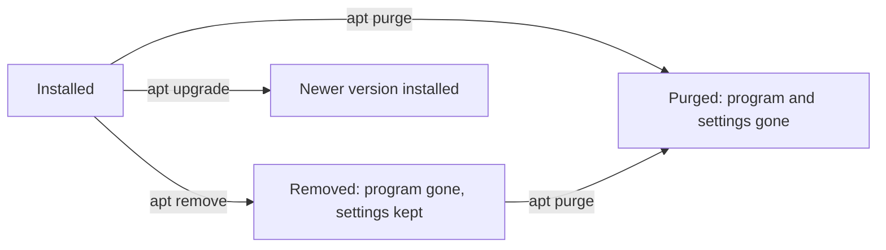

{:class="cover"}

---

By the end of this lesson you will be able to upgrade every installed package, remove software with `remove` or `purge`, and clear out what is no longer needed.

## Looking after a Pi

Installing is half the job. A Pi that runs for months needs security fixes, and a Pi that has had a few experiments needs tidying. Doing both is the difference between a Pi you trust and one you are slightly afraid of. A fresh, current, tidy Pi is exactly what we want before Docker moves in.



## Upgrading

The two steps together are the weekly routine. First refresh the list, then see what is waiting, then upgrade:

```bash
$ sudo apt update
$ apt list --upgradable
Listing... Done
libssl3/stable-security 3.x arm64 [upgradable from: 3.x]
openssh-server/stable-security 1:9.x arm64 [upgradable from: 1:9.x]
$ sudo apt upgrade
Reading package lists... Done
Building dependency tree... Done
Calculating upgrade... Done
The following packages will be upgraded:
  libssl3 openssh-server
2 upgraded, 0 newly installed, 0 to remove and 0 not upgraded.
Need to get 2,100 kB of archives.
Do you want to continue? [Y/n]
```

Your package names will differ. The numbers aren't important. What matters is that you **read** the list before pressing `Y`.

`upgrade` never removes a package. If something needs a package taken away or a new one added (this happens with big releases), `apt` says some packages were "kept back". `sudo apt full-upgrade` is allowed to remove and add packages to finish the job. Read its plan carefully before you accept.

If the kernel or firmware was upgraded, restart so the Pi uses it:

```bash
$ sudo reboot
```

> **Careful**: do not unplug a Pi in the middle of an upgrade. A half-written package can leave the Pi unable to boot. Do not upgrade a robot just before a demo either. Updates can change behaviour, so do it when you have time to fix things.

## Removing software

We installed `cowsay` for fun. Let's look at how to remove it.

```bash
$ sudo apt remove cowsay
The following packages will be REMOVED:
  cowsay
0 upgraded, 0 newly installed, 1 to remove and 0 not upgraded.
Do you want to continue? [Y/n] y
```

`remove` deletes the program but leaves its **configuration files** behind, so if you reinstall, your settings are still there. `purge` removes both:

```bash
$ sudo apt purge cowsay
```

> **Careful**: always read the list under `The following packages will be REMOVED`. Removing a library or a core tool can pull other packages with it. If you see something you did not expect (such as your desktop), answer `n`.

## Tidying with `autoremove`

When you install a program, its dependencies come too. When you remove the program, they can be left over with nobody using them. `autoremove` finds them:

```bash
$ sudo apt autoremove
Reading package lists... Done
Building dependency tree... Done
0 upgraded, 0 newly installed, 0 to remove and 0 not upgraded.
```

If you have been experimenting, the last line will show some packages to remove, and a list above it. Nothing to remove, as above, is a perfectly healthy answer.

Again, read the list first. You can also free the space taken by downloaded package files:

```bash
$ sudo apt clean
```

Then check you have gained disk space. We will learn the command for that in the next lesson.

Pi progress: your Pi is updated, tidy, and has the tools we want. The software side of the Docker-ready checklist is nearly done.

## Try it Yourself

1. Run `sudo apt update` and `apt list --upgradable`. Count how many packages could be upgraded.
2. Install `cowsay`, remove it with `apt remove`, then run `dpkg -l cowsay`. The first column shows `rc` if configuration files were left behind, or `un` if nothing was.
3. Purge it, run `dpkg -l cowsay` again, and explain what changed (or why nothing did, if it never left a configuration file).
4. Challenge: write down your own weekly upkeep routine as three commands in `~/homelab/notes.txt`.

## Common Issues

- **Problem**: `The following packages have been kept back`.
- **Solution**: Run `sudo apt full-upgrade` after reading its plan, or leave them for a later day.
- **Why**: `upgrade` will not remove or add packages, so anything that needs that is held back.

- **Problem**: The Pi feels slow, or the screen froze, while upgrading.
- **Solution**: Wait. Big upgrades are slow on an SD card. Check progress, and only power off if nothing has moved for a long time.
- **Why**: Writing many files to an SD card takes time, and cutting power mid-write can corrupt the system.

- **Problem**: `autoremove` wants to remove something I still need.
- **Solution**: Answer `n`, and mark the package as wanted with `sudo apt install packagename`.
- **Why**: A package only installed as a dependency is treated as leftover when nothing needs it any more.

## Check your understanding


? What is the difference between `apt remove` and `apt purge`?
- [ ] There is no difference
- [x] purge also deletes the configuration files
- [ ] remove also installs updates
> `remove` leaves your settings behind in case you reinstall, whereas `purge` deletes them too.

? What does `apt autoremove` do?
- [ ] Removes all installed software
- [x] Removes dependencies nothing needs any more
- [ ] Reboots the Pi
> Packages installed only as dependencies are cleaned up when no package needs them.

? Why read the plan before pressing Y?
- [x] It may list packages being removed that you did not expect
- [ ] apt sometimes asks for money
- [ ] The Pi will reboot if you skip it
> Reading the REMOVED list is the easiest way to catch a mistake before it happens.

? After upgrading the kernel, what should you do?
- [ ] Nothing
- [x] Reboot so the Pi uses it
- [ ] Run apt purge
> New kernels and firmware only take effect after a restart.

