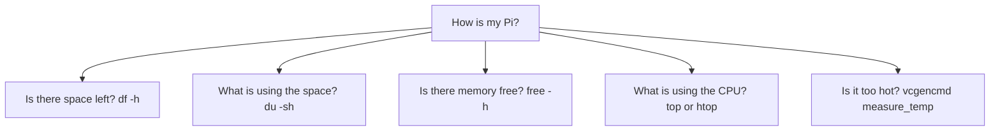

{:class="cover"}

---

By the end of this lesson you will be able to check how full the disk is, how much memory is free, what is using the CPU, and how hot the Pi is.

## A health check for your Pi

A Pi that is about to run Docker needs room to breathe. Docker images are big, so a small SD card can fill up quickly, and when a Pi runs out of space or memory, strange things happen: programs crash, files will not save, the whole board slows to a crawl. A hot Pi slows itself down on purpose to protect itself.

Just like checking a robot's battery before it goes out, we check the Pi's vital signs. Each command answers one question.



## Disk space: `df`

`df` (disk free) shows every mounted disk. `-h` makes sizes human readable:

```bash
$ df -h
Filesystem      Size  Used Avail Use% Mounted on
udev            1.7G     0  1.7G   0% /dev
tmpfs           380M  1.2M  379M   1% /run
/dev/mmcblk0p2   29G  5.1G   23G  19% /
tmpfs           1.9G     0  1.9G   0% /dev/shm
/dev/mmcblk0p1  510M   74M  437M  15% /boot/firmware
```

Look at the row mounted on `/`, the main SD card, and the `Use%` column. Under 80% is comfortable. Above 90% it is time to clean up. Your numbers will differ.

## Which folder is the hog? `du`

`du` (disk usage) adds up the size of a folder. `-s` gives one total, and `-h` makes it readable:

```bash
$ du -sh ~/homelab
12K	/home/pi/homelab
```

To find what is eating the space, list the sizes of everything one level down, biggest last:

```bash
$ du -h --max-depth=1 ~ | sort -h
12K	/home/pi/homelab
4.0K	/home/pi/Public
112M	/home/pi/.cache
115M	/home/pi
```

The `|` is a **pipe**. It sends the output of `du` into `sort -h`, which sorts human sizes properly. Pipes are covered again in the process lesson.

## Memory: `free`

```bash
$ free -h
               total        used        free      shared  buff/cache   available
Mem:           3.7Gi       412Mi       2.6Gi        38Mi       890Mi       3.3Gi
Swap:          199Mi          0B       199Mi
```

Read the **available** column, not `free`. Linux uses spare memory as a cache to speed things up, and gives it back when a program asks, so `available` is what you can really use. If `Swap used` keeps climbing, the Pi is short of memory and using the slow SD card instead.

## What is busy? `top` and `htop`

```bash
$ top
top - 10:21:07 up 2 days,  3:12,  2 users,  load average: 0.08, 0.05, 0.01
Tasks: 180 total,   1 running, 179 sleeping,   0 stopped,   0 zombie
%Cpu(s):  1.3 us,  0.7 sy,  0.0 ni, 97.7 id,  0.0 wa,  0.0 hi,  0.3 si
MiB Mem :   3794.5 total,   2661.2 free,    412.0 used,    890.1 buff/cache
```

`top` updates every few seconds. The **load average** is the number of jobs waiting for a CPU core on average over 1, 5 and 15 minutes. A Pi 4 or 5 has four cores, so a load under 4 means it is coping. Press `q` to quit.

`htop`, which we installed earlier, is the friendlier version, with coloured bars for each core and memory. Use the arrow keys to select a process and `F10` (or `q`) to leave.

```bash
$ htop
```

## Temperature and throttling

The Pi has its own commands, because it is a small board with a small cooler:

```bash
$ vcgencmd measure_temp
temp=48.3'C
$ vcgencmd get_throttled
throttled=0x0
```

Keep the Pi comfortably under about 80 degrees C, because that is when it starts slowing itself down. A `throttled` value of `0x0` means all is well. Anything else means the Pi has seen low voltage, throttling or overheating. The usual cure is the official power supply and a heatsink or fan.

`uptime` is a quick one-line summary of how long the Pi has been on and its load:

```bash
$ uptime -p
up 2 days, 3 hours, 12 minutes
```

Pi progress: you can now read the Pi's vital signs. We will put them into a script in the final project.

## Try it Yourself

1. Run `df -h` and write down the `Use%` of `/` in your notes file with `df -h / >> ~/homelab/notes.txt`.
2. Use `du -h --max-depth=1 /var | sort -h` (add `sudo` to avoid errors if you like) to find the biggest folder inside `/var`.
3. Open `htop`, find which process uses the most CPU, then press `q`.
4. Challenge: run `vcgencmd measure_temp`, then run something busy (`yes > /dev/null` for 30 seconds, stop it with `Ctrl + C`) and check the temperature again.

## Common Issues

- **Problem**: `vcgencmd: command not found`.
- **Solution**: Check you are logged in to the Pi itself and not another computer or a container. It comes with Raspberry Pi OS, so if it is missing on a Pi, search for it with `apt search vcgencmd`.
- **Why**: `vcgencmd` talks to the Pi's firmware, so it only exists on Raspberry Pi hardware.

- **Problem**: `du` prints lots of `Permission denied` lines.
- **Solution**: Add `2>/dev/null` to hide the errors, or use `sudo` for system folders.
- **Why**: Normal users cannot read other users' or system files, so `du` complains about them.

- **Problem**: `free` shows very little `free` memory and I am worried.
- **Solution**: Check the `available` column instead.
- **Why**: Linux borrows free memory for caching and returns it when needed.

## Check your understanding


? Which command shows how full the SD card is?
- [x] df -h
- [ ] free -h
- [ ] top
> `df` reports disk space for each mounted filesystem. `free` is for memory.

? Which column of `free -h` shows memory you can really use?
- [ ] free
- [x] available
- [ ] shared
> `available` includes memory Linux is using for caches but will release when needed.

? What does `vcgencmd get_throttled` returning `0x0` mean?
- [ ] The Pi is off
- [x] No under-voltage or overheating has been detected
- [ ] The SD card is empty
> Any other value flags a power or heat problem the Pi has seen.

? What does the `|` do in `du -h ~ | sort -h`?
- [ ] It saves the output to a file
- [x] It sends the output of du into sort
- [ ] It runs du twice
> A pipe feeds one command's output into the next command.

