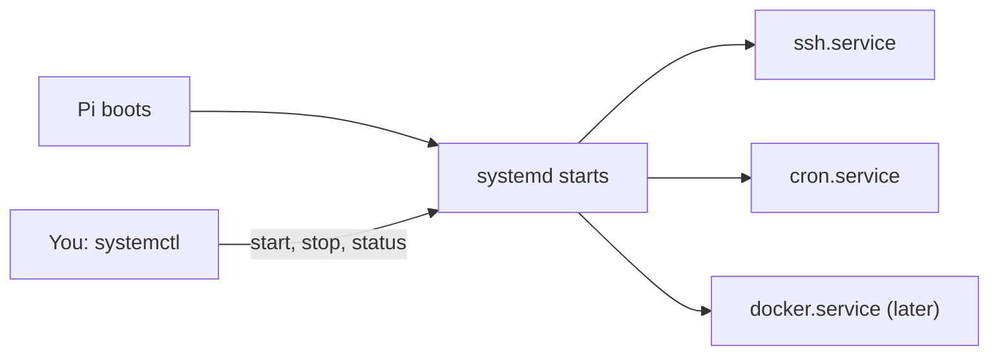

{:class="cover"}

---

By the end of this lesson you will be able to check whether a service is running, start, stop, restart and enable it, and read its log with `journalctl`.

## Programs that look after themselves

Some programs are not run by you at all. The network, the clock, the SSH server that lets you log in from another computer: all of them are **services** (also called daemons), started automatically when the Pi boots and kept running in the background. On Raspberry Pi OS they are managed by **systemd**, and you talk to it with the `systemctl` command.

This matters for our goal. Docker itself is a service called `docker`. When you finish the Docker course you will use exactly these commands to start it, make it launch at boot, and find out why it failed to start.



## Is it running? `status`

```bash
$ systemctl status cron
● cron.service - Regular background program processing daemon
     Loaded: loaded (/usr/lib/systemd/system/cron.service; enabled; preset: enabled)
     Active: active (running) since Mon 2026-11-23 09:12:41 GMT; 1 day 1h ago
       Docs: man:cron(8)
   Main PID: 642 (cron)
      Tasks: 1 (limit: 4357)
        CPU: 312ms
```

Read three lines:

- **Loaded**: systemd knows the service, and `enabled` means it will start at boot.
- **Active**: `active (running)` is healthy. `inactive (dead)` means stopped, and `failed` means it crashed.
- **Main PID**: the process number from the last lesson.

Press `q` to leave the pager. For a quick yes or no in a script, use:

```bash
$ systemctl is-active cron
active
$ systemctl is-enabled cron
enabled
```

## Starting and stopping

These change the system, so they need `sudo`. We practise on `cron`, the scheduler, which is harmless to restart:

```bash
$ sudo systemctl stop cron
$ systemctl is-active cron
inactive
$ sudo systemctl start cron
$ sudo systemctl restart cron
```

`restart` stops and starts in one step. You will use it after changing a service's settings. Most services also support `reload` (re-read settings without stopping).

> **Careful**: do not stop `ssh` if you are logged in over SSH, because you will lock yourself out of the Pi until someone with a keyboard restarts it. Do not stop or disable services you do not recognise, such as `networking`, `NetworkManager` or `systemd-logind`. Practise on `cron` only.

## Start now, or start at boot?

These are two separate things, and mixing them up catches everybody:

| Command | Runs it now? | Starts at boot? |
|---|---|---|
| `sudo systemctl start name` | Yes | No change |
| `sudo systemctl enable name` | No change | Yes |
| `sudo systemctl enable --now name` | Yes | Yes |
| `sudo systemctl disable name` | No change | No |
{:class="table table-single"}

Later in the Docker course you will meet a line like `sudo systemctl enable --now docker`, and you will know exactly what it does.

## What services are there?

```bash
$ systemctl list-units --type=service --state=running
  UNIT                     LOAD   ACTIVE SUB     DESCRIPTION
  avahi-daemon.service     loaded active running Avahi mDNS/DNS-SD Stack
  cron.service             loaded active running Regular background program processing daemon
  ssh.service              loaded active running OpenBSD Secure Shell server
  ...
```

And to find anything that has crashed:

```bash
$ systemctl --failed
0 loaded units listed.
```

`0 loaded units listed` is what you want to see. We will put this check into our final script.

## Reading the log: `journalctl`

When a service misbehaves, its log says why:

```bash
$ journalctl -u cron -n 3 --no-pager
Nov 24 10:17:01 raspberrypi CRON[3711]: pam_unix(cron:session): session opened for user root(uid=0)
Nov 24 10:17:01 raspberrypi CRON[3712]: (root) CMD (cd / && run-parts --report /etc/cron.hourly)
Nov 24 10:17:01 raspberrypi CRON[3711]: pam_unix(cron:session): session closed for user root
```

`-u` picks the service, `-n 3` shows the last three lines, and `-f` follows new lines as they arrive, like `tail -f` (press `Ctrl + C` to stop). If a service fails to start, `journalctl -u name -n 50` is the first place to look.

Pi progress: you can check, control and debug services. Your Pi is nearly ready for Docker. All that remains is the network side.

## Try it Yourself

1. Run `systemctl status ssh` and say whether it is enabled and running.
2. Stop `cron`, check with `systemctl is-active cron`, start it again and confirm.
3. Run `systemctl list-units --type=service --state=running` and count the services.
4. Challenge: use `journalctl -b -p err --no-pager` to list the errors since the last boot, and decide whether any matter.

## Common Issues

- **Problem**: `Unit docker.service could not be found.`
- **Solution**: The service is not installed yet. Install the software first, then check with `systemctl status`.
- **Why**: `systemctl` can only manage services that exist, and it uses the exact name.

- **Problem**: `Failed to start ...` or `Access denied`.
- **Solution**: Add `sudo` for start, stop, restart and enable, and read the log with `journalctl -u name -n 50`.
- **Why**: Changing services needs administrator rights, and the log explains why a service failed.

- **Problem**: I started a service but it is gone after a reboot.
- **Solution**: Use `sudo systemctl enable name` too (or `enable --now`).
- **Why**: `start` runs it for now, and only `enable` sets it to start at boot.

## Check your understanding


? Which command makes a service start every time the Pi boots?
- [ ] sudo systemctl start name
- [x] sudo systemctl enable name
- [ ] sudo systemctl status name
> `enable` sets up starting at boot. `start` only runs it once, right now.

? What does `Active: failed` in `systemctl status` mean?
- [ ] The service is running well
- [x] The service crashed or could not start
- [ ] The service is disabled
> Failed means it stopped because of an error, and the log tells you why.

? How do you read the log of the `cron` service?
- [ ] cat cron.log
- [x] journalctl -u cron
- [ ] systemctl log cron
> `journalctl -u` shows the log for one service.

? Why should you not stop `ssh` while logged in over SSH?
- [ ] It deletes your files
- [x] You would lock yourself out of the Pi
- [ ] It reboots the Pi
> Stopping SSH closes the way you connected, and you cannot start it again from the same session.

