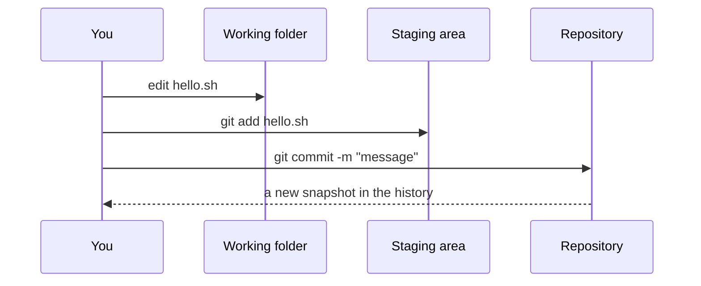

{:class="cover"}

---

By the end of this lesson you will be able to start a repository, commit your changes, look back through the history, undo an unwanted edit, and clone someone else's repository.

## Version control for `~/homelab/scripts`

Now that Git knows who you are, let's put our scripts under its care. The routine is the same every time: **change, status, add, commit**.

## Start a repository

```bash
$ cd ~/homelab/scripts
$ git init
Initialized empty Git repository in /home/pi/homelab/scripts/.git/
$ git status
On branch main

No commits yet

Untracked files:
  (use "git add <file>..." to include in what will be committed)
	diskcheck.sh
	hello.sh
	note.sh
	secrets.env

nothing added to commit but untracked files present (use "git add" to track)
```

`git init` creates a hidden `.git` folder, which holds all the history. `git status` is your best friend, and you should run it constantly. It always says what Git thinks is going on.

## Keep secrets out

Our `secrets.env` file has a password in it, and we do not want it in the history. A file called `.gitignore` lists names for Git to leave alone:

```bash
$ echo "secrets.env" > .gitignore
$ git status --short
?? .gitignore
?? diskcheck.sh
?? hello.sh
?? note.sh
```

`secrets.env` has vanished from the list. This habit will matter a lot with Docker, whose projects often include `.env` files holding passwords.

> **Careful**: once a secret is committed, deleting the file later does not remove it from the history. Add things to `.gitignore` *before* the first commit, and never commit passwords or keys.

## Add and commit

```bash
$ git add .gitignore hello.sh note.sh diskcheck.sh
$ git commit -m "Add first scripts"
[main (root-commit) 3f2a1bc] Add first scripts
 4 files changed, 45 insertions(+)
 create mode 100644 .gitignore
 create mode 100755 diskcheck.sh
 create mode 100755 hello.sh
 create mode 100755 note.sh
```

`git add` puts files in the staging area, and `git commit -m "message"` saves them with a short message describing *why*. (`git add .` adds everything, but it is better to name files so you do not accidentally include one you meant to leave out.) The commit code `3f2a1bc` and the numbers will differ on your Pi.

Now make a change. Edit `hello.sh`, then ask Git what changed:

```bash
$ echo 'echo "Have a lovely day"' >> hello.sh
$ git diff
@@ -3,3 +3,4 @@
 echo "Hello from $(hostname)!"
 echo "Today is $(date '+%A %d %B')"
 echo "You are logged in as $(whoami)"
+echo "Have a lovely day"
$ git add hello.sh
$ git commit -m "Add a friendly sign-off to hello.sh"
```



## Look back

```bash
$ git log --oneline
8c1d9e4 Add a friendly sign-off to hello.sh
3f2a1bc Add first scripts
```

## Undo a mistake

Edited a file and wished you had not? Before you commit, `git restore` puts back the last saved version:

```bash
$ echo "oops" >> hello.sh
$ git restore hello.sh
```

> **Careful**: `git restore` throws away your uncommitted changes in that file, and they cannot be recovered. Check with `git diff` first. Commands such as `git reset --hard` do the same for everything, so avoid them until you are confident.

## Clone someone else's work

`git clone` downloads a whole repository with its history, which is how you get projects from GitHub:

```bash
$ cd ~/homelab/projects
$ git clone https://github.com/USER/REPO.git
```

Replace `USER/REPO` with a real address from the project's page. You get a folder called `REPO` that is already a Git repository. This is how we will fetch Docker example projects in the next course.

Pi progress: `~/homelab/scripts` is under version control with a safe `.gitignore`. That's the whole tidy-up toolkit, so now we combine everything.

## Try it Yourself

1. Run `git init` in a new folder `~/homelab/practice`, create a file, and use `git status` to see it as untracked.
2. Commit the file with a clear message, edit it, and view the change with `git diff`.
3. Make three commits, then use `git log --oneline` to list them.
4. Challenge: edit a file, then use `git restore` to put it back, and confirm with `git status` that it is clean.

## Common Issues

- **Problem**: `fatal: not a git repository (or any of the parent directories): .git`.
- **Solution**: Run `git init`, or `cd` into the correct project folder first.
- **Why**: Git only works inside a folder that has been initialised as a repository.

- **Problem**: `nothing added to commit but untracked files present`, or `nothing to commit`.
- **Solution**: Run `git add filename` first, and check the name with `git status`.
- **Why**: A commit only includes files you have staged.

- **Problem**: `Author identity unknown`.
- **Solution**: Set your name and email with `git config --global`, as in the last lesson.
- **Why**: Git needs to label each commit with an author.

## Check your understanding


? In what order do you normally save work with Git?
- [ ] commit, add, status
- [x] edit, add, commit
- [ ] init, clone, restore
> You change files, stage them with `git add`, then save the snapshot with `git commit`.

? What is `.gitignore` for?
- [ ] Deleting old commits
- [x] Listing files Git should leave alone, such as secrets
- [ ] Speeding up commits
> Files named in it are not tracked, which keeps passwords out of the history.

? What does `git restore hello.sh` do?
- [ ] Commits the file
- [x] Discards your uncommitted changes to the file
- [ ] Deletes the repository
> It puts back the last committed version, so the edits are lost.

? Which command shows the saved history in short form?
- [x] git log --oneline
- [ ] git history
- [ ] git show-all
> `git log --oneline` prints one line per commit.

