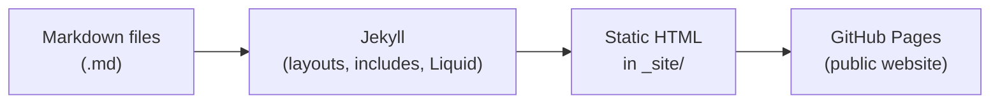

{:class="cover"}

---

Ahoy there makers! Every robot you build deserves a build log, a wiring guide and a README that future you can actually follow. In this course we'll learn to write all of that in **Markdown**, a plain-text format that looks tidy even before it is converted, and to turn it into a real website with **Jekyll** and GitHub Pages.

## Overview

Markdown is a way of writing formatted text using ordinary punctuation. A `#` makes a heading, `*` makes a list, and backticks make code. Jekyll is a static site generator: it reads folders of Markdown files, wraps them in layouts, and writes out plain HTML pages you can host for free.

We'll build one project as we go: a **Robot Build Log** website with a home page, one post per build session, a shared header and footer, your own styling, and a public address on GitHub Pages.

## What is a static site?

A dynamic website builds each page on a server when you ask for it, usually with a database. A static site is built once, ahead of time, and the server just hands over finished files. That makes it fast, cheap to host, hard to hack, and easy to keep in Git alongside your robot code. It is a great fit for documentation, which is why this very site's courses are written this way.

Jekyll was created by Tom Preston-Werner, one of GitHub's co-founders, and is open source under the MIT licence. GitHub Pages builds Jekyll sites for you automatically.

## Course Content

- **Introduction**: what Markdown and Jekyll are, the core Markdown syntax, and a working local setup
- **Creating content**: richer Markdown (tables, footnotes, code), Jekyll front matter, layouts and includes, and images and stylesheets
- **Enhancing your site**: Liquid templating, themes and plugins
- **Publishing**: building and testing locally, deploying to GitHub Pages, and where to go next

## Key Results

After completing this course, you will be able to:

- Write headings, lists, links, images, code and tables in Markdown, and know which features are core and which are extensions
- Set up Ruby, Jekyll and Bundler and preview a site on your own computer
- Use front matter, layouts and includes to share one design across many pages
- Use Liquid to list posts and show content conditionally
- Add your own CSS and a plugin
- Publish your site on GitHub Pages and update it with a Git push

## What you'll need

- A computer running Windows, macOS or Linux where you are allowed to install software
- A text editor. Anything works, and [Obsidian](/learn/obsidian/) or VS Code are friendly choices
- A free GitHub account (lesson 10)
- An internet connection
- Some Markdown notes of your own to publish, such as a robot build log

You do not need any hardware. If you have never used a terminal, start with [Introduction to the Linux Command Line](/learn/linux_intro/), which also covers the macOS terminal. Lessons 3, 9 and 10 use [Git](/learn/git/), so the Git course is a good companion. Once your site is up, the [Jekyll course](/learn/jekyll/) goes deeper into building websites, and [Create Diagrams with Mermaid](/learn/mermaid/) shows how to add flowcharts to your pages.

## How the course works

**Source and result.** When a lesson shows Markdown, you will see the source in a grey code block, then what it produces. Type the source yourself and compare.

**Core or extension?** Original Markdown is small. Many things people think of as Markdown, such as tables, footnotes and task lists, are extensions that only some tools understand. Each time we meet one, we say which it is. On this site and in Jekyll the converter is **kramdown**, and we flag the places it differs from GitHub's Markdown.

**Commands.** Terminal commands are in code blocks. Run them from your site's folder unless the lesson says otherwise.

**Quizzes.** Each lesson ends with a short quiz. Your score is kept in your browser and shown in the sidebar.

**Mistakes are normal.** Every lesson has a Common Issues list. Check it before you assume something is broken.

> **Teachers**: this course suits learners aged 13 and up, and adults. Allow 30 to 45 minutes per lesson, and a double session for lessons 3 and 10. Lessons 1, 2 and 4 need only a text editor or any online Markdown previewer, so they work on locked-down machines. Lesson 3 needs permission to install Ruby, which school Chromebooks and managed laptops often do not allow, so test one machine first or ask IT to install Ruby and Jekyll beforehand. Lesson 10 needs a GitHub account for each learner. GitHub's terms set a minimum age, so check them, and consider one shared school account. Everything published on GitHub Pages is public, so agree what learners may and may not post. One computer per learner is best, but pairs work.

Ready? Let's find out how a pile of plain-text files turns into a website.

## Check your understanding


? What does Jekyll do with your Markdown files?
- [ ] It runs them on a server each time someone visits
- [x] It converts them into static HTML pages ahead of time
- [ ] It stores them in a database
> Jekyll builds the whole site in advance, so the server only hands over finished files.

? Which is a good reason to choose a static site for documentation?
- [ ] It can run a database and user logins
- [x] It is fast, cheap to host and easy to keep in Git
- [ ] It needs no files at all
> Static sites have no server-side code or database to maintain, which makes them quick and low risk.

? Which Markdown converter does this site and Jekyll use?
- [ ] CommonMark only
- [x] kramdown
- [ ] There is no converter
> The "How the course works" section says Jekyll uses kramdown, which differs from GitHub's Markdown in places.

