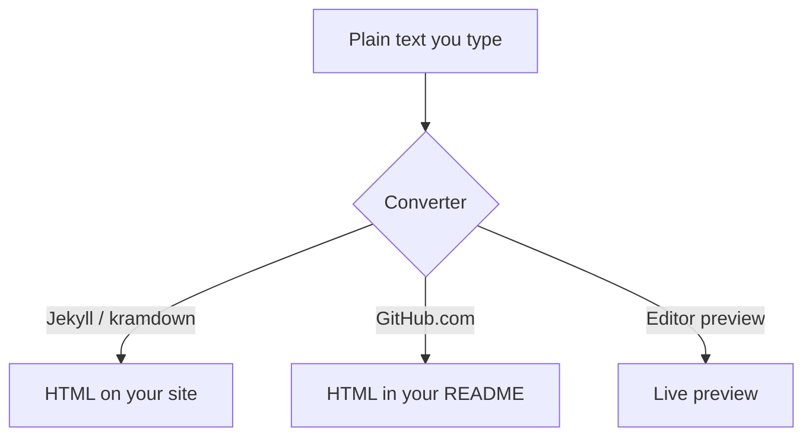

{:class="cover"}

By the end of this lesson you will be able to write a short, well-formatted page in core Markdown and predict what each piece of syntax produces.

## What is Markdown?

Markdown is a lightweight markup language: you write plain text, and punctuation tells a converter how to format it. It was created by John Gruber in 2004 with one goal, to be as readable as possible *before* it is converted. Files usually end in `.md`.

That plain-text nature is the big win for makers. A Markdown build log opens in any editor, works nicely with Git (you can see exactly which lines changed), and can be converted to HTML, PDF and more. The page you are reading now was written in Markdown and converted by Jekyll.

## The core syntax

These features are part of the original Markdown, and are supported by essentially every Markdown tool. Here is a tiny build log, first as source:

````markdown
# Wall-E Mk2 build log

## Day 1: chassis

I printed the **chassis** and the *wheel hubs*. The motors are N20 gear motors.

Parts I still need:

- Motor driver
- Battery holder
  - 2 x AA, or a 3.7 V cell

Steps for tomorrow:

1. Mount the motors
2. Wire the driver
3. Test the wheels

> Remember: check polarity before connecting the battery.

See the [Jekyll site](https://jekyllrb.com) for later lessons.
````

Each piece does one job:

| You type | You get |
| --- | --- |
| `# Heading` up to `###### Heading` | Headings, level 1 to 6 (more `#` means smaller) |
| `**bold**` or `__bold__` | **bold** |
| `*italic*` or `_italic_` | *italic* |
| `- item`, `* item` or `+ item` | A bulleted list. Indent two spaces for a sub-list |
| `1. item` | A numbered list. The numbers you type only need to start the list |
| `> quote` | A blockquote, handy for warnings |
| `[text](https://example.com)` | A link |
| `` | An image. Same as a link with a `!` in front |
| `` `code` `` | Inline code |
{:class="table table-single"}

And here is the result of the sample above, so you can compare:

> **Parts I still need:**
>
> - Motor driver
> - Battery holder
>   - 2 x AA, or a 3.7 V cell

**Why this matters:** Once these eight pieces are in your fingers, you can write a README, a build log or a lesson without ever touching HTML.

## Code in Markdown

Wrap short code in single backticks. For a block, put three backticks on their own line above and below, and name the language after the first fence so it can be colour-coded:

````markdown
```python
speed = 50
print("Motor speed:", speed)
```
````

Indenting every line by four spaces also makes a code block. This is the original way, but fenced blocks are clearer and are supported by CommonMark (the modern Markdown standard), GitHub and kramdown.

## Core versus extensions

Original Markdown has no tables, footnotes, task lists or strikethrough. Different tools add their own versions, which is why a page can look right in one place and wrong in another. The next lesson covers the common extensions. For now, remember that the list in the table above is safe everywhere.



## Try it Yourself

1. Create a file called `build-log.md` and write the sample above with your own robot's name. Open it in an editor with a Markdown preview and compare.
2. Add a second-level heading for each build session and a numbered list of what you did.
3. Add a code block that shows a one-line command you ran, with the language named after the fence.
4. Challenge: write a page in which you deliberately leave out the blank line before a list. What happens, and how do you fix it?

## Common Issues

- **Problem**: My list shows up as one long paragraph.
- **Solution**: Put a blank line before the first list item.
- **Why**: Markdown treats consecutive lines as one paragraph. Some converters let a list interrupt a paragraph and some do not, so the blank line is the safe habit that works everywhere.

- **Problem**: My heading does not appear as a heading.
- **Solution**: Put a space after the `#` characters: `# Title`, not `#Title`.
- **Why**: CommonMark and GitHub need the space to recognise the marker as a heading. Some converters are more forgiving, but a page that only works in one tool is a trap when you move it.

- **Problem**: Two lines I typed one under the other join together.
- **Solution**: End the first line with two spaces, or leave a blank line between them.
- **Why**: A single newline is treated as a space inside a paragraph.

## Check your understanding


? Which syntax makes text bold?
- [ ] `*bold*`
- [x] `**bold**`
- [ ] `#bold#`
> Two asterisks (or two underscores) give bold. One gives italics.

? What is the difference between a link and an image in Markdown?
- [ ] They use unrelated syntax
- [x] An image has a `!` in front of the link syntax
- [ ] Images need four spaces of indent
> `[text](url)` is a link and `` is an image.

? Which of these is part of core Markdown rather than an extension?
- [ ] Tables
- [ ] Footnotes
- [x] Blockquotes
> Tables and footnotes are extensions. Blockquotes, lists, headings, links and code are core.

? Why do you put a blank line before a list?
- [x] So the converter knows a new block is starting
- [ ] To make the list longer
- [ ] It makes the text bold
> Without the blank line, the list is often folded into the paragraph above it.

