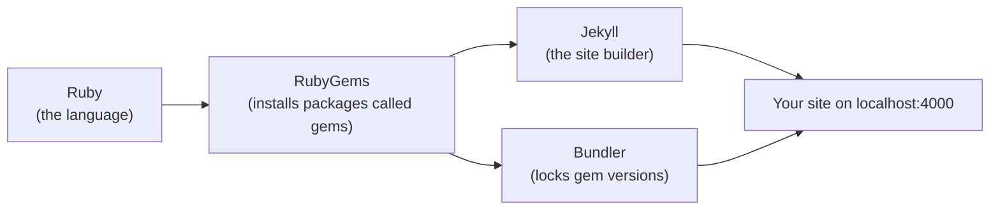

{:class="cover"}

By the end of this lesson you will be able to install Jekyll, create a new site and view it running at `http://localhost:4000` on your own computer.

## Why install anything?

You could write Markdown in any editor, but to see it as a finished website you need Jekyll, and Jekyll is a Ruby program. Think of Ruby as the engine, Jekyll as the machine you build on it, and Bundler as the parts list that makes sure every computer uses the same versions. Setting this up once means every later lesson is just writing and refreshing.



> **Teachers**: this lesson installs software, so it is the one most likely to be blocked on school-managed laptops and Chromebooks. Test one machine before the class, or ask your IT team to install Ruby and Jekyll in advance. Allow a full session, because installs differ between operating systems. If installing is impossible, learners can still do lessons 1, 2 and 4 in an online Markdown previewer and join again at lesson 10 with GitHub only.

## Step 1: install Ruby

The Jekyll installation guide at [jekyllrb.com/docs/installation](https://jekyllrb.com/docs/installation/) is the final word, because versions change. These are the usual routes.

**Windows.** Download **Ruby+Devkit** from [RubyInstaller](https://rubyinstaller.org/downloads/). When the installer finishes, leave the "Run ridk install" box ticked and accept the default choice in the window that opens, so the tools that build gems are installed too.

**macOS.** The Ruby that ships with macOS is meant for the system itself, and the Jekyll guide recommends installing your own. With [Homebrew](https://brew.sh):

```bash
brew install ruby
```

Homebrew then prints a line to add to your shell profile so the new Ruby is found before the system one. Follow it, then open a new terminal.

**Linux (Debian or Ubuntu).**

```bash
sudo apt install ruby-full build-essential zlib1g-dev
```

On Linux, also stop gems being installed as the administrator, by telling Ruby to keep them in your home folder:

```bash
echo 'export GEM_HOME="$HOME/gems"' >> ~/.bashrc
echo 'export PATH="$HOME/gems/bin:$PATH"' >> ~/.bashrc
source ~/.bashrc
```

Check it worked. Each command should print a version number:

```bash
ruby -v
gem -v
```

## Step 2: install Jekyll and Bundler

```bash
gem install jekyll bundler
```

## Step 3: create and preview a site

```bash
jekyll new robot-log
cd robot-log
bundle exec jekyll serve
```

`jekyll new` creates a folder with a starter site. `bundle exec` runs Jekyll using exactly the versions in the folder's `Gemfile`. When the terminal says the server is running, open `http://localhost:4000` in your browser. `localhost` means "this computer", so only you can see it. Press Ctrl+C in the terminal to stop the server.

Take a look at what was created:

| File or folder | What it is for |
| --- | --- |
| `_config.yml` | Site-wide settings such as the title. Restart the server after editing it |
| `Gemfile` | The gems this site needs |
| `index.markdown` | Your home page |
| `about.markdown` | An example extra page |
| `_posts/` | Blog posts, one Markdown file each |
| `_site/` | The built site. Jekyll writes it, so never edit it |
{:class="table table-single"}

## Step 4: keep it in Git

```bash
git init
git add .
git commit -m "Initial commit"
```

The starter site includes a `.gitignore` that already leaves out `_site/`, so only your source files are saved. If Git is new to you, the [Git course](/learn/git/) covers it.

## Try it Yourself

1. Install Ruby, Jekyll and Bundler and create a site called `robot-log`.
2. With the server running, open `_config.yml`, change `title`, stop the server with Ctrl+C and start it again. Does the new title show?
3. Edit `index.markdown` and add a sentence about your robot. Refresh the browser without restarting anything.
4. Challenge: run `bundle exec jekyll serve --port 4001`. What changes?

## Common Issues

- **Problem**: `jekyll: command not found`.
- **Solution**: Close and reopen the terminal, then run `ruby -v` and `gem -v`. If those work, run `gem install jekyll bundler` again.
- **Why**: A new terminal reads your updated PATH, and the command only exists once the gem is installed.

- **Problem**: `cannot load such file -- webrick` when starting the server.
- **Solution**: Run `bundle add webrick`, then start the server again.
- **Why**: From Ruby 3.0, the small web server Jekyll uses for previewing is no longer bundled, so it has to be added to the site.

- **Problem**: The browser shows the old title after I edited `_config.yml`.
- **Solution**: Stop the server with Ctrl+C and run `bundle exec jekyll serve` again.
- **Why**: Jekyll rebuilds when pages change but only reads `_config.yml` at start-up.

- **Problem**: `Address already in use` or port 4000 is busy.
- **Solution**: Stop the other server, or choose another port with `--port 4001`.
- **Why**: Only one program can listen on a port at a time.

## Check your understanding


? What does `bundle exec jekyll serve` do?
- [ ] Publishes your site to the internet
- [x] Builds the site and previews it on your computer
- [ ] Installs Ruby
> It builds the site and serves it at `http://localhost:4000`, only on your own computer.

? You edit `_config.yml` while the server is running. What must you do to see the change?
- [ ] Nothing, it updates instantly
- [x] Stop and restart the server
- [ ] Delete the `_site` folder by hand
> Jekyll only reads `_config.yml` at start-up.

? Which folder holds the built site that Jekyll generates?
- [ ] `_posts/`
- [x] `_site/`
- [ ] `_layouts/`
> `_site/` is the output. You edit the source files and let Jekyll regenerate it.

