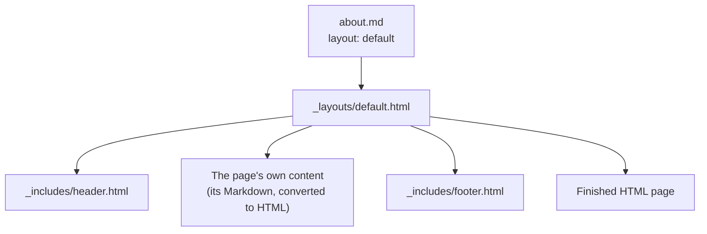

{:class="cover"}

By the end of this lesson you will be able to create a layout and an include, and use them so that changing one file updates every page on your site.

## The problem they solve

Imagine your Robot Build Log has twenty pages. Each needs the same menu, the same footer and the same page structure. Copying that into every file would mean twenty edits whenever you add a menu link. Jekyll avoids that with two tools:

- A **layout** is a template that wraps around a page's content.
- An **include** is a reusable snippet that you drop into layouts or pages.



## Layouts

Layouts live in the `_layouts` folder. Create `_layouts/default.html`:


```html
<!DOCTYPE html>
<html lang="en">
<head>
  <meta charset="UTF-8">
  <meta name="viewport" content="width=device-width, initial-scale=1">
  <title>{{ page.title }} | {{ site.title }}</title>
</head>
<body>
  
  <main>
    {{ content }}
  </main>
  
</body>
</html>
```


Two special things happen here. `{{ page.title }}` prints the `title` from the page's front matter, and `{{ site.title }}` prints the `title` from `_config.yml`. `{{ content }}` is the hole where Jekyll pours in the page's converted Markdown. The double curly braces are **Liquid**, which lesson 7 explores.

To use the layout, name it in the page's front matter, without the `.html`:

```markdown
---
layout: default
title: About my robot
---

# About my robot

This build log follows Wall-E Mk2.
```

**Layouts can be chained.** A `post.html` layout can start with `layout: default` in its own front matter, so a post is wrapped in the post layout, which is then wrapped in the default one. Put the shared structure in `default`, and extras (a date, an author) in `post`.

## Includes

Includes live in `_includes`. Create `_includes/header.html`:


```html
<header>
  <nav>
    <a href="{{ '/' | relative_url }}">Home</a>
    <a href="{{ '/about/' | relative_url }}">About</a>
  </nav>
</header>
```


The `relative_url` filter adds your site's `baseurl` (needed when your site lives at `username.github.io/repo`, as lesson 10 covers) so links keep working. Then make a very small `_includes/footer.html`:

```html
<footer>
  <p>Built with Markdown and Jekyll.</p>
</footer>
```

Use an include with the `include` tag, as the layout above does:


```liquid

```


### Includes with parameters

An include can take values. Make `_includes/note.html`:


```html
<aside class="note">{{ include.text }}</aside>
```

Then call it with:

```liquid

```


Inside the include, the values arrive under the name `include`. This is a good way to make warning boxes or part cards that look the same every time.

## Common mistakes

Layouts and includes are plain HTML plus Liquid, so the usual HTML rules apply. Keep `<html>`, `<head>` and `<body>` in the layout only. If an include has them as well, you end up with a page inside a page.

## Try it Yourself

1. Create `_layouts/default.html`, `_includes/header.html` and `_includes/footer.html` as above, and set `layout: default` in `index.markdown`.
2. Add a third link to the header, and watch it appear on every page.
3. Create the `note.html` include and use it twice with different text.
4. Challenge: create `_layouts/post.html` that starts with `layout: default` in its front matter and wraps `{{ content }}` in an `<article>` tag. Set a post to use it.

## Common Issues

- **Problem**: My page shows no styling or structure after I set `layout: default`.
- **Solution**: Check that `_layouts/default.html` exists, and that the folder name starts with an underscore.
- **Why**: Jekyll only looks for layouts in `_layouts`, and silently renders the page bare if it cannot find the one you named.

- **Problem**: `Liquid Exception: Could not locate the included file 'header.html'`.
- **Solution**: Check the file is in `_includes` and spelled exactly the same, including the extension.
- **Why**: The `include` tag searches `_includes` by exact file name.

- **Problem**: The page content does not appear inside the layout.
- **Solution**: Make sure the layout contains `{{ content }}` exactly once.
- **Why**: That tag is the only place the page's own body is inserted.

## Check your understanding


? Which folder holds layouts?
- [ ] `_includes`
- [x] `_layouts`
- [ ] `_site`
> Layouts live in `_layouts` and includes in `_includes`.

? What does `{{ content }}` do in a layout?
- [ ] Prints the site title
- [x] Marks where the page's own content is inserted
- [ ] Includes the footer
> It is the placeholder that Jekyll replaces with the converted page body.

? How do you pass a value into an include?
- [x] ``, then read it as `include.text`
- [ ] Rename the file
- [ ] Put it in `_config.yml`
> Parameters are written after the file name and arrive under the name `include`.

