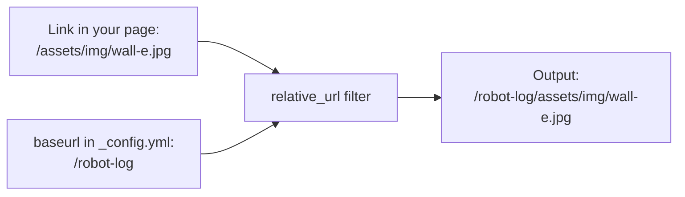

{:class="cover"}

By the end of this lesson you will be able to add an image, a stylesheet and a script to your Jekyll site and link to each of them with a path that works both locally and on GitHub Pages.

## What are static assets?

Assets are the files that are not pages: photos of your robot, a CSS file for colours, a JavaScript file for a little interactivity. Jekyll copies any file that has no front matter straight into the built site, in the same folder structure. So a file at `assets/img/wall-e.jpg` ends up at `_site/assets/img/wall-e.jpg`.

A tidy layout that many Jekyll sites use looks like this:

```
robot-log/
  assets/
    img/        <- photos and diagrams
    css/        <- stylesheets
    js/         <- scripts
  _layouts/
  _includes/
  _posts/
  _config.yml
  index.markdown
```

Folders that start with an underscore, such as `_layouts` and `_posts`, are special to Jekyll. They are used while building but are not copied into the site as they are, so keep assets in a normal folder like `assets/`.

## Linking to assets with `relative_url`

Here is a trap. If your site lives at `https://username.github.io/robot-log/`, then a link written as `/assets/img/wall-e.jpg` points at `https://username.github.io/assets/img/wall-e.jpg`, which does not exist. The site's folder name (`/robot-log`) is missing. That folder name is the **baseurl**, and you set it in `_config.yml`:

```yaml
baseurl: "/robot-log"
```

The `relative_url` filter adds the baseurl for you, so the same code works on your laptop and when published:


```markdown

```


Remember the Markdown image form: ``, with the `!` at the front. The alt text is read aloud by screen readers and shown if the image fails to load, so describe what is in the picture.

For a stylesheet and a script, use the same filter in your layout. CSS goes in the `<head>` and scripts go just before `</body>`, so the page appears before the script loads:


```html
<link rel="stylesheet" href="{{ '/assets/css/style.css' | relative_url }}">
...
<script src="{{ '/assets/js/robot.js' | relative_url }}"></script>
```




## Keep images small

Big photos make pages slow, especially on a phone. Resize a photo to the width it will actually display (often 800 to 1200 pixels is plenty), and save it as a JPEG, or as a PNG for diagrams and screenshots. A good aim is under 300 KB per image. Use meaningful names such as `wall-e-chassis.jpg` rather than `IMG_4821.jpg`.

> **Teachers**: images on a public site stay public. Do not publish photos in which learners can be identified without permission from them and, for younger learners, their parents or carers. Photos taken on phones can also carry location data in their EXIF metadata, so strip it or export a copy before uploading. Check that learners have the right to use any picture they did not take themselves.

## Sass in one minute

Jekyll can convert Sass (`.scss`) files into CSS. Put partial files in `_sass/`, such as `_sass/main.scss`, and create `assets/css/style.scss` with two lines of dashes at the top (empty front matter) so Jekyll knows to process it:

```scss
---
---

@import "main";
```

Jekyll writes the result to `assets/css/style.css`. Recent versions of the Sass compiler print a deprecation warning about `@import`. It still works, and the warning is safe to ignore while you are learning.

## Try it Yourself

1. Create `assets/img/` and add one photo of a project. Show it on your home page with `relative_url` and sensible alt text.
2. Create `assets/css/style.css` that sets a `body` background colour, link it in your layout, and reload.
3. Set `baseurl: "/robot-log"` in `_config.yml`, restart, and visit `http://localhost:4000/robot-log/`. Do your image and stylesheet still load?
4. Challenge: reduce a photo's file size by at least half and compare how it looks.

## Common Issues

- **Problem**: The image shows as a broken icon.
- **Solution**: Check the file name and folder spelling, including upper and lower case, and use `relative_url` for the path.
- **Why**: The path is exact, and a server on Linux (including GitHub Pages) treats `Robot.JPG` and `robot.jpg` as different files.

- **Problem**: My CSS works on my laptop but the published site has no styling.
- **Solution**: Set `baseurl` to your repository name in `_config.yml` and link with `relative_url`.
- **Why**: Without the baseurl, the link points at the site's root rather than your project's folder.

- **Problem**: A file in `_assets` or `_images` never appears on the site.
- **Solution**: Move it to a folder that does not start with an underscore, like `assets/`.
- **Why**: Jekyll treats underscore folders as its own working folders and does not copy them.

## Check your understanding


? What does the `relative_url` filter add to a path?
- [ ] The file's size
- [x] The site's `baseurl`
- [ ] The file extension
> It prefixes the path with the baseurl from `_config.yml`, which keeps links working in a subfolder.

? Where should the script tag normally go in a layout?
- [ ] At the very top, before `<html>`
- [x] Just before `</body>`
- [ ] Inside the Markdown front matter
> Loading scripts at the end lets the page appear first.

? Why is a folder called `_images` a bad place for images?
- [x] Jekyll does not copy folders beginning with an underscore
- [ ] Image files must be in `_site`
- [ ] Underscores are not allowed in URLs
> Underscore folders are reserved for Jekyll's own use, so use `assets/` instead.

