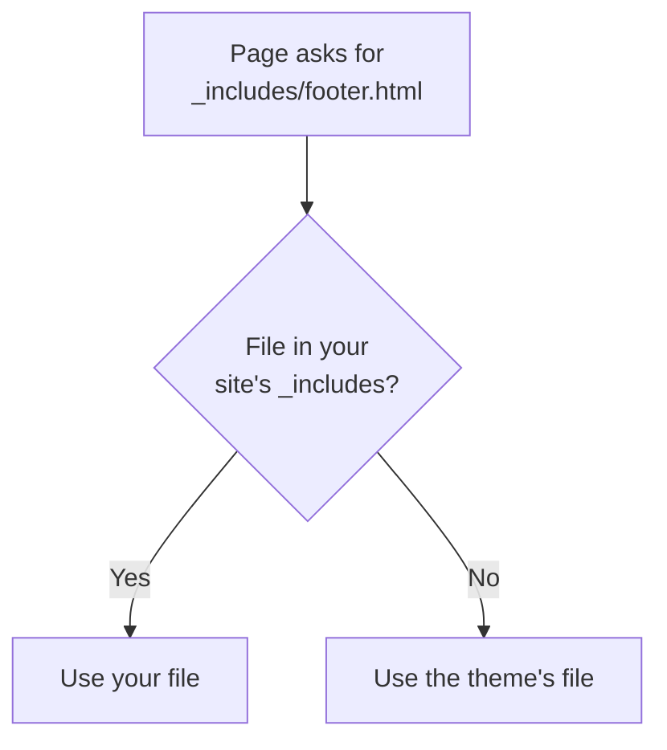

{:class="cover"}

By the end of this lesson you will be able to override one file from a Jekyll theme, add your own styles, and install a plugin, knowing which plugins work on GitHub Pages.

## Themes: a site you did not have to build

A **theme** bundles layouts, includes and styles into a gem. A site made with `jekyll new` uses the default theme, `minima`, which is why your starter site already looked finished even though your folder had hardly any layouts in it. Check `_config.yml`:

```yaml
theme: minima
```

The theme's files are hidden inside the installed gem. Jekyll finds them, but you do not see them in your folder.

## Overriding: your files win

Here is the key rule: **Jekyll looks in your site first, then in the theme.** If your `_layouts/` or `_includes/` contains a file with the same name as one in the theme, yours is used. So you only need to copy the files you want to change, not the whole theme.



To find where the theme lives, run this in your site folder:

```bash
bundle info --path minima
```

It prints a folder path. Copy the file you want, for instance `_includes/footer.html`, into the matching folder in your own site, and edit your copy. Restart the server if the change does not show.

## Adding your own styles

To add colours or fonts without touching theme internals, create your own stylesheet at `assets/css/robot.css`, then link it after the theme's styles so your rules win when they conflict. For the default theme, the usual way is to copy the theme's `_includes/head.html` into your site (as above) and add one line at the bottom of the `<head>`:


```html
<link rel="stylesheet" href="{{ '/assets/css/robot.css' | relative_url }}">
```


In `robot.css`, a first rule might be:

```css
a { color: #0b7285; }
```

If you built your own layout in lesson 5, you already control the `<head>`, so just add the link there.

## Plugins: extra abilities

**Plugins** are Ruby gems that add features, such as a sitemap, an RSS feed or search-engine metadata. There are two steps. First, add the gem to your `Gemfile` inside the `jekyll_plugins` group:

```ruby
group :jekyll_plugins do
  gem "jekyll-seo-tag"
end
```

Then run `bundle install`. Second, list it in `_config.yml`:

```yaml
plugins:
  - jekyll-seo-tag
```

Restart Jekyll. Many plugins also need a tag in a layout to do their work. For `jekyll-seo-tag`, put this in your layout's `<head>`:


```liquid

```


It adds a page title, description and social sharing tags based on your front matter and `_config.yml` (`title`, `description` and `url`).

## Will it work on GitHub Pages?

This catch trips up many people. When you publish by choosing a branch (lesson 10), GitHub builds your site for you, and for safety it allows only an approved list of plugins. Common ones such as `jekyll-seo-tag`, `jekyll-feed` and `jekyll-sitemap` are on the list. Other gems, and your own scripts in a `_plugins` folder, will work on your computer but be ignored when GitHub builds the site. The current list is on GitHub's "Dependency versions" page at [pages.github.com/versions](https://pages.github.com/versions/).

There is a way around it: build the site yourself with a GitHub Actions workflow, which allows any plugin. That is beyond this course, but it is good to know it exists.

## Try it Yourself

1. Run `bundle info --path minima`, find the theme's `footer.html`, and copy it into your own `_includes/`.
2. Edit your copy to add "Built by" and your name, and check the footer changes on every page.
3. Create `assets/css/robot.css`, change the link colour, and link it after the theme's styles.
4. Challenge: install `jekyll-seo-tag`, add `` to your layout, then use the browser's "View page source" to find the tags it added.

## Common Issues

- **Problem**: `Could not find gem 'jekyll-seo-tag'` after editing the Gemfile.
- **Solution**: Run `bundle install` in your site folder, then start the server again.
- **Why**: Editing the Gemfile only lists the gem. `bundle install` is what downloads it.

- **Problem**: A plugin works on my computer but does nothing on GitHub Pages.
- **Solution**: Check it is on the supported list, or build the site with GitHub Actions instead.
- **Why**: GitHub's automatic build only runs approved plugins, and ignores the rest.

- **Problem**: My override file is ignored.
- **Solution**: Check the folder and file name match the theme's exactly, such as `_includes/footer.html`, and restart the server.
- **Why**: Jekyll only prefers your file when the path inside the site matches the theme's path.

## Check your understanding


? A file with the same name exists in both your site and the theme. Which does Jekyll use?
- [x] Yours
- [ ] The theme's
- [ ] Both, merged together
> Jekyll looks in your site first, so you only copy the files you want to change.

? Where do you add a plugin gem so Jekyll can load it?
- [ ] Only in `_config.yml`
- [x] In the `Gemfile` and in the `plugins` list in `_config.yml`
- [ ] In `_site/`
> The Gemfile installs the gem and the `plugins` list switches it on.

? Why might a plugin not work when you publish to GitHub Pages by choosing a branch?
- [x] Only an approved list of plugins is allowed
- [ ] Plugins only work on Windows
- [ ] GitHub does not support Ruby
> The lesson explains that GitHub's automatic build allows only supported plugins.

