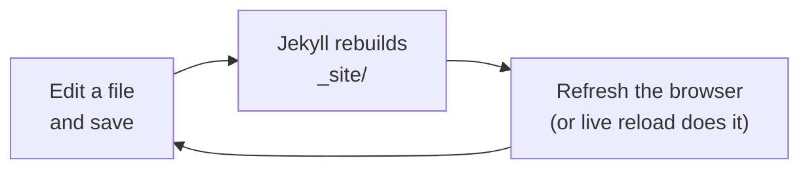

{:class="cover"}

By the end of this lesson you will be able to build your site, preview it with live reload, read Jekyll's error messages, and check it against a pre-flight list before you publish.

## Two commands, two jobs

You have already used `bundle exec jekyll serve`. Jekyll has two main commands, and it helps to know which does what:

| Command | What it does |
| --- | --- |
| `bundle exec jekyll build` | Builds the site once and writes it to `_site/` |
| `bundle exec jekyll serve` | Builds the site, rebuilds whenever you save a file, and serves it at `http://localhost:4000` |
{:class="table table-single"}

While you are writing, use `serve`. Use `build` when you want to look at the finished files, or in a script.



## Handy options

Add these to the `serve` command:

```bash
bundle exec jekyll serve --livereload
bundle exec jekyll serve --drafts
bundle exec jekyll serve --future
```

- `--livereload` refreshes the browser for you each time the site rebuilds.
- `--drafts` also builds the files in a `_drafts/` folder. Drafts are posts with no date in the file name, such as `_drafts/servo-jitter.md`. Perfect for a half-written build log you are not ready to publish.
- `--future` also builds posts dated in the future, which are normally hidden.

Remember that changes to `_config.yml` need a restart.

## Reading errors

Jekyll prints problems in the terminal, and the clues are usually good. The exact wording changes between versions, but an error looks something like this:

```
Liquid Exception: Liquid syntax error (line 12): Unknown tag 'endif' in _layouts/default.html
```

Read it as three clues: **what** kind of problem (a Liquid syntax error), **where** (the file and line), and **detail** (an unknown tag). Fix the named line first, save, and read the next message. Warnings, which start with `Warning` rather than an error, will not stop the build, but they often point at a mistake such as a broken front matter line.

If the whole page is blank or odd, use your browser's developer tools (usually the F12 key) to see missing files in the Network tab, and errors in the Console tab.

## A pre-flight checklist

Before you publish, click through your site at `localhost:4000` and check:

- Every menu link goes where it should, and none lead to a 404 page.
- Every image appears, and has alt text.
- A post you wrote in the future (or a draft) is not showing unless you meant it to.
- The `baseurl` in `_config.yml` matches your repository name if you are publishing a project site. Try the site at the baseurl path locally, as in lesson 6.
- The site looks right at a narrow phone-sized window.

You can also test on a real phone on the same Wi-Fi. Run `bundle exec jekyll serve --host 0.0.0.0` and browse to your computer's address from the phone. This lets other devices on your network reach your site, so only do it on a network you trust.

> **Teachers**: `--host 0.0.0.0` opens the preview to everyone on the same network, and school networks often block device-to-device traffic anyway. It is safest to leave the default, which only allows your own machine, and to test narrow layouts by resizing the browser window instead.

## Keep the site fast

Speed is part of quality. Resize and compress images (lesson 6), keep each page light, and avoid loading scripts you do not use. A static site is quick by nature, so most slowness is oversized files.

## Try it Yourself

1. Run `bundle exec jekyll build` and open the `_site/` folder. Find the HTML file for your home page and open it in a text editor. What did the layout add around your content?
2. Create `_drafts/servo-jitter.md` with a heading and start the server with and without `--drafts`. When is it visible?
3. Break something on purpose: remove an `endif` from a layout. Read the error and fix it.
4. Challenge: write your own pre-flight checklist for your site, and run through it.

## Common Issues

- **Problem**: My change does not show up in the browser.
- **Solution**: Check the terminal shows a rebuild, do a hard refresh (Ctrl+Shift+R), and restart the server if you edited `_config.yml`.
- **Why**: Browsers cache files, and `_config.yml` is only read at start-up.

- **Problem**: A post is missing from the preview.
- **Solution**: Check the date in the file name is not in the future, or start with `--future`.
- **Why**: Jekyll hides future-dated posts by default.

- **Problem**: The terminal says the site is built but the browser shows nothing or an error.
- **Solution**: Open exactly the address the terminal printed, usually `http://localhost:4000`, plus your `baseurl` if you set one.
- **Why**: With a `baseurl` set, the site is served below that path rather than at the root.

## Check your understanding


? What is the difference between `jekyll build` and `jekyll serve`?
- [ ] There is none
- [x] `build` writes the site once, and `serve` also previews it and rebuilds on every change
- [ ] `serve` publishes to GitHub
> `serve` is for writing. `build` produces the finished files in `_site/`.

? Which option builds the posts in `_drafts/`?
- [ ] `--future`
- [x] `--drafts`
- [ ] `--livereload`
> `--drafts` includes the draft folder, and `--future` is for future-dated posts.

? When an error appears in the terminal, what should you read first?
- [x] The file and line it names
- [ ] The Ruby version
- [ ] Nothing, just restart
> Errors name the kind of problem and where it is, which is the quickest way to the fix.

