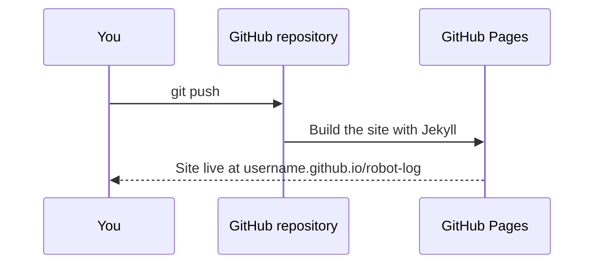

{:class="cover"}

By the end of this lesson you will be able to publish your Jekyll site on GitHub Pages and update it by pushing a change.

## Publishing, the easy way

GitHub Pages is a free hosting service built into GitHub. You push your site's files to a repository, GitHub runs Jekyll for you, and your pages appear at a public address. Your Markdown stays the source of truth, and publishing becomes a `git push`.



> **Teachers**: GitHub Pages sites are public to the whole internet. Each learner needs a GitHub account, and GitHub's terms set a minimum age, so check them first, and consider one shared class account or organisation instead. Remind learners not to publish names, photos, locations or contact details of anyone without permission, and never to commit passwords or keys. Free GitHub accounts publish Pages from public repositories, so check current plan rules before assuming a repository can be private. The school network may also block GitHub, so test it beforehand.

## Step 1: prepare your site

1. In `_config.yml`, set the address of your site and, for a project site, the repository name as baseurl:

```yaml
url: "https://YOUR-USERNAME.github.io"
baseurl: "/robot-log"
```

2. Check that every asset link uses `relative_url` (lesson 6), and that your site builds and looks right locally (lesson 9).

Use your real GitHub username and repository name in place of the capitals and example name.

GitHub builds Jekyll sites with its own fixed set of gem versions, which may differ from the ones on your computer, and only allows the plugins we met in lesson 8. GitHub's guide, "About GitHub Pages and Jekyll", explains how to match your local setup, and it is worth a read if your site builds locally but fails on GitHub.

## Step 2: create the repository and push

On github.com, create a new **public** repository named `robot-log` with no README, then, in your site folder:

```bash
git add .
git commit -m "Robot log ready to publish"
git branch -M main
git remote add origin https://github.com/YOUR-USERNAME/robot-log.git
git push -u origin main
```

Replace `YOUR-USERNAME` with your own. If you want your site at the shorter address `https://YOUR-USERNAME.github.io/` with no repository name, name the repository `YOUR-USERNAME.github.io` and leave `baseurl` empty.

## Step 3: switch on Pages

1. Open the repository on GitHub and choose **Settings**, then **Pages** in the left menu.
2. Under **Build and deployment**, set **Source** to **Deploy from a branch**.
3. Choose the `main` branch and the `/ (root)` folder, and save. If your site's files are in a folder called `docs`, choose `/docs` instead.

GitHub's menu names move around now and then, so if your screen looks a little different, follow GitHub's "Configuring a publishing source for your GitHub Pages site" guide.

Wait a minute or two. The Pages settings screen will show the address of your site when it is ready, and the **Actions** tab shows the build running.

## Updating your site

Edit a Markdown file, test it locally, and then:

```bash
git add .
git commit -m "Add day 2 build log"
git push
```

GitHub rebuilds automatically, and the change is live a minute or two later.

## A custom domain (optional)

If you own a domain name, you can add it under **Settings**, **Pages**, **Custom domain**. You will also need to set records at your domain provider, and GitHub's guide to custom domains walks through that.

## Try it Yourself

1. Publish your Robot Build Log and open its address on your phone.
2. Add a new post, push it, and time how long it takes to appear.
3. Look at the **Actions** tab on GitHub and find your latest build.
4. Challenge: break the build on purpose with a bad front matter line, push, and find the error message on GitHub. Then fix it.

## Common Issues

- **Problem**: The address shows a 404 page right after switching on Pages.
- **Solution**: Wait a few minutes and refresh. Then check the branch and folder you chose contain an `index.md`, `index.markdown` or `index.html`.
- **Why**: The first build takes a little while, and the site needs a home page to show.

- **Problem**: The site is live but has no styling or the images are missing.
- **Solution**: Set `baseurl` to `"/repository-name"` in `_config.yml`, and use `relative_url` for links.
- **Why**: A project site is served in a subfolder, so root-relative paths point to the wrong place.

- **Problem**: The build fails on GitHub but works on my computer.
- **Solution**: Open the **Actions** tab, read the error, and check you are using only supported plugins and versions.
- **Why**: GitHub builds with its own fixed versions and allows only approved plugins.

- **Problem**: `git push` is refused or asks for a password that does not work.
- **Solution**: Sign in using GitHub's current method, such as a personal access token or GitHub's credential helper, rather than your account password.
- **Why**: GitHub no longer accepts account passwords for pushes over HTTPS.

## Check your understanding


? What publishes your site once GitHub Pages is switched on?
- [ ] Copying `_site` to a USB stick
- [x] Pushing your changes to the chosen branch
- [ ] Running `jekyll serve` on GitHub
> GitHub rebuilds the site each time you push to the branch you chose.

? Your project site is at `username.github.io/robot-log`. What must `baseurl` be?
- [ ] An empty string
- [x] `"/robot-log"`
- [ ] `"/username"`
> A project site lives in a subfolder named after the repository.

? Who can see a site published on GitHub Pages?
- [ ] Only you
- [ ] Only your class
- [x] Anyone on the internet
> The teachers' note explains Pages sites are public, so only publish what you are happy to share.

