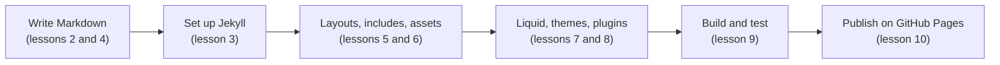

{:class="cover"}

By the end of this lesson you will be able to describe how a Markdown file becomes a published web page, and choose what to learn next.

## What you built

Well done makers! You started with plain text and finished with a website that anyone can visit. Along the way you learned the whole chain:

## The ideas to keep

- **Markdown is plain text with punctuation.** Headings, lists, links, images, code and quotes are core and work everywhere. Tables, footnotes and task lists are extensions, so check them on the tool that will show them.
- **Front matter turns a file into a Jekyll page.** It sets the layout and gives you variables such as `page.title`.
- **Layouts and includes mean you write a design once.** Change one file and the whole site follows.
- **Liquid runs before Markdown.** It prints values, loops over posts and makes decisions while the site is built.
- **Your files override the theme's.** Copy only what you want to change.
- **Test locally, then publish.** `jekyll serve` for writing, and a `git push` to publish.
- **`baseurl` and `relative_url` keep links working** on a project site.

## What to do next

- Write a real README for one of your robots in Markdown, with a wiring table and a diagram.
- Keep a build log after every session. Short posts you actually write beat grand ones you never finish.
- Add `jekyll-feed` so people can subscribe to your build log, if you publish with a branch deploy.

## Where to go next

- [Building Websites with Jekyll](/learn/jekyll/) takes the same tools further, with more on content and real-world sites.
- [Create Diagrams with Mermaid](/learn/mermaid/) shows how to draw flowcharts and wiring diagrams in Markdown.
- [Obsidian](/learn/obsidian/) is a friendly Markdown notebook app for writing and organising your notes.
- [Git](/learn/git/) covers branches, history and collaboration, which makes your site much safer to change.

## Try it Yourself

1. Write down, in your own words, the journey of one Markdown file from your editor to the live site, naming each tool on the way.
2. Choose one robot project and plan three pages for its documentation: a home page, a parts list and a build log.
3. Add a diagram to one of your pages that shows how your robot's parts connect.

## Common Issues

- **Problem**: I am not sure where something went wrong, at writing, building or publishing.
- **Solution**: Check in order: does the Markdown look right in a previewer, does `jekyll serve` build it, and does the **Actions** tab on GitHub build it?
- **Why**: Each stage can fail for its own reasons, and working through them in order finds the broken one quickly.

## Check your understanding


? Which part of a Jekyll build turns Markdown into HTML?
- [ ] GitHub Desktop
- [x] The Markdown converter, kramdown, inside Jekyll
- [ ] Your web browser
> Jekyll converts Markdown to HTML while building the site, ahead of time.

? Which of these is an extension, so worth testing on the tool that will show it?
- [x] A table
- [ ] A heading
- [ ] A link
> Headings and links are core Markdown, but tables are an extension.

? What is the quickest way to update a published GitHub Pages site?
- [ ] Re-create the repository
- [x] Commit and push your changes
- [ ] Email GitHub
> Every push to the published branch triggers a rebuild.

