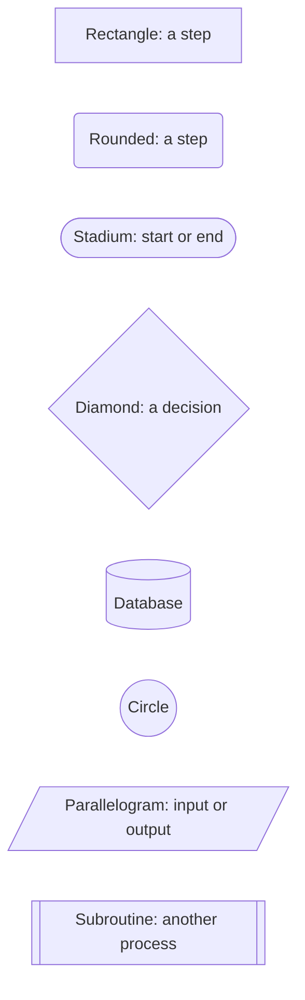
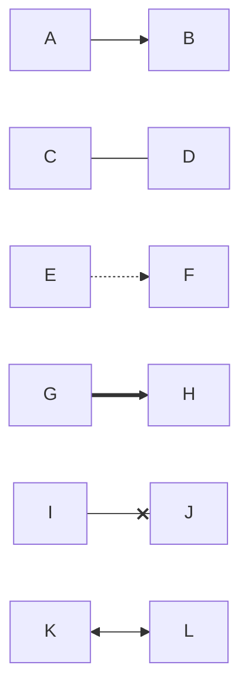
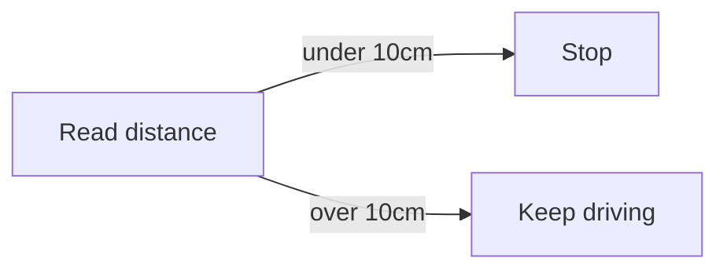
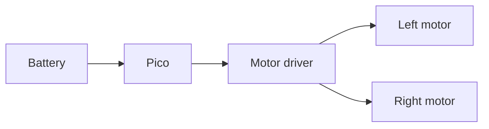
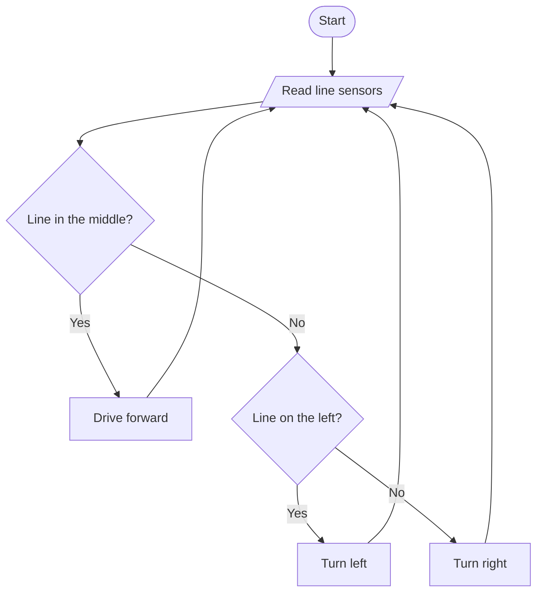

## Why flowcharts?

Flowcharts show **steps and decisions**. They're perfect for planning a robot's main loop before you write the code, or explaining a program to someone else. They're also the diagram type you'll use most, so let's get to know them well.

---

## Direction

A flowchart starts with `flowchart` followed by a direction:

Direction | Meaning
----------|--------
`TD` or `TB` | Top down (top to bottom)
`BT` | Bottom to top
`LR` | Left to right
`RL` | Right to left
{:class="table table-striped"}

Long sequences of steps usually read best `LR`; processes with lots of decisions usually read best `TD`.

> You'll also see `graph TD` in older examples. `graph` is the original keyword and still works, but `flowchart` is the newer version with more features, so use that.

---

## Node shapes

The brackets around a label choose the shape. Here are the ones you'll use most:

```text
flowchart LR
    a[Rectangle: a step]
    b(Rounded: a step)
    c([Stadium: start or end])
    d{Diamond: a decision}
    e[(Database)]
    f((Circle))
    g[/Parallelogram: input or output/]
    h[[Subroutine: another process]]
```

Here's what it draws:



Traditional flowcharts use stadiums for start and end, rectangles for steps, diamonds for decisions and parallelograms for input and output. Following that convention makes your diagrams easy for anyone to read.


There's also a hexagon, written with double curly brackets: `prep{{Prepare}}`.


---

## Arrows and lines

The characters between two nodes choose the type of link:

```text
flowchart LR
    A --> B
    C --- D
    E -.-> F
    G ==> H
    I --x J
    K <--> L
```

Here's what it draws:



From top to bottom: an arrow, a plain line, a dotted arrow, a thick arrow, a line ending in a cross, and an arrow both ways. Thick arrows are great for showing the main path through a process; dotted ones for something optional.

---

## Labels on arrows

There are two ways to put text on a link. Both draw the same thing:

```text
flowchart LR
    sensor[Read distance] -->|under 10cm| stop[Stop]
    sensor -- over 10cm --> go[Keep driving]
```

Here's what it draws:



---

## Chaining and shortcuts

You can chain links on one line, and use `&` to connect several nodes at once:

```text
flowchart LR
    battery[Battery] --> pico[Pico] --> driver[Motor driver]
    driver --> left[Left motor] & right[Right motor]
```

Here's what it draws:



---

## Putting it together: a line follower

```text
flowchart TD
    start([Start]) --> read[/Read line sensors/]
    read --> centre{Line in the middle?}
    centre -->|Yes| fwd[Drive forward]
    centre -->|No| side{Line on the left?}
    side -->|Yes| left[Turn left]
    side -->|No| right[Turn right]
    fwd & left & right --> read
```

Here's what it draws:



---

## Try it yourself

1. Copy the line follower into the [Live Editor](https://mermaid.live) and change it to `LR`. Which do you prefer?
2. Make the main path (`read` to `centre` to `fwd`) use thick `==>` arrows.
3. Challenge: add a "Line lost?" decision that leads to a `Spin slowly to search` step.

---

## Common issues

- **Problem**: Brackets or punctuation in a label break the diagram, such as `a[Read sensor (cm)]`
- **Solution**: Wrap the label in double quotes: `a["Read sensor (cm)"]`
- **Why**: Mermaid sees the `(` as the start of a new shape. Quotes tell it everything inside is just text

- **Problem**: My arrow label doesn't appear
- **Solution**: Use either `-->|label|` or `-- label -->`, not a mix like `-->|label -->`
- **Why**: Each style has to be written completely for Mermaid to recognise it

- **Problem**: The diagram is very wide and hard to read
- **Solution**: Try a different direction, or split it into two diagrams
- **Why**: Lots of branches in an `LR` chart spread out sideways quickly

---

## Check your understanding


? Which shape is traditionally used for a decision?
- [ ] `a[Rectangle]`
- [x] `a{Diamond}`
- [ ] `a((Circle))`
> Curly brackets draw a diamond, the classic flowchart shape for a yes/no question.

? Which link draws a dotted arrow?
- [ ] `==>`
- [x] `-.->`
- [ ] `---`
> `-.->` is dotted, `==>` is thick, and `---` is a line with no arrowhead.

? A label like `Distance (cm)` breaks your node. What's the fix?
- [x] Put the label in double quotes
- [ ] Use a different diagram type
- [ ] Remove the node ID
> `a["Distance (cm)"]` tells Mermaid the brackets are part of the text.


---
