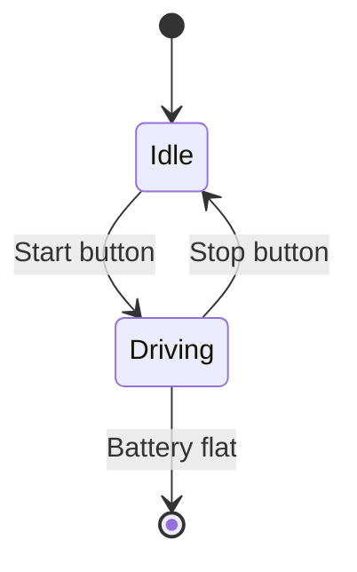
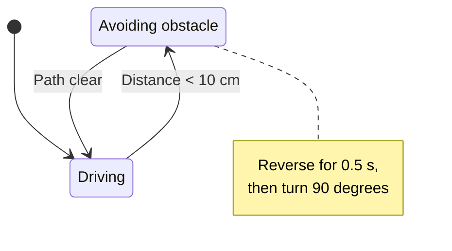
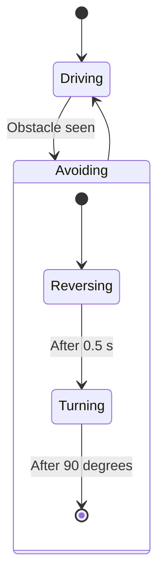
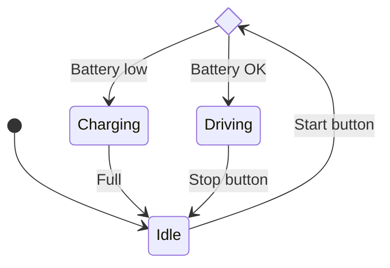

## Robots have moods

At any moment your robot is in one **state**: idle, driving, avoiding an obstacle, charging. Something happens, a button press, a sensor reading, a timer running out, and it moves to a different state. That move is called a **transition**.

This idea, a **state machine**, is one of the most useful patterns in robotics. Drawing it first makes the code much easier to write, because each state usually becomes one branch of an `if` statement or one function.

---

## Your first state diagram

```text
stateDiagram-v2
    [*] --> Idle
    Idle --> Driving : Start button
    Driving --> Idle : Stop button
    Driving --> [*] : Battery flat
```

Here's what it draws:



- Start with `stateDiagram-v2`. (There's an older `stateDiagram` too; `-v2` is the newer version, so use that.)
- `[*]` is the start point when it's on the left of an arrow, and the end point when it's on the right.
- `A --> B : reason` is a transition with a label saying what causes it.
- States are created automatically the first time you use them.

---

## Descriptions and notes

Give a state a longer description, and add notes to explain things:

```text
stateDiagram-v2
    state "Avoiding obstacle" as Avoiding
    [*] --> Driving
    Driving --> Avoiding : Distance < 10 cm
    Avoiding --> Driving : Path clear
    note right of Avoiding
        Reverse for 0.5 s,
        then turn 90 degrees
    end note
```

Here's what it draws:



`state "long name" as ID` lets you use a short ID in your arrows and a friendly name in the diagram.

---

## States inside states

Sometimes a state has its own smaller steps. While a robot is "Avoiding", it first reverses and then turns. These are **composite states**:

```text
stateDiagram-v2
    [*] --> Driving
    Driving --> Avoiding : Obstacle seen
    state Avoiding {
        [*] --> Reversing
        Reversing --> Turning : After 0.5 s
        Turning --> [*] : After 90 degrees
    }
    Avoiding --> Driving
```

Here's what it draws:



---

## Choices

A `<<choice>>` state picks a path depending on a condition, like a diamond in a flowchart:

```text
stateDiagram-v2
    state check_battery <<choice>>
    [*] --> Idle
    Idle --> check_battery : Start button
    check_battery --> Driving : Battery OK
    check_battery --> Charging : Battery low
    Charging --> Idle : Full
    Driving --> Idle : Stop button
```

Here's what it draws:



---

## From diagram to code

Here's how that last diagram might start in MicroPython. Each state becomes a branch, and each transition changes the `state` variable:

```python
state = "idle"

while True:
    if state == "idle":
        if start_button.value():
            state = "driving" if battery_ok() else "charging"
    elif state == "driving":
        drive_forward()
        if stop_button.value():
            state = "idle"
    elif state == "charging":
        if battery_full():
            state = "idle"
```

Notice how easy it is to check the code against the diagram: every arrow should be one `state = ...` line.

---

## Try it yourself

1. Draw a state diagram for a traffic light: `Red`, `RedAmber`, `Green` and `Amber`, with timers as the transitions.
2. Add a `Flashing` state for when a fault is detected.
3. Challenge: draw a [SMARS](/learn/smars/) robot with `Idle`, `Exploring`, `Avoiding` and `Sleeping` states. Make `Avoiding` a composite state, and use a `<<choice>>` to decide whether to turn left or right.

---

## Common issues

- **Problem**: A state name with spaces breaks the diagram
- **Solution**: Use `state "Long name" as ShortID` and use the ID in arrows
- **Why**: State IDs can't contain spaces

- **Problem**: The diagram looks different from examples online
- **Solution**: Check you're using `stateDiagram-v2`, not `stateDiagram`
- **Why**: The two versions are drawn by different renderers

- **Problem**: My note doesn't close
- **Solution**: Finish multi-line notes with `end note` on its own line
- **Why**: Mermaid treats everything until `end note` as part of the note

---

## Check your understanding


? What does `[*]` on the left of an arrow mean?
- [x] The starting point
- [ ] The end point
- [ ] Any state
> On the left it's where the machine starts; on the right it's where it finishes.

? What is a transition?
- [ ] A state with other states inside it
- [x] A move from one state to another, usually caused by an event
- [ ] A comment on a state
> Transitions are the arrows, and their labels say what makes them happen.

? Which keyword makes a state that picks between paths?
- [ ] `<<fork>>`
- [x] `<<choice>>`
- [ ] `<<if>>`
> A `<<choice>>` state works like a decision diamond in a flowchart.


---
