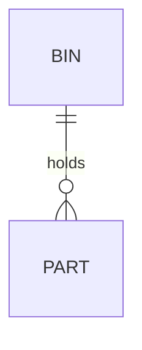
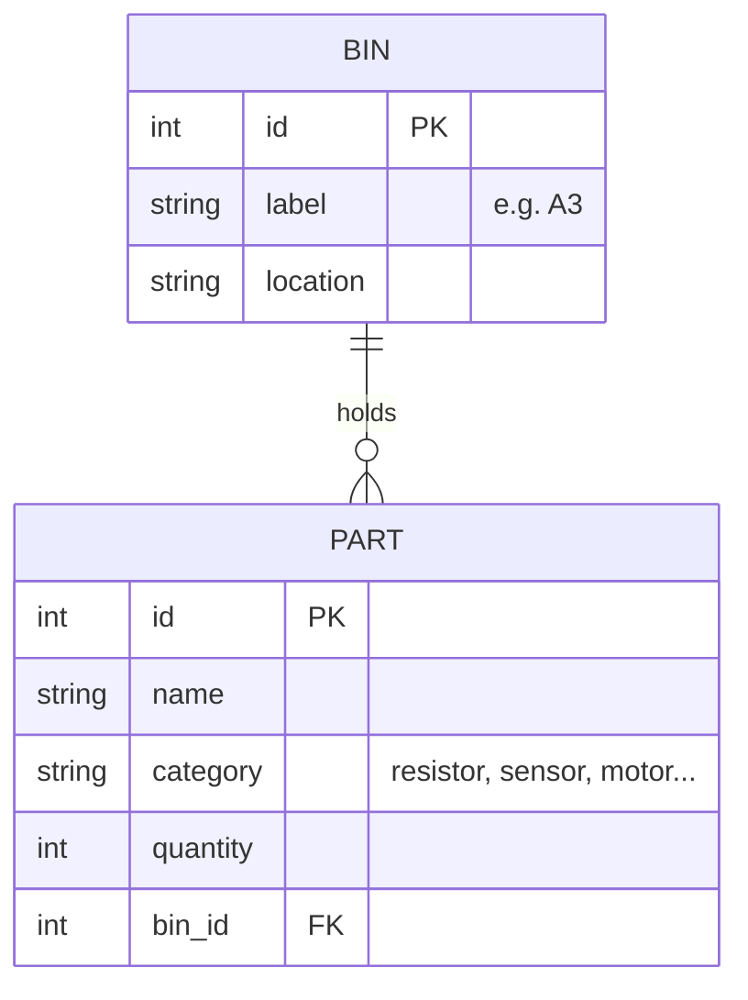
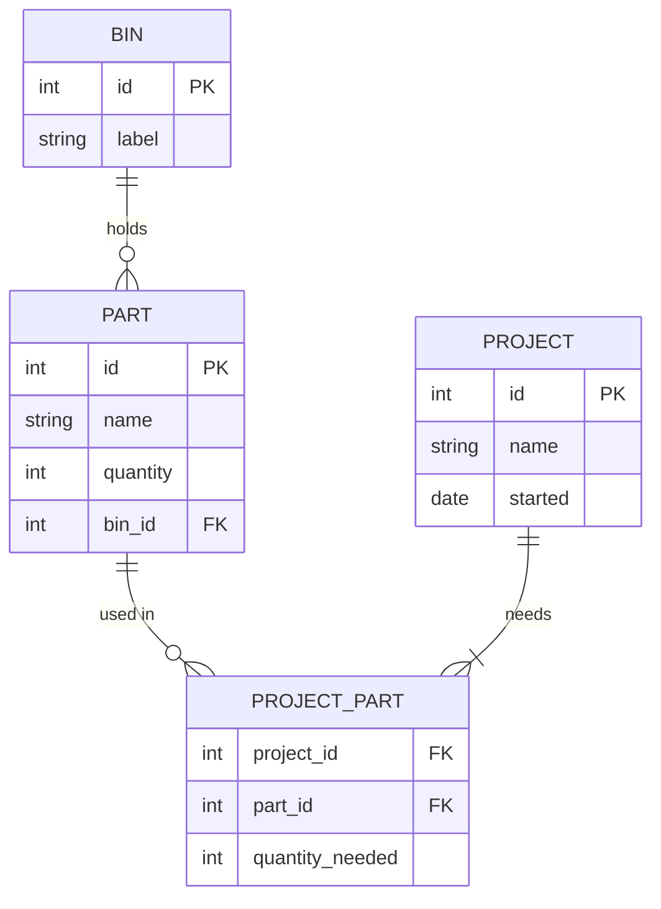

## Planning a database

Every maker eventually has a drawer full of parts and no idea what's in it. Let's say you want to build a little **parts inventory** database: which parts you have, where they're stored, and which projects use them.

Before writing any SQL, it helps to sketch the tables and how they connect. That sketch is an **entity relationship diagram**, or **ER diagram**:

- An **entity** is a thing you store data about, which becomes a **table**: `PART`, `BIN`, `PROJECT`
- A **relationship** is how two entities are linked: a bin *holds* parts

If you'd like to build the database for real afterwards, the [SQLite3 course](/learn/sqlite3/) shows you how.

---

## Your first ER diagram

```text
erDiagram
    BIN ||--o{ PART : holds
```

Here's what it draws:



That one line says "a bin holds parts". The odd-looking symbols either side of `--` are called **crow's feet**, and they say *how many* of each side there can be.

---

## Reading crow's feet

Each end of a relationship has two characters. The outer one is the maximum, the inner one is the minimum:

- **Exactly one**: `||` on either end
- **Zero or one**: `|o` on the left end, `o|` on the right end
- **One or more**: `}|` on the left end, `|{` on the right end
- **Zero or more**: `}o` on the left end, `o{` on the right end

So `BIN ||--o{ PART` reads as: "each bin holds **zero or more** parts, and each part is in **exactly one** bin."

A handy way to remember: `|` looks like a 1, `o` looks like a 0, and `{` looks like a crow's foot, meaning "many".

---

## Adding columns

List an entity's attributes inside curly brackets: the **type** first, then the **name**, then optionally `PK` (primary key), `FK` (foreign key) or `UK` (unique key), and a comment in quotes:

```text
erDiagram
    BIN {
        int id PK
        string label "e.g. A3"
        string location
    }
    PART {
        int id PK
        string name
        string category "resistor, sensor, motor..."
        int quantity
        int bin_id FK
    }
    BIN ||--o{ PART : holds
```

Here's what it draws:



The `bin_id FK` column is how the database actually stores the link: each part remembers the ID of the bin it lives in.

---

## Many-to-many: parts and projects

A project uses lots of parts, and a part can be used in lots of projects. That's a **many-to-many** relationship. Databases handle it with an extra "joining" table in the middle, here called `PROJECT_PART`, which also records how many of each part a project needs:

```text
erDiagram
    BIN ||--o{ PART : holds
    PART ||--o{ PROJECT_PART : "used in"
    PROJECT ||--|{ PROJECT_PART : needs

    BIN {
        int id PK
        string label
    }
    PART {
        int id PK
        string name
        int quantity
        int bin_id FK
    }
    PROJECT {
        int id PK
        string name
        date started
    }
    PROJECT_PART {
        int project_id FK
        int part_id FK
        int quantity_needed
    }
```

Here's what it draws:



Notice `PROJECT ||--|{ PROJECT_PART`: every project needs **one or more** parts, but a part might not be used in any project yet, so that side is **zero or more**.

> Relationship labels with spaces need quotes, like `"used in"`. One-word labels don't.

---

## Solid and dashed lines

Use `--` for a solid line and `..` for a dashed one. A solid line is an **identifying** relationship (the child can't be identified without the parent, like `PROJECT_PART` without its project); dashed is a looser, **non-identifying** link. As a beginner, solid lines are fine for everything.

---

## Try it yourself

1. Draw the parts inventory above in the [Live Editor](https://mermaid.live).
2. Add a `SUPPLIER` entity with `name` and `website`, where each part comes from one supplier and a supplier sells many parts.
3. Challenge: design a database for a robot competition: `ROBOT`, `TEAM`, `MATCH` and `RESULT`. Think carefully about which relationships are many-to-many.

---

## Common issues

- **Problem**: "Parse error" on an attribute line
- **Solution**: Write the type before the name, like `int quantity`, with no commas
- **Why**: Mermaid expects `type name` on every attribute line

- **Problem**: A relationship label with two words breaks the diagram
- **Solution**: Put it in double quotes: `: "used in"`
- **Why**: Without quotes, Mermaid only expects a single word

- **Problem**: My crow's feet are back to front
- **Solution**: Read each end from the entity next to it: the symbols beside `PART` describe how many parts there are
- **Why**: Each end describes the entity it's touching

---

## Check your understanding


? What does `BIN ||--o{ PART` mean?
- [x] Each bin holds zero or more parts; each part is in exactly one bin
- [ ] Each part holds exactly one bin
- [ ] Bins and parts can't be linked
> `||` beside BIN means exactly one; `o{` beside PART means zero or more.

? How do databases usually store a many-to-many relationship?
- [ ] With two primary keys in one table
- [x] With an extra joining table that has a foreign key to each side
- [ ] They can't
> A table like `PROJECT_PART` links each project to each part it uses.

? What does `FK` mean after a column?
- [ ] Fixed key
- [x] Foreign key: it refers to another table's primary key
- [ ] First key
> `bin_id FK` points at the `id` of a row in the `BIN` table.


---
