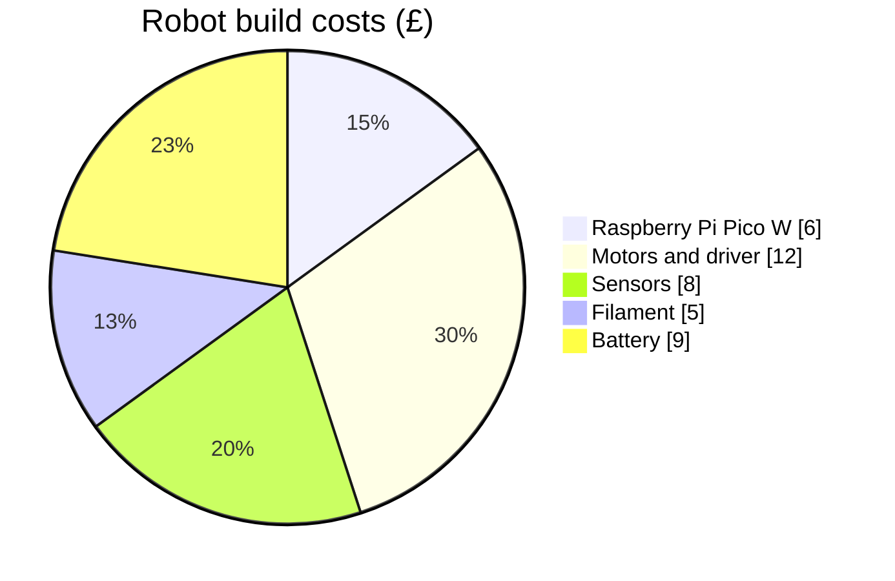
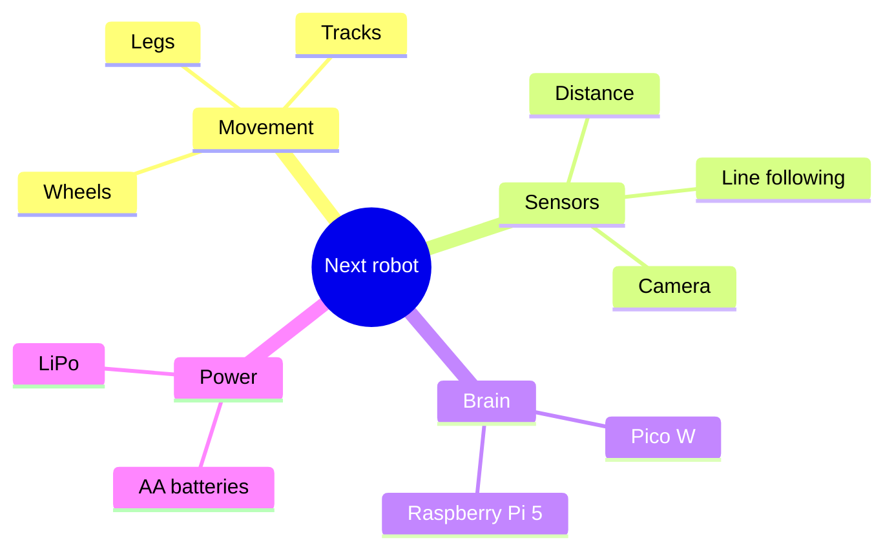
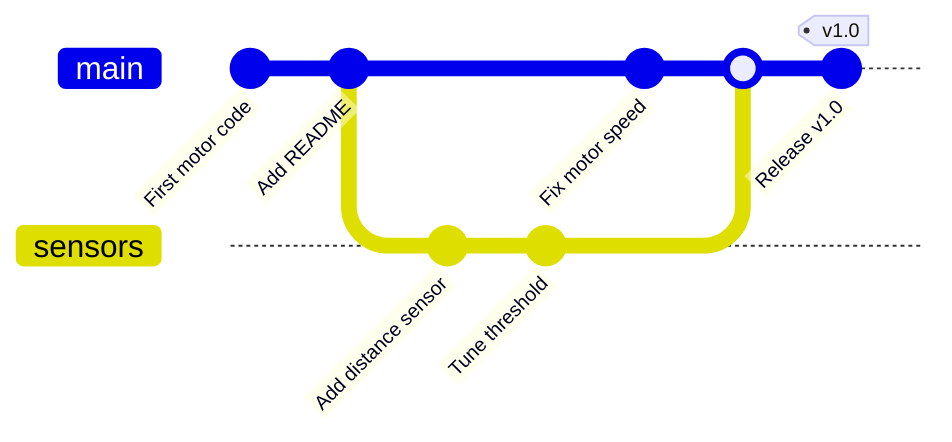
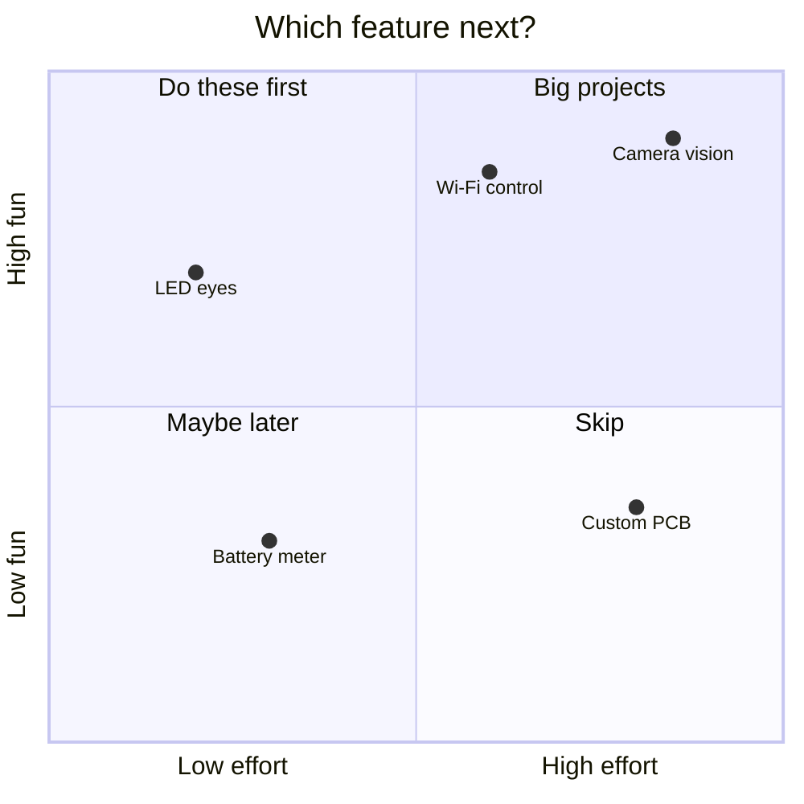

## Four more tools for your toolbox

You've now met the "big" Mermaid diagrams. This lesson covers four smaller ones that are quick to learn and surprisingly handy.

---

## Pie charts

Where did all the money go on that robot build? A **pie chart** shows how a whole splits into parts:

```text
pie showData
    title Robot build costs (£)
    "Raspberry Pi Pico W" : 6
    "Motors and driver" : 12
    "Sensors" : 8
    "Filament" : 5
    "Battery" : 9
```

Here's what it draws:



Each slice is a label in double quotes, a colon and a number. Mermaid works out the percentages for you. `showData` is optional and adds the actual values to the legend.

---

## Mind maps

A **mind map** is perfect for brainstorming: put an idea in the middle and branch out. The structure comes from **indentation**: each level is indented further than its parent.

```text
mindmap
    root((Next robot))
        Movement
            Wheels
            Tracks
            Legs
        Sensors
            Distance
            Line following
            Camera
        Brain
            Pico W
            Raspberry Pi 5
        Power
            AA batteries
            LiPo
```

Here's what it draws:



Node shapes work like flowcharts: `((circle))`, `(rounded)`, `[square]`. The `root` is just an ID, and the text in brackets is what's shown. If a line has no brackets, the text itself is shown.

> Indent with spaces, and be consistent. Mixing tabs and spaces is the number one cause of a mind map that comes out wrong.

---

## Git graphs

If you use Git, a **Git graph** is a great way to explain branches and merges. It draws commits as dots on coloured lines, one line per branch:

```text
gitGraph
    commit id: "First motor code"
    commit id: "Add README"
    branch sensors
    checkout sensors
    commit id: "Add distance sensor"
    commit id: "Tune threshold"
    checkout main
    commit id: "Fix motor speed"
    merge sensors
    commit id: "Release v1.0" tag: "v1.0"
```

Here's what it draws:



The commands match real Git commands:

- `commit` adds a commit to the current branch; `id:` gives it a label and `tag:` adds a tag
- `branch name` creates a branch **and** moves onto it
- `checkout name` moves to another branch
- `merge name` merges that branch into the current one

You start on `main` automatically. The `checkout` line straight after `branch sensors` isn't strictly needed, since `branch` already moves you there, but it makes the diagram easier to follow.

If Git is new to you, the [Git for beginners](/learn/git/) course explains branches and merging properly.

---

## Quadrant charts

A **quadrant chart** plots things on two scales, split into four boxes. It's great for deciding what to work on next: how much effort each idea takes against how much fun it'd be.

```text
quadrantChart
    title Which feature next?
    x-axis Low effort --> High effort
    y-axis Low fun --> High fun
    quadrant-1 Big projects
    quadrant-2 Do these first
    quadrant-3 Maybe later
    quadrant-4 Skip
    LED eyes: [0.2, 0.7]
    Wi-Fi control: [0.6, 0.85]
    Camera vision: [0.85, 0.9]
    Battery meter: [0.3, 0.3]
    Custom PCB: [0.8, 0.35]
```

Here's what it draws:



Points use values from `0` to `1` on each axis. The quadrants are numbered like a maths graph: `quadrant-1` is top right, then anticlockwise: top left, bottom left, bottom right.

---

## Try it yourself

1. Make a pie chart of how you spend your making time: designing, printing, coding, debugging...
2. Draw a mind map for your next project idea with at least four branches.
3. Challenge: draw a Git graph with two feature branches, `lights` and `sound`, that are both merged back into `main`.

---

## Common issues

- **Problem**: My mind map branches are attached to the wrong parent
- **Solution**: Check the indentation; use spaces only, the same number for each level
- **Why**: Mind maps work out the structure purely from indentation

- **Problem**: A Git graph says a branch doesn't exist
- **Solution**: Create it with `branch name` before you `checkout` or `merge` it
- **Why**: Just like real Git, you can't move to a branch that hasn't been made

- **Problem**: Pie labels break the chart
- **Solution**: Put every label in double quotes
- **Why**: Pie charts need quotes around labels, even single words

---

## Check your understanding


? What decides the structure of a mind map?
- [ ] Arrows between nodes
- [x] Indentation
- [ ] The order of the brackets
> Each line's parent is the nearest line above it that's indented less.

? In a Git graph, what does `branch sensors` do?
- [ ] Merges `sensors` into `main`
- [x] Creates a branch called `sensors` and moves onto it
- [ ] Deletes the `sensors` branch
> Like `git switch -c sensors` in real Git, it creates the branch and switches to it.

? Which quadrant is `quadrant-1`?
- [x] Top right
- [ ] Top left
- [ ] Bottom left
> Quadrants are numbered like a maths graph, starting top right and going anticlockwise.


---
