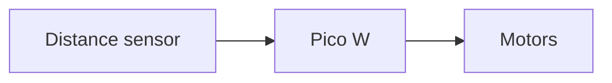

## Two ways to share a diagram

There are two ways to get a Mermaid diagram in front of people:

1. **Share the code** and let the tool draw it. This is best for GitHub, GitLab, Obsidian and websites, because the diagram stays editable text.
2. **Export an image** (PNG or SVG). This is best for places that don't understand Mermaid: slides, Word documents, a printed build guide, or a social media post.

Let's look at both.

---

## Sharing the code

### GitHub and GitLab

Add a `mermaid` code block to any Markdown file, such as your project's `README.md`, and it's drawn automatically when someone views the file:

~~~text
## How it works


~~~

The same works in GitHub issues, pull requests and discussions, which is very handy for explaining a bug or a proposed change. Because the diagram is text, it's version-controlled with the rest of your code; when you change the wiring, update the diagram in the same commit. The [Git course](/learn/git/) shows you how.

### Obsidian

Type the same code block into any note. It's drawn in reading view and in live preview as soon as you move the cursor out of the block. It's a lovely way to keep diagrams alongside your project notes; see the [Obsidian course](/learn/obsidian/) for more.

### Sharing a link

In the [Mermaid Live Editor](https://mermaid.live), your whole diagram is stored in the page address. Copy the address (or use the editor's share option) and anyone who opens it sees your diagram and can edit their own copy. Your original doesn't change.

---

## Exporting images from the Live Editor

The Live Editor can download your diagram as:

- **PNG** - a normal picture. Good for slides, documents and social media
- **SVG** - a vector image that stays sharp at any size. Good for websites and printing

> **PNG or SVG?** If you can, choose SVG. It scales without going blurry, the files are tiny, and the text stays crisp. Use PNG when the place you're putting it doesn't accept SVG.

---

## Exporting from the command line with mermaid-cli

If you have lots of diagrams, or want them rebuilt automatically, use **mermaid-cli**. It's a command-line tool called `mmdc` that turns Mermaid files into images. You'll need [Node.js](https://nodejs.org) installed first.

Install it:

```bash
npm install -g @mermaid-js/mermaid-cli
```

Save a diagram in a file ending `.mmd`, such as `robot.mmd`:

```text
flowchart LR
    sensor[Distance sensor] --> pico[Pico W] --> motors[Motors]
```

Then turn it into an image:

```bash
mmdc -i robot.mmd -o robot.svg
```

Change the ending of the output file to get a different format:

```bash
mmdc -i robot.mmd -o robot.png
mmdc -i robot.mmd -o robot.pdf
```

A few useful options:

Option | What it does | Example
-------|--------------|--------
`-t` | Choose a theme | `-t dark`
`-b` | Background colour | `-b transparent`
`-w` | Width in pixels | `-w 1600`
`-s` | Scale (for sharper PNGs) | `-s 2`
{:class="table table-striped"}

```bash
mmdc -i robot.mmd -o robot.png -t dark -b transparent -s 2
```

### Converting a whole Markdown file

mermaid-cli can also read a Markdown file, turn every `mermaid` code block into an image, and write a new Markdown file that links to those images:

```bash
mmdc -i build-guide.template.md -o build-guide.md
```

That's handy for documentation sites that don't support Mermaid themselves.

> If you don't want to install it globally, `npx -p @mermaid-js/mermaid-cli mmdc -i robot.mmd -o robot.svg` downloads and runs it in one go. mermaid-cli uses a hidden copy of the Chrome browser to draw the diagram, so the first run downloads that too and can take a minute.

---

## Try it yourself

1. Create a GitHub repository (or open one you already have) and add a Mermaid diagram to its `README.md`. Check it's drawn on the repository's page.
2. Export the same diagram as both PNG and SVG from the Live Editor. Zoom right in on each. What's the difference?
3. Challenge: install mermaid-cli and render a diagram with a transparent background and the `dark` theme.

---

## Common issues

- **Problem**: `mmdc: command not found`
- **Solution**: Install it with `npm install -g @mermaid-js/mermaid-cli`, or use the `npx` command above
- **Why**: `mmdc` is part of the mermaid-cli package, which isn't installed with Node.js by default

- **Problem**: mermaid-cli fails with an error about Chrome or Puppeteer
- **Solution**: Run it again so it can finish downloading its browser, or try the [Live Editor](https://mermaid.live) instead
- **Why**: mermaid-cli draws diagrams using a headless Chrome browser, which it downloads separately

- **Problem**: A diagram looks fine in the Live Editor but GitHub shows an error
- **Solution**: Check you're not using a very new feature, and that the code block starts with three backticks followed by the word `mermaid`
- **Why**: Each site uses its own copy of Mermaid, which may be slightly older

---

## Check your understanding


? Why is SVG usually a better export format than PNG?
- [x] It stays sharp at any size and the files are small
- [ ] It can be edited in the Live Editor
- [ ] It works in every program
> SVG is a vector format, so it never goes blurry when you zoom in.

? Which command turns `robot.mmd` into a PNG image?
- [ ] `mermaid robot.mmd robot.png`
- [x] `mmdc -i robot.mmd -o robot.png`
- [ ] `npm robot.mmd -o robot.png`
> `-i` is the input file and `-o` the output file; the ending sets the format.

? What's the main advantage of putting the Mermaid code in a README instead of an image?
- [ ] It loads faster on slow connections
- [x] The diagram stays editable and is tracked by Git with your code
- [ ] It's the only way GitHub shows diagrams
> When the project changes, you update a few lines of text in the same commit.


---
