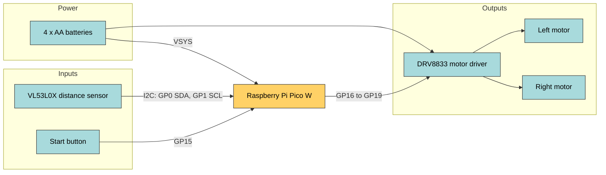
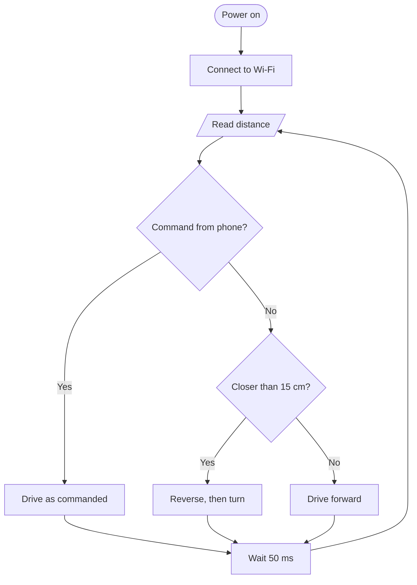
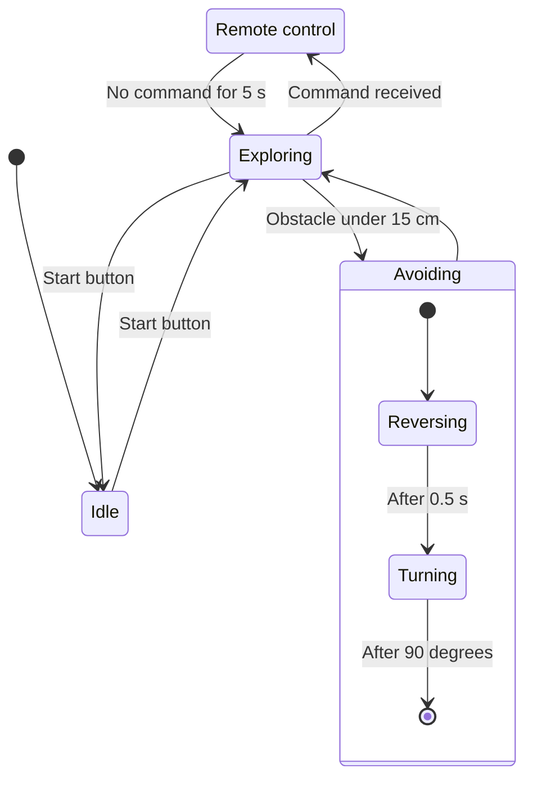
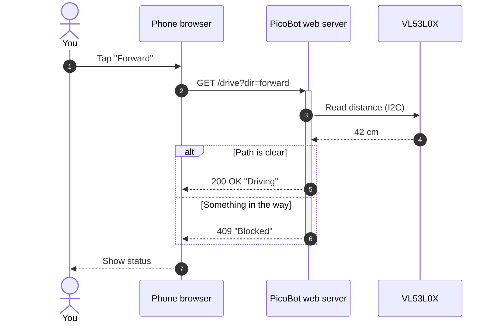
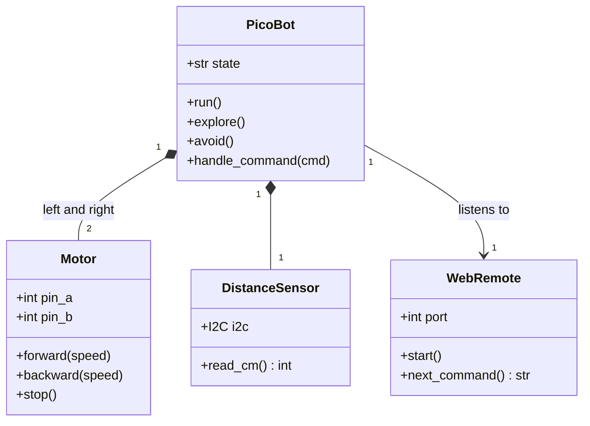
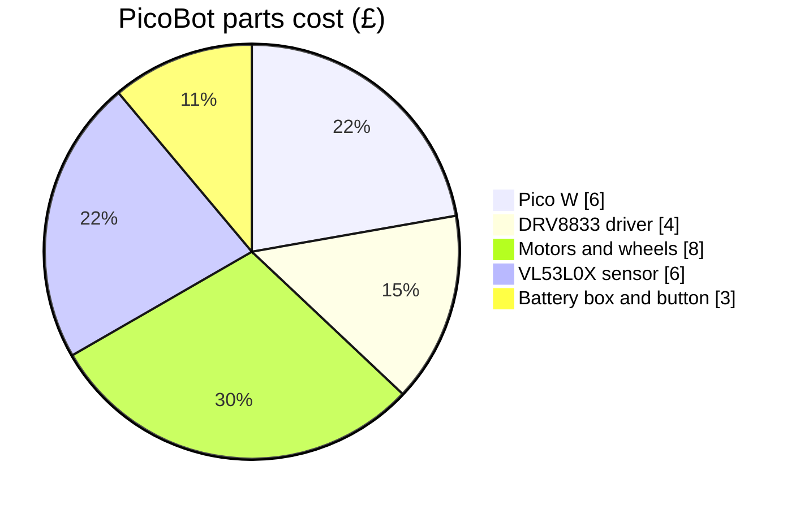
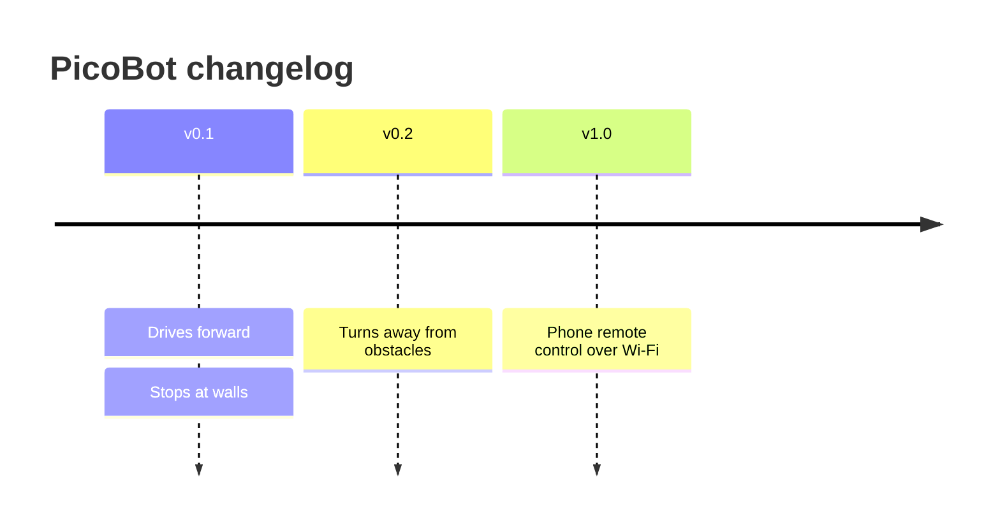

## The project

Time to put everything you've learned to work. We're going to write the `README.md` for a small robot called **PicoBot**: a two-wheeled robot with a Raspberry Pi Pico W for a brain, a distance sensor on the front, and a phone app that can drive it over Wi-Fi.

A good README answers the questions every visitor has: *What is it? How is it wired? How does it think? How does the code fit together?* We'll answer each one with a diagram.

By the end you'll have a README you can drop into a GitHub repository, and a template you can reuse for your own projects.

---

## Step 1: The README skeleton

Start with the headings. Each `##` section will get one diagram and a sentence or two of explanation:

~~~text
# PicoBot

A two-wheeled Pico W robot that avoids obstacles and can be
driven from a phone over Wi-Fi.

## Parts
## How it's wired
## How it thinks
## Its modes
## Driving it from your phone
## How the code is organised
~~~

---

## Step 2: How it's wired - a block diagram

A flowchart with subgraphs makes a great block diagram. We'll group the parts by what they do, label each link with the pins used, and colour the parts by type:

```text
flowchart LR
    classDef brain fill:#ffd166,stroke:#333,color:#000
    classDef part fill:#a8dadc,stroke:#333,color:#000

    subgraph power [Power]
        bat[4 x AA batteries]:::part
    end
    subgraph inputs [Inputs]
        tof["VL53L0X distance sensor"]:::part
        btn[Start button]:::part
    end
    pico[Raspberry Pi Pico W]:::brain
    subgraph outputs [Outputs]
        drv[DRV8833 motor driver]:::part
        ml[Left motor]:::part
        mr[Right motor]:::part
    end

    bat -->|VSYS| pico
    bat --> drv
    tof -->|"I2C: GP0 SDA, GP1 SCL"| pico
    btn -->|GP15| pico
    pico -->|GP16 to GP19| drv
    drv --> ml & mr
```

Here's what it draws:



Notice the label with a colon and commas is in double quotes. Without them, Mermaid could get confused by the punctuation.

> This diagram shows *what connects to what*, not every wire. Ground connections and power rails would clutter it, so leave those for a proper wiring diagram or a photo.

---

## Step 3: How it thinks - the main loop

Next, a flowchart of the main loop. This is the diagram that'll help you most when you come back to the code in six months:

```text
flowchart TD
    start([Power on]) --> wifi[Connect to Wi-Fi]
    wifi --> read[/Read distance/]
    read --> cmd{Command from phone?}
    cmd -->|Yes| drive[Drive as commanded]
    cmd -->|No| near{Closer than 15 cm?}
    near -->|Yes| avoid[Reverse, then turn]
    near -->|No| fwd[Drive forward]
    drive & avoid & fwd --> wait[Wait 50 ms]
    wait --> read
```

Here's what it draws:



---

## Step 4: Its modes - a state diagram

PicoBot can be idle, exploring on its own, avoiding something, or under remote control. A state diagram shows how it moves between those modes:

```text
stateDiagram-v2
    state "Remote control" as Remote
    [*] --> Idle
    Idle --> Exploring : Start button
    Exploring --> Avoiding : Obstacle under 15 cm
    state Avoiding {
        [*] --> Reversing
        Reversing --> Turning : After 0.5 s
        Turning --> [*] : After 90 degrees
    }
    Avoiding --> Exploring
    Exploring --> Remote : Command received
    Remote --> Exploring : No command for 5 s
    Exploring --> Idle : Start button
```

Here's what it draws:



---

## Step 5: Driving from your phone - a sequence diagram

The phone app sends commands to a tiny web server running on the Pico W. A sequence diagram shows the conversation, including what happens when the robot says no:

```text
sequenceDiagram
    autonumber
    actor You
    participant Phone as Phone browser
    participant Pico as PicoBot web server
    participant Sensor as VL53L0X

    You->>Phone: Tap "Forward"
    Phone->>+Pico: GET /drive?dir=forward
    Pico->>Sensor: Read distance (I2C)
    Sensor-->>Pico: 42 cm
    alt Path is clear
        Pico-->>Phone: 200 OK "Driving"
    else Something in the way
        Pico-->>Phone: 409 "Blocked"
    end
    deactivate Pico
    Phone-->>You: Show status
```

Here's what it draws:



Because the reply happens inside an `alt` block, we switch the activation off with a separate `deactivate Pico` line after the block, rather than with `-` on one of the replies.

---

## Step 6: How the code is organised - a class diagram

Finally, a class diagram helps anyone who wants to change the code find their way around:

```text
classDiagram
    class PicoBot {
        +str state
        +run()
        +explore()
        +avoid()
        +handle_command(cmd)
    }
    class Motor {
        +int pin_a
        +int pin_b
        +forward(speed)
        +backward(speed)
        +stop()
    }
    class DistanceSensor {
        +I2C i2c
        +read_cm() int
    }
    class WebRemote {
        +int port
        +start()
        +next_command() str
    }
    PicoBot "1" *-- "2" Motor : left and right
    PicoBot "1" *-- "1" DistanceSensor
    PicoBot "1" --> "1" WebRemote : listens to
```

Here's what it draws:



---

## Step 7: Bonus - parts and progress

Two small extras finish the README off nicely. A pie chart of the build cost:

```text
pie showData
    title PicoBot parts cost (£)
    "Pico W" : 6
    "DRV8833 driver" : 4
    "Motors and wheels" : 8
    "VL53L0X sensor" : 6
    "Battery box and button" : 3
```



And a timeline of the project's history, which you can add to as it grows:

```text
timeline
    title PicoBot changelog
    v0.1 : Drives forward : Stops at walls
    v0.2 : Turns away from obstacles
    v1.0 : Phone remote control over Wi-Fi
```



The prices are just examples, so swap in what you actually paid.

---

## Step 8: Publish it

1. Put each diagram under its heading in `README.md`, inside a `mermaid` code block, with a sentence explaining what it shows.
2. Add a **Parts** list and a photo of the finished robot.
3. Commit the README and push it to GitHub. If you've not done that before, the [Git for beginners](/learn/git/) course walks you through it.
4. Open the repository on GitHub and check every diagram is drawn.

From now on, whenever you change the robot, update the diagram in the same commit as the code. Your README will never go out of date again.

---

## Try it yourself

1. Build the full PicoBot README in the [Live Editor](https://mermaid.live) one diagram at a time, then paste them into a Markdown file.
2. Add a **Line following** mode to the state diagram, and a `LineSensor` class to the class diagram.
3. Challenge: write a README like this for one of your own projects. Which diagram was the most useful to draw? Did drawing it change how you think about the project?

---

## Common issues

- **Problem**: One diagram in the README shows an error, and the others are fine
- **Solution**: Copy just that diagram into the Live Editor, where the error message tells you the line number
- **Why**: Each code block is drawn separately, so one mistake doesn't affect the rest

- **Problem**: The block diagram is too wide on a phone screen
- **Solution**: Switch it from `LR` to `TD`, or split it into two smaller diagrams
- **Why**: Wide diagrams are shrunk to fit, which can make the text tiny

- **Problem**: The diagrams have got out of step with the code
- **Solution**: Make "update the diagram" part of every change, in the same commit
- **Why**: A diagram is only useful if it's true, and the closer it lives to the code the easier that is

---

## Check your understanding


? Why do link labels like `"I2C: GP0 SDA, GP1 SCL"` need double quotes?
- [ ] Labels always need quotes
- [x] The punctuation could otherwise confuse Mermaid
- [ ] Quotes make the text bold
> Quotes tell Mermaid everything inside is just text, including colons and commas.

? Which diagram best shows the robot's modes and what switches between them?
- [ ] A class diagram
- [x] A state diagram
- [ ] A pie chart
> State diagrams are made for modes (states) and the events that move between them.

? What's the best way to keep README diagrams up to date?
- [x] Change the diagram in the same commit as the code it describes
- [ ] Redraw all the diagrams once a year
- [ ] Export them as PNGs so they can't change
> Keeping diagrams as text next to the code makes updating them part of the normal workflow.


---
