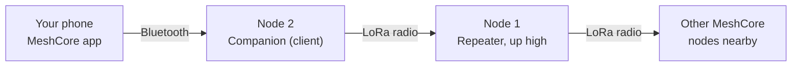

{:class="cover"}

---

By the end of this lesson you will be able to describe what you will build in this course, what kit you need, and how the lessons work.

Ahoy there makers! Imagine sending a text message to a friend a few kilometres away with no mobile signal, no WiFi, no internet, and no monthly bill. That is what we are going to build in this course.

---

## Overview

[MeshCore](https://meshcore.io) is a free, open source mesh networking system for LoRa radios. You flash it onto a small LoRa board, pair the board with your phone over Bluetooth, and you have an encrypted messaging network that runs entirely on its own.

In this course we build a **two node mesh**:

- **Node 1, the repeater.** A board that sits high up, listens for packets and forwards the ones that need forwarding. It has no phone attached. It quietly extends the range of the network.
- **Node 2, the client.** A board that pairs to your phone over Bluetooth and lets you send and receive messages.

Both nodes use the same hardware, a **Heltec WiFi LoRa 32 V3** board. The only difference is the firmware you flash and how you configure it.



---

## Course Content

- What MeshCore is, and how it differs from Meshtastic
- How LoRa works: spreading factor, bandwidth and coding rate
- Choosing the right board and the right frequency variant
- Antennas, battery safety, and the rules in the UK, EU and US
- Flashing MeshCore firmware with the web flasher
- Picking the correct radio settings for your region
- Setting up node 1 as a repeater over the serial console
- Where to put a repeater, and how to power it
- Setting up node 2 as a Bluetooth companion client
- Pairing the phone app and sending your first message
- Channels, flood routing versus path routing
- Administering your repeater remotely
- Troubleshooting a mesh that will not talk

---

## Key Results

After completing this course, you will:

- Explain the difference between LoRa, LoRaWAN and a LoRa mesh
- Flash and configure a MeshCore repeater and a companion client
- Set radio settings that match your region and stay inside the local rules
- Read RSSI, SNR and hop counts to diagnose a weak link
- Place and power a repeater sensibly
- Handle antennas and LiPo batteries safely

---

## What you'll need

**Hardware**

- 2 x Heltec WiFi LoRa 32 V3 boards, in the frequency variant for your region (863-928MHz, sold as 868MHz or 915MHz, not the 433MHz one). MeshCore supports the Heltec V3 according to its FAQ, but check the official flasher for the current device list
- 2 x antennas that match your band, with the connector your board uses (the V3 has a small U.FL / IPEX socket, so a U.FL to SMA pigtail is often needed)
- 1 x USB-C **data** cable (not a charge-only cable)
- Optional: a 3.7V LiPo battery with the right connector for your board, and a weatherproof box for an outdoor repeater

**Software**

- Google Chrome or Microsoft Edge on a computer (the web flasher needs WebUSB, which Firefox and Safari do not have)
- The MeshCore app for Android or iOS, or the MeshCore web client

**Skills**

- No soldering and no programming
- If you can plug in a USB cable and type a command, you can do this

---

## How the course works

Each lesson teaches one idea, then puts it to work. Commands you type into the repeater console look like this:

```text
set name Kev-Repeater-01
```

Values you should change for your own setup are shown in angle brackets, like `set lat <your-latitude>`. Every lesson ends with **Try it Yourself** exercises, **Common Issues**, and a short quiz.

MeshCore is a fast-moving project. Menu names in the flasher and the apps, and a few commands, change between versions. Where I am not certain something is current I say so, and the official documentation at [docs.meshcore.io](https://docs.meshcore.io) always wins.

Prerequisites: none, but the [Linux command line course](/learn/linux_intro/) helps if typing commands is new to you. When you finish, carry on with [MeshCore Room Servers and Sensors](/learn/meshcore_rooms_sensors/).

> **Teachers**: this course suits learners aged about 12 and up, working in pairs. Allow 30 to 45 minutes per lesson; lessons 5 to 10 need the boards and take longest. Each pair needs two boards, two antennas and a data cable, plus one phone with the app (or a laptop using the web client over USB). Lessons 1 to 4 and 12 to 14 need no hardware. Radio rules differ by country, so check your own regulator before running a repeater outdoors. Never power a board without its antenna fitted, and keep LiPo batteries off the table unless a teacher supervises. Flashing needs Chrome or Edge, which locked-down school laptops sometimes block.

Right then. Let's build a radio network.

---
